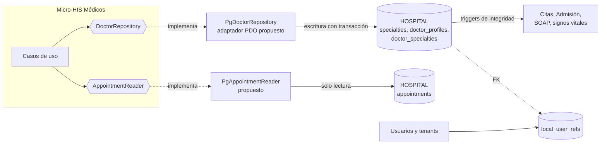

# Repositorio de datos compartido

## Situación actual

En el HIS, las tablas del módulo ya viven en la base **HOSPITAL** que comparten todos los módulos clínicos: `specialties`, `doctor_profiles` y `doctor_specialties` (`database/migrations/hospital/2026_08_11_000100_create_local_identity_and_professional_tables.php:31-78`). Otros módulos dependen de ellas desde la propia base:

| Consumidor | Cómo usa los datos de Médicos | Evidencia |
|---|---|---|
| Citas (ASII-05) | Trigger `appointments_specialty_trigger`: la cita exige que el médico tenga la especialidad activa en la fecha. | migración `000300`, línea 32 |
| Admisión (ASII-07) | Trigger `care_assignments_specialty_trigger`: igual para el médico responsable del episodio. | migración `000200`, línea 52 |
| Notas SOAP, diagnósticos y signos vitales | Sus triggers exigen un `doctor_profiles` con asignación de atención activa. | migraciones `000400` y `000401` |
| Gestión de usuarios y tenants | Es dueña de `local_user_refs`, al que apunta `doctor_profiles.local_user_ref_id`. | migración `000100`, línea 13 |

## Integración propuesta

- El módulo no cambia: se agrega un adaptador nuevo del mismo `DoctorRepository`. Controlador, casos de uso y dominio quedan igual, y el contrato se valida con la misma suite de `run.php`.
- **Escritura:** solo Médicos escribe sus tres tablas. Los demás módulos las leen o las validan con triggers, nunca las modifican.
- **Lectura de Citas:** `PgAppointmentReader` solo lee `starts_at` y `status` de `appointments`, sin datos del paciente (RNF-MED-03).

## Correspondencia de datos

| Micro-HIS (`schema.sql`) | HOSPITAL (migración `000100`) | Diferencia que absorbe el adaptador |
|---|---|---|
| ids `TEXT` (`doc-…`) | `uuid` con `gen_random_uuid()` | El adaptador PostgreSQL deja que la base genere el id y lo obtiene con `RETURNING`. |
| `specialties (id, code, status)` | Además `name`, `created_at`, `updated_at` | Columnas que el micro-HIS no necesita; no se leen. |
| `doctor_specialties` sin id propio | `doctor_specialty_id uuid` | Lo genera la base. |
| Reglas de periodo en `SpecialtyAssignmentPolicy` | Además `EXCLUDE USING gist` (misma especialidad y principal única) | Doble defensa: si dos peticiones simultáneas pasan la política, la base rechaza la segunda con SQLSTATE `23P01`, que el adaptador debe traducir a `409`. |
| `local_access_audits (event, actor_id, detail)` | **No existe** en las migraciones de `develop` | Ver SD-MED-10. |
| `ConfigScheduleProvider` | **No hay** tabla de horarios | Ver SD-MED-11. |

## Propiedad, consistencia y riesgos

| Tema | Decisión |
|---|---|
| Propiedad | Médicos es dueño de las tres tablas y del significado de vigencia y principal. Un cambio de columnas se coordina con Citas y Admisión porque sus triggers las leen. |
| Consistencia | Fuerte: misma base y misma transacción. Una especialidad desactivada o vencida deja de ser válida para citas nuevas en el mismo instante (el trigger de Citas revisa `doctor_specialties.status` y la vigencia). |
| Riesgo de acoplamiento | Los triggers de otros módulos dependen de columnas de Médicos (`status`, `valid_from`, `valid_to`). Renombrarlas rompe Citas y Admisión: esas columnas son contrato público. |
| Borrado | `ON DELETE RESTRICT` en todas las FK: un médico con citas o asignaciones no se borra; se desactiva con `status`. |

- **SD-MED-10:** la auditoría del alta y de la asociación se guardará en la tabla común de auditoría del HOSPITAL, en la misma transacción. Está pendiente del módulo Gobernanza y auditoría; según el plan del grupo se expone como interfaz (`AuditLogger`).
- **SD-MED-11:** `doctor_schedules` sigue como propuesta (acuerdo C1 de la Semana 1). Antes de crearla hay que acordarla con quien verifica la base de datos. Mientras tanto, el horario se lee por configuración detrás de `DoctorScheduleProvider`.
- **SD-MED-12:** la traducción de `23P01` a `409` es propuesta; el prototipo usa SQLite y no la ejercita.
