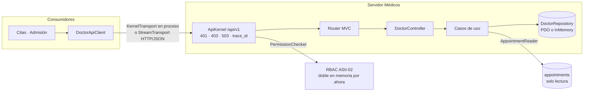

# Médicos, especialidades y disponibilidad — Semana 5

## Ficha de la asignación

- **Estudiante:** Hicho García, Josué Fernando (`Jhos-hgnu`)
- **Módulo:** ASII-04 — Médicos, especialidades y disponibilidad
- **Semana:** Semana 5 — Cliente-servidor y microservicios
- **Tarea individual:** Evolucione el MISMO «Micro-HIS Médicos, especialidades y disponibilidad» y el flujo «registro de médico, asociación de especialidad y consulta de disponibilidad» hacia un diseño cliente-servidor y evalúe una frontera de microservicio. Especifique contrato API, propiedad de datos, comunicación, seguridad, resiliencia, observabilidad y consistencia; incluya diagramas y una migración razonada. Puede entregar diseño/prototipo: no construya infraestructura de producción ni divida el sistema sin una justificación medible.
- **Entregable / evidencia:** prototipo cliente-servidor sobre el micro-HIS de la Semana 4 (servidor API v1 y cliente HTTP), contrato OpenAPI, evaluación de la frontera de microservicio con migración y pruebas. Código en [`micro-his/medicos-especialidades/`](../../../micro-his/medicos-especialidades/).

## Punto de partida

La [Semana 4](../semana-04/README.md) dejó el flujo en MVC (`Router`, `DoctorController`, `JsonView`) sobre el `DoctorRepository` con adaptadores PDO e InMemory. Esta semana se agrega una capa de servidor delante del `Router` y un cliente para los módulos que consumen Médicos, sin tocar casos de uso ni dominio.

## Vista cliente-servidor



- **`ApiKernel`** (Presentation): rutas bajo `/api/v1`, `401` sin actor, `403` sin el permiso `modulo.accion` de la ruta, `503` si RBAC no responde, `trace_id` en cuerpo y encabezado, y bitácora de acceso.
- **`PermissionChecker`** (Application): puerto hacia RBAC. Mientras la integración con María no esté en `develop`, lo implementa `InMemoryPermissionChecker`.
- **`DoctorApiClient`** (Client): convierte los errores del servidor en `DoctorApiError` (estado, código, `trace_id`) y la falta de respuesta en `DoctorApiUnavailable`. Reintenta una sola vez la consulta de disponibilidad y nunca un alta.

## Archivos de esta entrega

- [Contrato API v1](./contrato-api.md): endpoints, permisos, ejemplos, códigos de error, propiedad de datos y consistencia.
- [OpenAPI 3.0](./openapi.yaml): el mismo contrato, validado con `swagger-cli validate`.
- [Frontera de microservicio](./frontera-microservicio.md): criterios medibles, decisión y migración razonada.
- [Declaración de uso de IA](./DECLARACION_IA.md)

## Cómo verificar

```bash
php micro-his/medicos-especialidades/tests/api.php   # servidor y cliente (Semana 5)
php micro-his/medicos-especialidades/tests/run.php   # flujo por el router con PDO e InMemory (Semana 4)
php -S 127.0.0.1:8004 -t micro-his/medicos-especialidades/public
```

Resultado de `tests/api.php` con PHP 8.3.33 (código de salida 0):

```text
OK: servidor: POST /api/v1/doctors con permiso -> 201 con trace_id en cuerpo y encabezado
OK: servidor: sin X-User-ID -> 401 UNAUTHENTICATED
OK: servidor: recepción sin medicos.registrar -> 403 FORBIDDEN con el permiso faltante
OK: servidor: recepción con medicos.disponibilidad.ver -> 200
OK: servidor: ruta sin /api/v1 -> 404 ROUTE_NOT_FOUND
OK: servidor: JSON malformado -> 422 PAYLOAD_INVALID con trace_id
OK: servidor: bitácora de acceso con trace_id, método, ruta y estado, sin el cuerpo
OK: servidor: RBAC caído -> 503 AUTHORIZATION_UNAVAILABLE (falla cerrada, no se consulta)
OK: cliente: registra y asocia una especialidad secundaria
OK: cliente: disponibilidad del lunes -> Ana libre 08:00 y 09:00
OK: cliente: licencia repetida -> DoctorApiError 409 con código y trace_id del servidor
OK: cliente: la consulta se reintenta una vez si el servidor no responde
OK: cliente: consulta sin servidor -> DoctorApiUnavailable tras 2 intento(s), sin reintentos infinitos
OK: cliente: alta sin servidor -> DoctorApiUnavailable tras 1 intento(s), sin reintentos infinitos
OK: cliente HTTP real: puerto cerrado -> DoctorApiUnavailable
Todas las pruebas del API pasaron.
```

`tests/run.php` sigue en verde: 20 casos por adaptador más las 3 verificaciones de política, ISP y MVC.

Prueba con el servidor real (`php -S`) y el cliente `StreamTransport`:

```text
POST /api/v1/doctors (admin1)          -> 201 doctor_profile_id=doc-1
POST /api/v1/doctors (recepcion1)      -> 403 {"code":"FORBIDDEN","permission":"medicos.registrar","trace_id":"25e81d9b9564f787"}
GET /api/v1/availability (sin actor)   -> 401 {"code":"UNAUTHENTICATED","trace_id":"f908fe2477941bbf"}
GET /api/v1/availability (recepcion1)  -> 200 {"code":"NO_DOCTORS_FOR_SPECIALTY","doctors":[],"trace_id":"5af010c7a40f882d"}
```

## Supuestos y límites

- **SD-MED-10:** RBAC aún no está integrado; los permisos de desarrollo de `public/index.php` (`admin1` con todo, `recepcion1` solo disponibilidad) son datos ficticios del doble.
- **SD-MED-11:** los tres permisos `medicos.*` y su matriz por rol son una propuesta pendiente de que María los agregue al catálogo de RBAC.
- La auditoría sigue en `local_access_audits` con la estructura mínima del micro-HIS hasta que exista la tabla del slice H8.
- No se construye infraestructura de producción: no hay gateway, TLS ni despliegue separado.

## Organización de la entrega

| Rama | Contenido | Base | Orden |
|---|---|---|---|
| `feature/asii-04-semana-05-medicos-especialidades-api-jhos-hgnu` | `ApiKernel`, `PermissionChecker`, cliente, `public/index.php` y `tests/api.php` | Semana 4 `mvc-tests` (#356) | después de #126, #355 y #356 |
| `feature/asii-04-semana-05-medicos-especialidades-docs-jhos-hgnu` | Esta documentación | `develop` | independiente |
