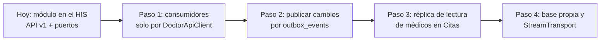

# Frontera de microservicio — Médicos

## Pregunta

¿Conviene sacar Médicos del HIS como un microservicio con su propia base, o mantenerlo como módulo con un contrato API dentro del mismo despliegue?

## Criterios medibles

| Criterio | Situación actual | ¿Favorece separar? |
|---|---|---|
| Acoplamiento de datos | `appointments` tiene FK a `doctor_profiles` y `specialties`, y su trigger `enforce_appointment_integrity` lee `doctor_specialties` para validar cada cita. | **No.** Con bases separadas se pierden la FK y el trigger, y Citas tendría que validar por red. |
| Frecuencia de cambio | El catálogo de médicos cambia poco; la disponibilidad se consulta en cada reserva. | **No.** El tráfico es de lectura y lo cubre el mismo proceso. |
| Escala independiente | Un hospital tiene decenas o cientos de médicos; la consulta es por un día y una especialidad. | **No.** No hay una carga medida que justifique escalar aparte. |
| Equipo dueño | Un integrante y un módulo; el resto del HIS se despliega junto. | **No.** Separar suma operación sin un equipo que la sostenga. |
| Aislamiento de fallas | Si Médicos cae, Citas y Admisión no pueden elegir médico en ningún caso. | Neutro: separar no evita la dependencia funcional. |

## Decisión

**Médicos sigue como módulo del HIS** (monolito modular), con una frontera lógica clara:

1. Toda lectura y escritura de otros módulos pasa por el [contrato API v1](./contrato-api.md) o por los puertos (`DoctorsBySpecialty`, `SpecialtyCatalog`); nadie consulta sus tablas por SQL.
2. Médicos solo lee `appointments` a través de `AppointmentReader`.
3. El cliente `DoctorApiClient` funciona igual en proceso (`KernelTransport`) que por red (`StreamTransport`). Si algún día se separa, los consumidores cambian el transporte, no su código.

Se reevalúa si se mide alguno de estos disparadores (umbrales propuestos, supuesto pendiente de validar con el grupo): más de 50 consultas de disponibilidad por segundo sostenidas, un segundo equipo dueño del módulo, o una red de hospitales que comparta un único directorio de médicos.

## Comunicación, seguridad, resiliencia y observabilidad

| Aspecto | Diseño |
|---|---|
| Comunicación | HTTP/JSON síncrono para consultas y altas. Si se separa, los cambios de médico se publicarían por `outbox_events` (slice H8) para que Citas no consulte en cada pantalla. |
| Seguridad | Autenticación delegada (JWT/tenant en Laravel); autorización por permiso `modulo.accion` contra RBAC. Si RBAC no responde, `503` y no se atiende (falla cerrada). |
| Resiliencia | El cliente reintenta una sola vez la consulta de disponibilidad (idempotente) y nunca un alta. Tiempo máximo por petición: 3 s. Sin respuesta, `DoctorApiUnavailable`: el consumidor muestra "no disponible" y no inventa franjas. |
| Observabilidad | `trace_id` en cada respuesta y en `X-Trace-Id`; bitácora de acceso con `trace_id`, método, ruta y estado, sin datos del cuerpo. |
| Consistencia | Transacción local para alta y asociación. La disponibilidad es una foto del momento; la reserva la confirma Citas con su propia restricción de solape. |

## Migración razonada (si se cumple un disparador)

1. **Paso 1:** todo consumidor usa `DoctorApiClient`; se verifica buscando SQL contra `doctor_*` fuera del módulo.
2. **Paso 2:** cada alta o asociación publica un evento en `outbox_events` dentro de la misma transacción.
3. **Paso 3:** Citas mantiene una réplica de lectura con esos eventos y valida sus citas contra ella en lugar del trigger.
4. **Paso 4:** Médicos se despliega aparte con su base; los consumidores cambian `KernelTransport` por `StreamTransport`.

Cada paso se puede revertir sin tocar los anteriores. Hoy el micro-HIS ya ofrece el cliente del paso 1; falta que Citas y Admisión lo adopten.
