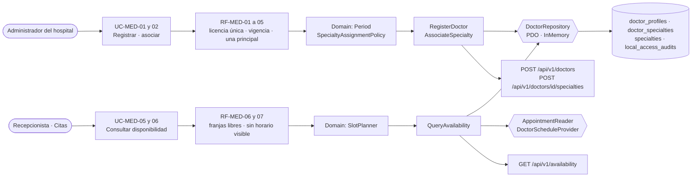

# Médicos, especialidades y disponibilidad — Semana 6: primera evaluación parcial

**Estudiante:** Hicho García, Josué Fernando (`Jhos-hgnu`) · **Módulo:** ASII-04 · **Entrega:** defensa teórica y caso práctico arquitectónico.

> La evaluación presencial ya se realizó; este documento deja por escrito la defensa del módulo con la evidencia de las Semanas 1 a 5.

## Tesis arquitectónica

En el flujo «registro de médico, asociación de especialidad y consulta de disponibilidad», **la disponibilidad que se ofrece es verdadera**: un médico aparece solo si su perfil y su especialidad están vigentes en la fecha, y una franja se ofrece solo si está dentro de su horario y no tiene una cita activa. El dominio (`Period`, `SpecialtyAssignmentPolicy`) rechaza antes lo que ya sabe que es inválido, y la base lo garantiza aunque dos altas lleguen a la vez: las exclusiones GiST de `doctor_specialties` impiden la misma especialidad solapada y dos principales en el mismo periodo.

## Trazabilidad de punta a punta

| Semana | Qué aportó | Evidencia |
|---|---|---|
| 1 | Actores, UC-MED-01 a 08, actividad y secuencia sobre la migración `000100` | `docs/medicos-especialidades/semana-01/` (PR #35, integrado) |
| 2 | 7 RF y 5 RNF; ISP: `DoctorDirectory` de 8 métodos dividida en 6 puertos | `semana-02/` (PR #66) |
| 3 | Micro-HIS en cuatro capas, transacción completa y pruebas con SQLite | `micro-his/medicos-especialidades/` (PR #124 integrado, #126, #127) |
| 4 | MVC + `DoctorRepository` con PDO e InMemory; la misma suite contra los dos | PR #355, #356, #357 |
| 5 | API v1 con permisos y `trace_id`, `DoctorApiClient`, OpenAPI y frontera | PR #371, #372 |

## Decisiones defendidas

| Decisión | Por qué | Evidencia verificable |
|---|---|---|
| Seis puertos pequeños (ISP) | La consulta de disponibilidad no debe depender de métodos de escritura | Prueba «ISP: la disponibilidad no depende de puertos de escritura» |
| La base decide la carrera entre dos asociaciones | Dos administradores pueden asociar la misma especialidad a la vez | `doctor_specialties_active_period_exclusion` y `..._primary_period_exclusion` (migración `000100`) |
| Perfil, especialidad principal y auditoría en una transacción | Un médico sin especialidad o sin traza es un dato roto | Prueba de rollback: con la auditoría caída responde `500` y no queda perfil |
| Médico sin horario visible, no oculto (RF-MED-07) | Ocultarlo haría creer a Citas que no existe | Estado `SCHEDULE_NOT_CONFIGURED` con `slots: []` |
| Horario detrás de `DoctorScheduleProvider` | El esquema de 27 entidades no tiene horario | `ConfigScheduleProvider` hoy; `doctor_schedules` propuesta a Javier |
| Disponibilidad sin datos del paciente (RNF-MED-03) | Médicos solo necesita saber qué franjas están ocupadas | `AppointmentReader` devuelve solo horas |
| Tipos validados en la entrada | `"false"` como texto no puede guardarse como principal | `422 PAYLOAD_INVALID` sin guardar (revisión de #126) |
| El cliente reintenta la consulta y nunca el alta | Repetir un POST sin saber si llegó duplicaría el médico | `DoctorApiUnavailable` tras 2 intentos en GET y 1 en POST |

**Riesgos que sigo defendiendo como abiertos:** la tabla `doctor_schedules` depende de Javier; `local_access_audits` (slice H8) no tiene migración; los permisos `medicos.*` no están en el catálogo de RBAC; RF-MED-06 consulta un día y no el rango de 14; `PdoDoctorStore` necesita ajustes para PostgreSQL (`uuid`, `timestamptz`).

## Caso práctico arquitectónico

**Pedido:** Dirección médica pide registrar **ausencias** (vacaciones, licencia, congreso) para que la disponibilidad no ofrezca franjas de un médico ausente. Si el médico ya tiene citas activas en esas fechas, la ausencia no puede dejarlas huérfanas.

| Capa o pieza | ¿Cambia? | Qué cambia |
|---|---|---|
| Domain | Sí, mínimo | `Period` se reutiliza para el rango de la ausencia; `SlotPlanner` no cambia |
| Application | Sí, un puerto nuevo | `QueryAvailability` recibe `DoctorAbsenceReader` (puerto pequeño, ISP; no se agranda `DoctorScheduleProvider`). Médico ausente: estado `DOCTOR_ON_LEAVE` con `slots: []`, igual que RF-MED-07 |
| Application | Sí, un caso de uso | `RegisterAbsence`: si hay citas activas en el rango, `409 ABSENCE_HAS_APPOINTMENTS` con el número de citas; Citas reprograma primero |
| Persistence | Sí | Tabla `doctor_absences` (médico, vigencia, motivo, estado) con exclusión GiST por médico; requiere acuerdo con Javier, como `doctor_schedules` |
| Contrato API | Sí, compatible | `POST /api/v1/doctors/{id}/absences` y el valor nuevo `DOCTOR_ON_LEAVE` en `status`; los clientes actuales siguen funcionando |
| Consumidores | Citas | Muestra al médico como ausente y reprograma sus citas antes de que se registre la ausencia |

**Conclusión:** la ausencia entra como un puerto y un caso de uso nuevos. Las reglas de vigencia y de principal única, la transacción y el contrato existente no cambian.

Guion de la exposición: [presentacion.md](./presentacion.md) · Uso de IA: [DECLARACION_IA.md](./DECLARACION_IA.md)
