# Médicos, especialidades y disponibilidad — Semana 7: componentes backend/frontend

**Estudiante:** Hicho García, Josué Fernando (`Jhos-hgnu`) · **Módulo:** ASII-04 · **Entrega:** diagrama de componentes y propuesta de refactorización.

## Objetivo

Diseñar los componentes del flujo «registro de médico, asociación de especialidad y consulta de disponibilidad» dentro del HIS real (Laravel 12 y Vue 3, ya presentes en `develop`), separando UI, aplicación, dominio y persistencia. El diseño reutiliza el dominio y los casos de uso del micro-HIS de las Semanas 3 a 5 sin reescribirlos.

[Fuente Mermaid](./fuentes/01-componentes.mmd)

## Componentes y responsabilidades

| Componente | Responsabilidad | Dónde está hoy |
|---|---|---|
| Middlewares `tenant` y `jwt.auth` | Resolver el hospital (`X-Tenant-ID`) y el usuario del JWT | En `develop`: `TenantMiddleware` y `JwtAuth`, con alias en `bootstrap/app.php` |
| Middleware `permission:medicos.*` | Proteger cada ruta con su permiso de RBAC | Parcial: `spatie/laravel-permission` y `config/permission.php` están; falta el alias `permission` (María, ASII-02) y los tres permisos `medicos.*` en el catálogo |
| `Api/V1/DoctorController` + `StoreDoctorRequest`, `StoreSpecialtyLinkRequest`, `AvailabilityRequest` | Controller delgado: el FormRequest valida tipos y obligatorios y el controller llama al caso de uso | No (propuesto) |
| Application: `RegisterDoctor` · `AssociateSpecialty` · `QueryAvailability` | Orquestan los casos de uso; se copian del micro-HIS sin cambios de lógica | Micro-HIS, `src/Application` (PR #124, integrado) |
| Domain: `Period` · `SpecialtyAssignmentPolicy` · `SlotPlanner` | Reglas puras de vigencia, principal única y franjas, sin Laravel | Micro-HIS, `src/Domain` (PR #124, integrado) |
| `DoctorRepository` «interfaz» + `EloquentDoctorRepository` | Puerto de persistencia; el adaptador usa el Query Builder sobre la conexión `hospital` | Micro-HIS: el puerto y los adaptadores PDO/InMemory (PR #355) |
| `AppointmentReader` + `DbAppointmentReader` | Lee solo las horas ocupadas de `appointments`, sin datos del paciente | Micro-HIS: puerto y doble InMemory (PR #355) |
| `DoctorScheduleProvider` | Horario de atención | `ConfigScheduleProvider` hoy; `doctor_schedules` propuesta a Javier |
| `AuditLogger` | Evidencia de alta y asociación en `local_access_audits` | Interfaz común pendiente (slice H8); mientras tanto, doble en memoria |
| Vue: `DoctorsPage.vue`, `DoctorForm.vue`, `SpecialtyLinkForm.vue`, `AvailabilityPage.vue` | Alta de médico, asociación de especialidad y consulta de franjas | No (propuesto), en `resources/js/modules/medicos/` como el módulo `auth` |
| `stores/doctors.js` y `api/doctorsApi.js` | Estado de las pantallas y llamadas HTTP con el plugin `axios` existente | En `develop`: `resources/js/plugins/axios.js` (JWT y `X-Tenant-ID` ya agregados) |

El botón «Registrar» se deshabilita mientras el POST está en curso y, si la red falla, la pantalla pide buscar la licencia antes de repetir el alta (el alta no es idempotente). La consulta de disponibilidad sí puede repetirse.

## Rutas protegidas

`bootstrap/app.php` ya monta `routes/api.php` con el prefijo `api/v1`, así que las rutas coinciden con el [contrato de la Semana 5](../semana-05/contrato-api.md):

| Método | Ruta | Permiso |
|---|---|---|
| POST | `/api/v1/doctors` | `medicos.registrar` |
| POST | `/api/v1/doctors/{doctor}/specialties` | `medicos.asociar_especialidad` |
| GET | `/api/v1/availability` | `medicos.ver_disponibilidad` |

## Propuesta de refactorización (micro-HIS → HIS Laravel)

| En el micro-HIS (Semanas 3 a 5) | Problema al integrar | Refactor propuesto |
|---|---|---|
| `ApiKernel` valida `X-User-ID` y consulta `PermissionChecker` | Duplica `JwtAuth` y el middleware de permisos; `X-User-ID` no es seguro fuera del micro-HIS | Quitar esas validaciones: el actor sale de `auth()->user()` y el permiso de `permission:medicos.*` |
| `Router` con un `match` de rutas | Laravel ya enruta | Una acción por método en el controller y rutas en `routes/api.php` dentro del grupo `['tenant', 'jwt.auth']` |
| `Request::text()` / `flag()` lanzan `422 PAYLOAD_INVALID` | Laravel tiene FormRequest con errores por campo | Los FormRequest validan tipos (`string`, `boolean`, `date`, `nullable`); el dominio conserva las reglas de negocio |
| `DoctorRuleViolation` mapeada en el controller | Cada controller repetiría el mapeo | Renderizarla en `withExceptions` de `bootstrap/app.php` con el mismo `code` y estado del contrato |
| `PdoDoctorStore` con PDO directo e IDs `doc-xxxx` | Otra conexión; las PK reales son `uuid` y `starts_at` es `timestamptz` | `EloquentDoctorRepository` con `DB::connection('hospital')`, `RETURNING doctor_profile_id` y `starts_at::date`; enlazado en un ServiceProvider. El InMemory queda para las pruebas |
| `JsonView` | Laravel serializa con `response()->json()` | Se reemplaza por respuestas JSON del controller; el `trace_id` lo agrega un middleware común |
| `DoctorApiClient` | Dentro del HIS, Citas y Admisión están en el mismo proceso | Llaman al caso de uso o al endpoint; el cliente HTTP se usa solo si el módulo se separa (Semana 5) |

**Qué no cambia:** el dominio, los casos de uso, el contrato `/api/v1` y los códigos de error. Por eso el refactor es de bajo riesgo: las pruebas de dominio y de contrato de las Semanas 3 a 5 siguen valiendo.

## Plan de la refactorización

1. Copiar `Domain` y `Application` a `app/Modules/Medicos/` y ajustar el namespace.
2. Crear `EloquentDoctorRepository` y `DbAppointmentReader` y enlazarlos a sus puertos en un ServiceProvider del módulo.
3. Crear el controller, los FormRequest y las rutas con `permission:` cuando María publique el alias y el catálogo.
4. Renderizar `DoctorRuleViolation` en `bootstrap/app.php` con el `code` del contrato.
5. Crear las páginas Vue, el store y `api/doctorsApi.js` en `resources/js/modules/medicos/`, con los estados de la Semana 8.
6. Correr la suite de la Semana 4 con `EloquentDoctorRepository` contra PostgreSQL.

**Estado:** este PR es diseño; el código Laravel/Vue queda **propuesto** para la integración del 20 y 21 de octubre. Uso de IA: [DECLARACION_IA.md](./DECLARACION_IA.md).
