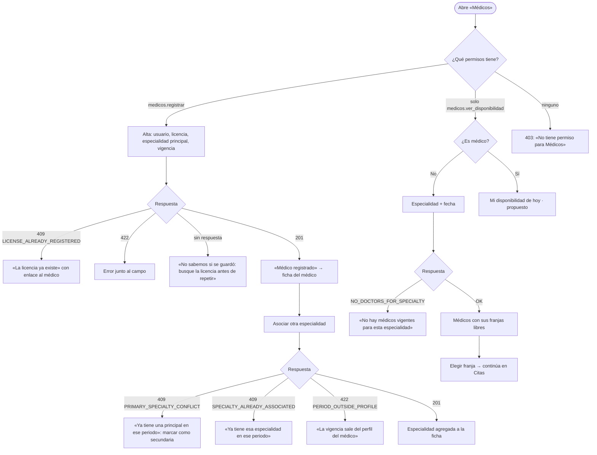

# Médicos, especialidades y disponibilidad — Semana 8: flujo UX por rol

**Estudiante:** Hicho García, Josué Fernando (`Jhos-hgnu`) · **Módulo:** ASII-04 · **Entrega:** user flow, wireframes iniciales y reglas de interacción.

## Objetivo

Diseñar la experiencia del flujo «registro de médico, asociación de especialidad y consulta de disponibilidad» para cada rol autorizado, con estados vacío, carga, éxito y error recuperable, y mensajes que usan los códigos reales del [contrato API](../semana-05/contrato-api.md).

## Roles

| Rol | Objetivo en el flujo | Permiso |
|---|---|---|
| Administrador del hospital | Registrar al médico y asociarle especialidades | `medicos.registrar` · `medicos.asociar_especialidad` · `medicos.ver_disponibilidad` |
| Recepcionista | Encontrar una franja libre por especialidad y fecha para agendar | `medicos.ver_disponibilidad` |
| Médico | Ver solo su propia disponibilidad del día | `medicos.ver_disponibilidad` |

## User flow



## Wireframes iniciales (baja fidelidad)

### 1. Alta de médico (administrador)

```text
┌ Registrar médico ───────────────────────────────────────── Hospital: HOSP-DEMO ┐
│ Usuario*               [Ana López (u-ana) ▼]                                    │
│ Número de colegiado*   [COL-1________]                                          │
│ Especialidad principal*[Cardiología (CARD) ▼]   Vigente desde* [2026-01-01]     │
│                                              [Cancelar] [Registrar médico]      │
└─────────────────────────────────────────────────────────────────────────────────┘
```

### 2. Ficha del médico: asociar especialidad

```text
┌ Dra. Ana López · COL-1 ─────────────────────────────────────────────────────────┐
│ Especialidades: ● Cardiología (principal, desde 2026-01-01)                     │
│                 ○ Neurología (secundaria, 2026-02-01 → sin fin)                  │
│ Agregar: [Pediatría ▼] [ ] Principal  Desde* [2026-11-01] Hasta [__________]    │
│                                                         [Asociar especialidad]  │
└─────────────────────────────────────────────────────────────────────────────────┘
```

### 3. Disponibilidad (recepcionista)

```text
┌ Disponibilidad ─────────────── Especialidad [Neurología ▼]  Fecha [2026-10-19] ┐
│ Dra. Ana López    [08:00] [09:00]          (08:30 ocupada, no se muestra)       │
│ Dr. Beto Ruiz     Sin horario configurado — consulte con administración         │
│                                                      [Elegir franja → Citas]    │
└─────────────────────────────────────────────────────────────────────────────────┘
```

## Estados de la pantalla

| Estado | Qué ve el usuario |
|---|---|
| Carga | Lista en gris y botones deshabilitados mientras llega la respuesta |
| Vacío | «No hay médicos vigentes para esta especialidad» (`NO_DOCTORS_FOR_SPECIALTY`, es un `200`, no un error) |
| Médico sin horario | Aparece con «Sin horario configurado» y sin franjas (`SCHEDULE_NOT_CONFIGURED`); no se oculta |
| Conflicto (409) | Mensaje con el motivo y la acción sugerida: ver el médico existente o marcar como secundaria |
| Validación (422) | Error junto al campo: licencia, especialidad inactiva, vigencia o fecha |
| Sin permiso (403) | «No tiene permiso para esta acción»; el botón no se muestra si el rol no tiene el permiso |
| Servicio no disponible (503 o sin respuesta) | «No se pudo consultar; intente de nuevo». En el alta: «busque la licencia antes de repetir» |
| Éxito (201 / 200) | Confirmación con enlace a la ficha del médico, o la lista de franjas |

## Reglas de interacción

- «Registrar médico» y «Asociar especialidad» se deshabilitan mientras la petición está en curso: el alta no es idempotente y un doble clic podría intentar duplicarla.
- La lista de especialidades solo ofrece las activas; una especialidad inactiva no aparece como opción.
- «Principal» viene desmarcado; si el médico ya tiene una principal en el periodo, se avisa antes de enviar.
- Las franjas ocupadas no se muestran como opción. Elegir una franja no la reserva: la reserva la confirma Citas.
- Cada mensaje de error muestra el `trace_id` en pequeño, para que soporte lo encuentre en la bitácora.
- **Médico (propuesto):** «Mi disponibilidad» filtra por su propio `doctor_profile_id`; el contrato v1 consulta por especialidad, así que se propone el parámetro opcional `doctor` en `GET /api/v1/availability`.

Los wireframes se evalúan en la Semana 9 (usabilidad y accesibilidad) y se adaptan a móvil en la Semana 10. Uso de IA: [DECLARACION_IA.md](./DECLARACION_IA.md).
