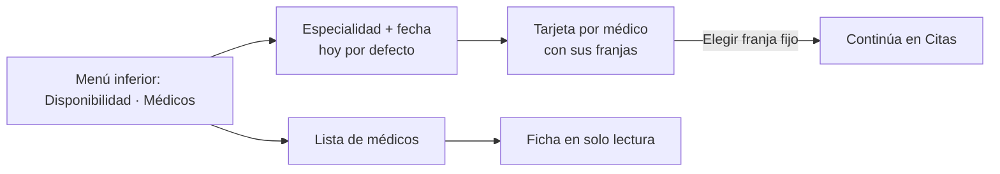

# Médicos, especialidades y disponibilidad — Semana 10: adaptación responsive y móvil

**Estudiante:** Hicho García, Josué Fernando (`Jhos-hgnu`) · **Módulo:** ASII-04 · **Entrega:** escenarios móviles y prioridades de pantalla.

## Objetivo

Adaptar las pantallas de la [Semana 8](../semana-08/README.md) a teléfono y tablet según cómo se usan en el hospital, con las reglas de [breakpoints.md](./breakpoints.md) y las mejoras de la [Semana 9](../semana-09/README.md).

## Escenarios móviles

| # | Quién y dónde | Qué necesita | Respuesta del diseño |
|---|---|---|---|
| 1 | Recepcionista, en el mostrador con tablet | Encontrar una franja libre mientras atiende al paciente | Disponibilidad en dos columnas: médicos a la izquierda, franjas del elegido a la derecha |
| 2 | Médico, en el pasillo con el teléfono | Ver sus franjas libres de hoy | «Mi disponibilidad» en una columna, fecha de hoy fija arriba (propuesto, Semana 8) |
| 3 | Administrador del hospital, en la oficina | Registrar médicos y asociar especialidades | Layout de escritorio de la Semana 8; en teléfono solo consulta la ficha |

El alta y la asociación de especialidades se hacen en escritorio: son tareas ocasionales con varios campos y vigencias. En teléfono la ficha se muestra en solo lectura, para no registrar datos profesionales con prisa.

## Prioridad de cada pantalla

| Pantalla | `sm` (teléfono) | `md` (tablet) |
|---|---|---|
| Disponibilidad | Selector de especialidad y fecha arriba; una tarjeta por médico con sus franjas como botones de 44 px; «Elegir franja» fijo abajo | Lista de médicos y franjas del médico elegido lado a lado |
| Ficha del médico | Solo lectura: especialidades vigentes con «principal» en texto | Solo lectura, en dos columnas |
| Alta de médico | No se ofrece; mensaje «Use una computadora para registrar médicos» | Formulario en una columna |

## Navegación móvil

## Mejoras de la Semana 9 incorporadas

- **H2:** el botón fijo dice «Elegir franja (se confirma en Citas)», para que no parezca una reserva.
- **H3:** cada tarjeta es un `radiogroup` con `aria-label` «Franjas de Dra. Ana López».
- **H5:** la fecha es hoy por defecto, con botones «‹ día anterior · día siguiente ›» de 44 px.
- **H1 y H6:** quedan en escritorio, porque el alta no se ofrece en teléfono.

El prototipo navegable de la Semana 11 implementa estos breakpoints. Uso de IA: [DECLARACION_IA.md](./DECLARACION_IA.md).
