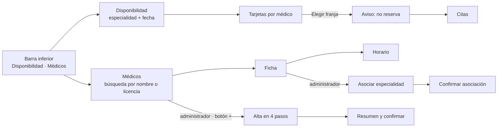

# Médicos, especialidades y disponibilidad — Semana 10: diseño para movilidad

**Estudiante:** Hicho García, Josué Fernando (`Jhos-hgnu`) · **Módulo:** ASII-04 · **Entrega:** jerarquía móvil, navegación, formularios, confirmaciones y recuperación ante conexión limitada.

**Tarea individual:** Adapte «registro de médico, asociación de especialidad y consulta de disponibilidad» a móvil (320–430 px): jerarquice los datos y acciones de médicos, especialidades, horarios, disponibilidad y conflictos de agenda, reduzca carga cognitiva y defina navegación, tablas/formularios, confirmaciones y recuperación ante conexión limitada.

## Objetivo

Llevar las pantallas de la [Semana 8](../semana-08/README.md) a teléfonos de 320 a 430 px de ancho, con las mejoras de la [Semana 9](../semana-09/README.md) y las reglas de [breakpoints.md](./breakpoints.md). Los tres roles usan el teléfono: el administrador registra y asocia, la recepcionista consulta disponibilidad y el médico ve la suya.

## Jerarquía de datos y acciones

Cada pantalla muestra primero lo que el rol necesita para decidir, y deja lo demás a un toque.

| Pantalla | Primero (siempre visible) | Después (al desplazar) | A un toque (oculto) | Acción principal (fija abajo) |
|---|---|---|---|---|
| Disponibilidad | Especialidad y fecha (hoy por defecto) | Una tarjeta por médico con sus franjas libres | Médicos sin horario, agrupados al final | «Elegir franja (se confirma en Citas)» |
| Ficha del médico | Nombre, licencia y especialidad principal | Especialidades secundarias con su vigencia | Horario semanal y vigencias pasadas | «Asociar especialidad» (solo administrador) |
| Horario | Bloques de hoy (`08:00–09:30`) | Resto de la semana | Vigencia del horario | — (solo lectura; lo carga administración) |
| Alta de médico | Paso actual y progreso (`2 de 4`) | Ayuda del campo | — | «Siguiente» / «Registrar médico» |
| Conflicto de agenda | Qué pasó, en una frase | Qué hacer ahora | Código y `trace_id` | La acción que lo resuelve |

## Reducción de la carga cognitiva

- **Un dato clave por línea:** el nombre del médico arriba y las franjas debajo; nunca una tabla de varias columnas.
- **Valores por defecto:** fecha de hoy, «Principal» desmarcado y «Hasta» vacío (sin fin).
- **Solo opciones válidas:** especialidades activas y franjas libres; lo inválido no se muestra en lugar de mostrarse deshabilitado.
- **Un paso a la vez:** el alta se divide en cuatro pantallas cortas en vez de un formulario largo.
- **Lenguaje del hospital:** «Número de colegiado», «Vigente desde», horas `08:00`; los códigos técnicos van solo en el detalle del error.

## Navegación



La barra inferior tiene dos destinos, con iconos y texto. El alta aparece como botón «+» solo para quien tiene `medicos.registrar`. «Atrás» del sistema vuelve un paso sin perder lo escrito.

## Tablas y formularios

**Tablas → tarjetas.** La disponibilidad y la lista de especialidades pasan a tarjetas apiladas. Ejemplo a 360 px:

```text
┌ Neurología · hoy 19/10  ‹ › ───────┐
│ Dra. Ana López                     │
│ [08:00] [09:00]                    │
│ Dr. Beto Ruiz                      │
│ Sin horario · avisar a admin.      │
├────────────────────────────────────┤
│ [ Elegir franja · confirma Citas ] │
└────────────────────────────────────┘
```

**Alta en cuatro pasos:** 1) usuario (búsqueda), 2) número de colegiado, 3) especialidad principal, 4) vigente desde, con selector de fecha. Cada paso valida su campo antes de avanzar; el 422 del servidor vuelve al paso del campo con el error junto a él.

**Asociar especialidad:** especialidad, interruptor «Principal» y vigencia en una sola pantalla corta. Si el médico ya tiene una principal vigente, el interruptor muestra «Ya tiene principal: Cardiología» antes de enviar (H4).

## Confirmaciones

| Acción | Confirmación |
|---|---|
| Registrar médico | Resumen con usuario, licencia, especialidad y vigencia; «Registrar» o «Corregir» (H6) |
| Asociar especialidad | «Agregar Neurología como secundaria desde 01/11/2026», «Asociar» o «Volver» |
| Elegir franja | Aviso «Elegir no reserva: Citas confirma la hora» antes de pasar a Citas (H2) |
| Éxito | Mensaje visible con `role="status"` y enlace a la ficha; nada se confirma solo con un aviso que desaparece |

## Conflictos de agenda

| Situación | Qué ve el usuario | Qué puede hacer |
|---|---|---|
| La franja ya no está libre al volver a consultar | La franja desaparece y aparece «08:30 ya no está libre» | Elegir otra de la lista actualizada |
| `409 PRIMARY_SPECIALTY_CONFLICT` | «Ya tiene una principal en ese periodo» | Cambiar a secundaria con un toque |
| `409 SPECIALTY_ALREADY_ASSOCIATED` | «Ya tiene Neurología en ese periodo» | Ver la ficha |
| `409 LICENSE_ALREADY_REGISTERED` | «Ese número de colegiado ya está registrado» | Abrir el médico existente |
| Médico sin horario | «Sin horario configurado · avisar a administración» (H7) | Seguir con otro médico |

## Recuperación ante conexión limitada

Sigue el comportamiento del cliente de la [Semana 5](../semana-05/contrato-api.md): 3 s de espera por petición, la consulta se reintenta una vez y el alta nunca.

| Situación | Comportamiento |
|---|---|
| Sin conexión al abrir | Banda «Sin conexión» y la última disponibilidad consultada con su hora («de las 08:12»); las franjas no se pueden elegir |
| Conexión lenta (más de 3 s) | Indicador de carga en la tarjeta, no en toda la pantalla; un reintento automático en la consulta |
| La consulta falla dos veces | «No se pudo consultar» con botón «Reintentar»; no hay reintentos infinitos |
| El alta o la asociación no responde | «No sabemos si se guardó» y «Buscar licencia» antes de permitir repetir (H1); el formulario conserva lo escrito |
| Vuelve la conexión | La disponibilidad se vuelve a pedir sola; los formularios siguen como estaban |

El prototipo navegable de la Semana 11 implementa estas pantallas a 360 px. Uso de IA: [DECLARACION_IA.md](./DECLARACION_IA.md).
