# Médicos, especialidades y disponibilidad — Semana 11: prototipo navegable

**Estudiante:** Hicho García, Josué Fernando (`Jhos-hgnu`) · **Módulo:** ASII-04 · **Entrega:** prototipo navegable desktop y móvil, mapa de navegación y capturas.

**Tarea individual:** Construya un prototipo navegable desktop y móvil del flujo principal de Médicos, especialidades y disponibilidad, cubriendo camino feliz y un error crítico relacionado con médicos, especialidades, horarios, disponibilidad y conflictos de agenda; mantenga consistencia de roles, estados y accesibilidad.

## Cómo abrirlo

Abra [`prototipo/index.html`](./prototipo/index.html) en cualquier navegador. Es un solo archivo, funciona sin conexión y no llama a ningún servidor. Para verlo como teléfono use el modo de dispositivo del navegador (360 px).

- **Rol:** el selector de arriba cambia entre administrador del hospital, recepcionista y médico, con los permisos de la [Semana 8](../semana-08/README.md).
- **Respuesta simulada:** elige qué responde el servidor (Correcta, Franja tomada, Licencia repetida, Sin respuesta y Sin conexión), con los códigos del [contrato `/api/v1`](../semana-05/contrato-api.md), para recorrer los caminos de error sin backend.
- **Flujo principal:** alta del médico en cuatro pasos con confirmación, asociación de especialidad y consulta de disponibilidad con elección de franja.

## Error crítico: conflicto de agenda

La recepcionista elige una franja y, mientras decide, otra cita la toma. Es el error más grave del flujo porque la llevaría a prometer al paciente una hora que ya no existe (hallazgo H2 de la [Semana 9](../semana-09/README.md)). El prototipo:

1. vuelve a consultar al pulsar «Elegir franja»;
2. muestra «08:00 ya no está libre» con `role="alert"` y el `trace_id`;
3. quita esa hora de la lista y limpia la selección, para que elija otra sin recargar.

## Mapa de navegación

[Fuente Mermaid](./fuentes/01-mapa-navegacion.mmd)

## Capturas

| Camino | Desktop (1280 px) | Móvil (360 px) |
|---|---|---|
| Feliz: confirmar alta | [01](./capturas/01-alta-confirmar-desktop.png) | [07](./capturas/07-alta-confirmar-movil.png) |
| Feliz: médico registrado | [02](./capturas/02-alta-registrada-desktop.png) | — |
| Feliz: especialidad asociada | [08](./capturas/08-especialidad-asociada-desktop.png) | — |
| Feliz: franja lista para Citas | [03](./capturas/03-disponibilidad-ok-desktop.png) | [05](./capturas/05-disponibilidad-ok-movil.png) |
| **Error crítico: franja tomada** | [04](./capturas/04-error-franja-tomada-desktop.png) | [06](./capturas/06-error-franja-tomada-movil.png) |
| Error: ya tiene principal (409) | — | [09](./capturas/09-asociar-conflicto-principal-movil.png) |

Las capturas se tomaron con Chrome controlado por Puppeteer, con el viewport real de cada ancho; la página no desborda a 320, 360 ni 430 px y no hubo errores de JavaScript. Cada captura se reproduce con un parámetro de demostración, por ejemplo `index.html?rol=recepcion&sim=tomada&demo=elegir#disponibilidad`.

## Consistencia de roles, estados y accesibilidad

| Aspecto | Cómo se cumple |
|---|---|
| Roles | Solo el administrador ve la licencia, «+ Registrar médico» y «Asociar especialidad»; el médico ve «Mi disponibilidad»; sin permiso, el mensaje de 403 |
| Estados | Carga (pantalla atenuada y botones deshabilitados), vacío, sin horario, sin conexión, confirmación, éxito y error, como en la Semana 8 |
| Confirmación | Resumen del alta con «Corregir» por línea (H6) y confirmación de la asociación; «Elegir no reserva» en la franja (H2) |
| Teclado y foco | Todo se usa con Tab, Enter y flechas; contorno de foco de 3 px (H9) |
| Lector de pantalla | Franjas como `radiogroup` con «Franjas de Dra. Ana López» (H3); mensajes con `role="status"` o `role="alert"` |
| Móvil | Barra inferior, acción principal fija abajo, objetivos de 44 px y campos de 16 px ([Semana 10](../semana-10/README.md)) |
| Conexión limitada | «Sin conexión» bloquea las franjas; «Sin respuesta» en el alta pide buscar la licencia antes de repetir (H1) |

**Pendiente de medir:** el contraste (WCAG 1.4.3) y el zoom al 200 % (1.4.4) que la Semana 9 dejó para el prototipo se miden en la Semana 12 con una herramienta de contraste sobre estas pantallas.

**Medido en la Semana 12:** los 16 pares de color de la pantalla cumplen 1.4.3 y 1.4.11. La medición encontró que el indicador de foco (`#f59e0b`, 2,01:1 sobre el fondo de la página) no cumplía el mínimo de 3:1 de 1.4.11, así que se cambió a `#b45309` (4,69:1). El zoom al 200 % y los caminos de rol, estado y error quedaron verificados en la [Semana 12](../semana-12/README.md).

Uso de IA: [DECLARACION_IA.md](./DECLARACION_IA.md).
