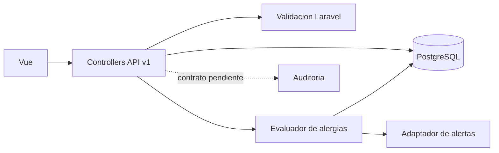

# ASII-06 - Alergias, medicamentos y prescripciones

Responsable: Javier Fajardo
Rama de trabajo: `feature/asii-06-alergias-medicamentos-prescripciones-javier`
Issue: [#24](https://github.com/AxelHerrera11/sistema-hospitalario-integrado/issues/24)
Area asignada: alergias, catalogo de medicamentos y prescripciones electronicas
Modulos originales: 12, 14 y 15

## 1. Alcance

El modulo permite registrar las alergias clinicas de un paciente, consultar y administrar el
catalogo de medicamentos y crear prescripciones vinculadas a una nota SOAP. Antes de firmar
una prescripcion, el servidor debe evaluar las alergias activas del paciente y bloquear las
incompatibles.

Fuera de alcance:

- Crear pacientes, medicos o notas SOAP (areas 2, 3 y 5).
- Mostrar o atender alertas criticas (area 8); este modulo solo solicita su creacion.
- Definir el mecanismo transversal de auditoria (area 1).
- Firma criptografica. Para el MVP se propone una firma logica con usuario y fecha.

## 2. Actores y permisos

| Actor | Capacidades |
|---|---|
| Admin | Consulta alergias y prescripciones; administra medicamentos. |
| Medico | Registra y edita alergias; consulta medicamentos; crea y firma prescripciones. |
| Enfermera | Consulta y registra alergias; consulta medicamentos y prescripciones. |
| Sistema | Aisla datos por hospital, evalua alergias y bloquea incompatibilidades. |

Los permisos existentes son `alergias.ver`, `alergias.registrar`, `alergias.editar`,
`medicamentos.ver`, `medicamentos.gestionar`, `prescripciones.ver`,
`prescripciones.crear` y `prescripciones.firmar`.

## 3. Casos de uso

| Codigo | Caso de uso | Actor | Resultado |
|---|---|---|---|
| CU-ALG-01 | Consultar alergias del paciente | Medico, Enfermera | Lista paginada del hospital actual. |
| CU-ALG-02 | Registrar alergia | Medico, Enfermera | Alergia asociada al paciente, usuario y hospital. |
| CU-ALG-03 | Editar o desactivar alergia | Medico | Se actualiza sin borrar el historial. |
| CU-MED-01 | Consultar medicamentos | Personal autorizado | Catalogo paginado y buscable. |
| CU-MED-02 | Gestionar medicamentos | Admin | Alta, edicion y desactivacion. |
| CU-PRE-01 | Crear prescripcion | Medico | Prescripcion valida o bloqueada con motivo. |
| CU-PRE-02 | Consultar prescripciones | Medico, Enfermera | Listado filtrable y detalle. |
| CU-PRE-03 | Firmar prescripcion | Medico | Firma unica de una prescripcion no bloqueada. |

## 4. Requisitos funcionales

| Codigo | Requisito | Criterio de aceptacion |
|---|---|---|
| RF-ALG-01 | Listar alergias de un paciente. | Solo devuelve registros del tenant y permite filtrar por estado, tipo y gravedad. |
| RF-ALG-02 | Registrar una alergia. | El paciente pertenece al tenant; `tenant_id` y `registered_by` se asignan en el servidor. |
| RF-ALG-03 | Editar o desactivar una alergia. | No permite cambiar paciente, tenant ni autor; no realiza borrado fisico. |
| RF-MED-01 | Listar y buscar medicamentos. | Busca por nombre, generico y categoria usando `whereSearch`. |
| RF-MED-02 | Administrar medicamentos. | Nombre unico por tenant y desactivacion sin borrar historial. |
| RF-PRE-01 | Crear una prescripcion desde SOAP. | Paciente, medico, SOAP y medicamento pertenecen al mismo tenant y son coherentes. |
| RF-PRE-02 | Evaluar alergias activas. | El resultado incluye coincidencia, alergia, termino, gravedad y motivo. |
| RF-PRE-03 | Bloquear incompatibilidades. | Guarda `blocked=true` y un motivo legible; no permite firmar. |
| RF-PRE-04 | Firmar una prescripcion valida. | Registra identidad y fecha una sola vez. |
| RF-PRE-05 | Generar alerta por bloqueo. | Crea una alerta `alergia_prescripcion` dentro de la misma transaccion. |

## 5. Requisitos no funcionales

| Codigo | Requisito | Criterio de aceptacion |
|---|---|---|
| RNF-01 | Aislamiento multi-tenant | Todo modelo usa `BelongsToTenant`; IDs ajenos responden 404. |
| RNF-02 | Autorizacion | Cada ruta usa JWT, tenant y su permiso `modulo.accion`. |
| RNF-03 | Validacion | Enums y longitudes se validan antes de llegar a PostgreSQL. |
| RNF-04 | Seguridad del binding | El middleware resuelve el tenant antes del binding y `BelongsToTenant` oculta IDs ajenos. |
| RNF-05 | Integridad | Prescripcion, bloqueo y alerta se crean en una transaccion. |
| RNF-06 | Compatibilidad | Pruebas en SQLite y PostgreSQL; busquedas mediante `whereSearch`. |
| RNF-07 | Usabilidad | UI responsive y riesgo comunicado con texto, no solo color. |
| RNF-08 | Datos sensibles | Los errores no revelan recursos de otro hospital ni detalles SQL. |

## 6. Contrato API preliminar

Todas las rutas usan `/api/v1`, `X-Tenant-ID`, Bearer JWT y el permiso indicado.

| Metodo | Ruta | Permiso | Estado |
|---|---|---|---|
| GET | `/patients/{patient}/allergies` | `alergias.ver` | Implementado |
| POST | `/patients/{patient}/allergies` | `alergias.registrar` | Implementado |
| PUT | `/allergies/{allergy}` | `alergias.editar` | Implementado |
| GET | `/medications` | `medicamentos.ver` | Implementado |
| POST | `/medications` | `medicamentos.gestionar` | Implementado |
| GET | `/medications/{medication}` | `medicamentos.ver` | Implementado |
| PUT | `/medications/{medication}` | `medicamentos.gestionar` | Implementado |
| GET | `/prescriptions` | `prescripciones.ver` | Pendiente |
| POST | `/prescriptions` | `prescripciones.crear` | Bloqueado por contratos SOAP/alertas |
| GET | `/prescriptions/{prescription}` | `prescripciones.ver` | Pendiente |
| POST | `/prescriptions/{prescription}/sign` | `prescripciones.firmar` | Pendiente |

### Alergias

Registro:

```json
{
  "allergen": "Penicilina",
  "allergen_type": "medicamento",
  "severity": "grave",
  "reaction": "Dificultad respiratoria",
  "active": true
}
```

Los valores permitidos son:

- `allergen_type`: `medicamento`, `alimento`, `ambiental`, `otro`.
- `severity`: `leve`, `moderada`, `grave`, `anafilaxis`.

Errores comunes: `401` sin token, `403` sin permiso o con token de otro tenant, `404`
para paciente/alergia inexistente o de otro tenant y `422` para datos invalidos.

### Medicamentos

El listado acepta `q`, `category`, `active`, `page` y `per_page`. La busqueda `q` usa
`whereSearch` sobre `name`, `generic_name` y `category`; `per_page` se limita a 50.

Alta o edicion:

```json
{
  "name": "Amoxicilina 500 mg",
  "generic_name": "Amoxicilina",
  "category": "Antibiotico",
  "presentation": "Capsula",
  "concentration": "500 mg",
  "active": true
}
```

`name` es obligatorio y unico dentro del hospital. El servidor ignora `tenant_id`; desactivar
un medicamento se realiza con `active=false` mediante `PUT`, sin borrarlo. Los listados devuelven
el paginator directo y las operaciones individuales usan el envoltorio `medication` definido por
`docs/contrato-api.md`.

## 7. Arquitectura



Los controllers resuelven autorizacion, entrada y respuesta. La regla clinica se aislara en
un evaluador determinista y testeable. Un servicio de prescripciones orquestara la transaccion
solo cuando se confirmen los contratos de SOAP y alertas; no se crean abstracciones vacias.

## 8. Regla clinica pendiente

El esquema actual solo almacena texto para la alergia y nombre comercial/generico para el
medicamento. Comparar texto libre no cubre principios activos, familias ni reacciones cruzadas.
Antes de implementar el bloqueo, el equipo debe elegir una de estas opciones:

1. Coincidencia normalizada de nombre comercial y generico.
2. Catalogo controlado de principios activos, recomendado para el MVP.
3. Relaciones adicionales para familias farmacologicas y reacciones cruzadas.

El esquema sugiere guardar la prescripcion incompatible con `blocked=true`; esto sigue siendo
una propuesta hasta que el equipo confirme el comportamiento.

## 9. Dependencias y decisiones abiertas

- Issue oficial confirmado: #24, asignado a `Javifa2324`.
- Confirmar algoritmo y fuente de principios activos.
- Confirmar si una prescripcion bloqueada se guarda o se rechaza.
- Confirmar quien puede firmar y si una prescripcion firmada es inmutable.
- Acordar contrato de notas SOAP con el area 5.
- Acordar creacion de alertas con el area 8.
- Acordar auditoria clinica con el area 1.

## 10. Amenazas y controles

| Amenaza | Control |
|---|---|
| Acceso a datos de otro hospital por ID | Binding posterior al tenant, scope `BelongsToTenant` y pruebas cruzadas. |
| Suplantar `tenant_id` o `registered_by` | Ambos valores se toman del contexto autenticado. |
| Escribir enums invalidos y provocar error SQL | `Rule::in` antes de persistir. |
| Firmar una prescripcion bloqueada | Regla de dominio en servidor y prueba feature. |
| Doble firma o alertas duplicadas | Transaccion, bloqueo de fila e idempotencia. |
| Omitir una alergia en UI | Mostrar resumen persistente; backend conserva autoridad. |

## 11. Plan incremental

- [x] Crear rama y worktree y actualizarla a `origin/develop` (`1748ab6`).
- [x] Documentar alcance, actores, RF/RNF, API, arquitectura y amenazas.
- [x] Implementar API y pruebas de alergias.
- [x] Implementar API y pruebas de medicamentos.
- [ ] Confirmar y probar el motor de coincidencia de alergias.
- [ ] Implementar prescripciones, firma y alerta.
- [ ] Implementar frontend Vue responsive.
- [ ] Verificar SQLite, PostgreSQL y build frontend.
- [ ] Abrir PR hacia `develop` con evidencia.
