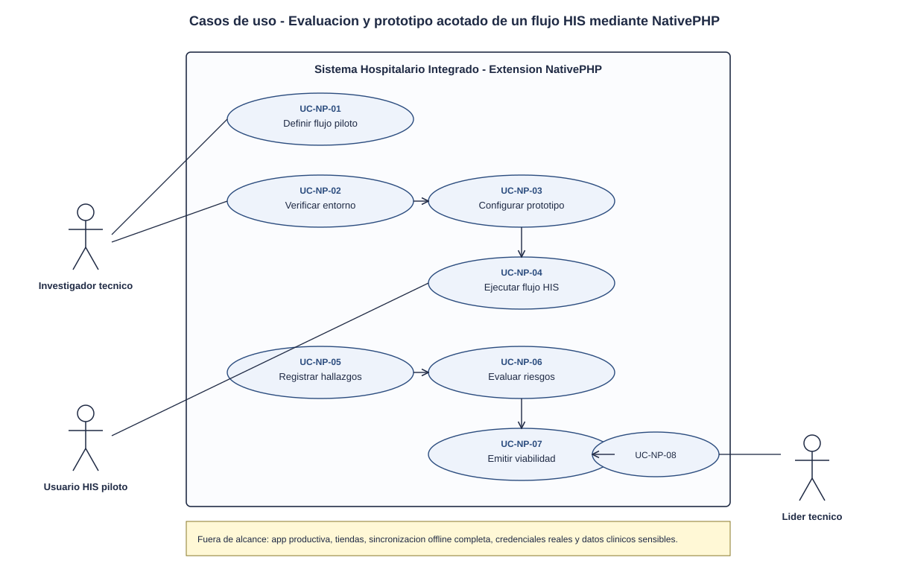
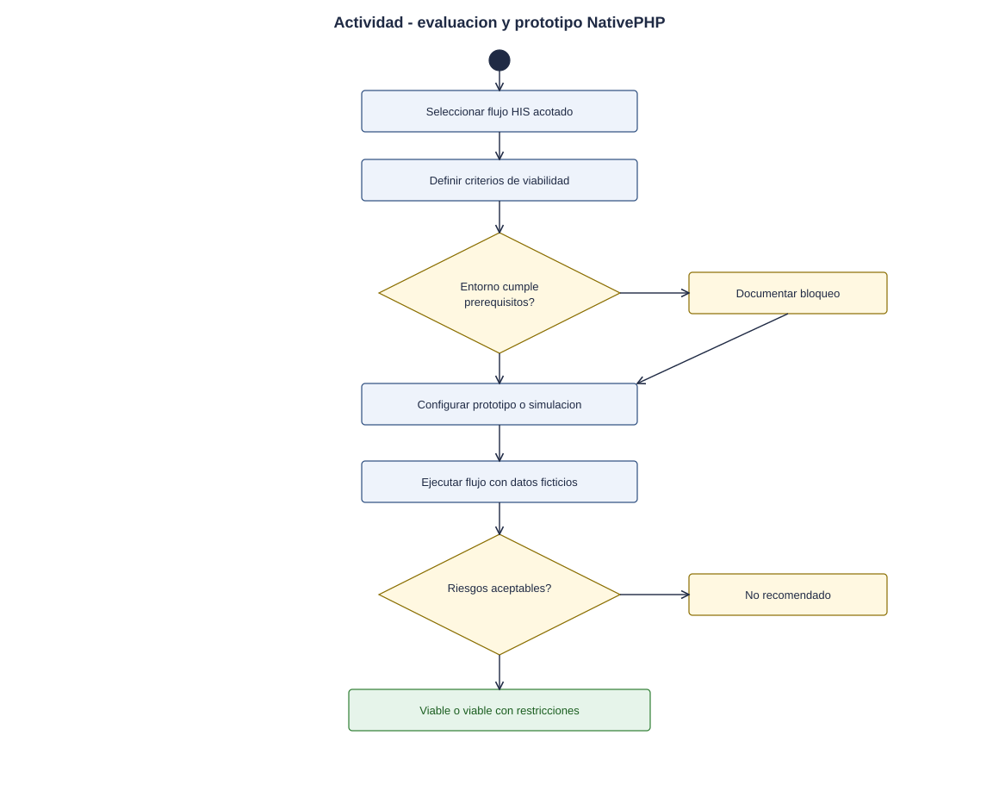
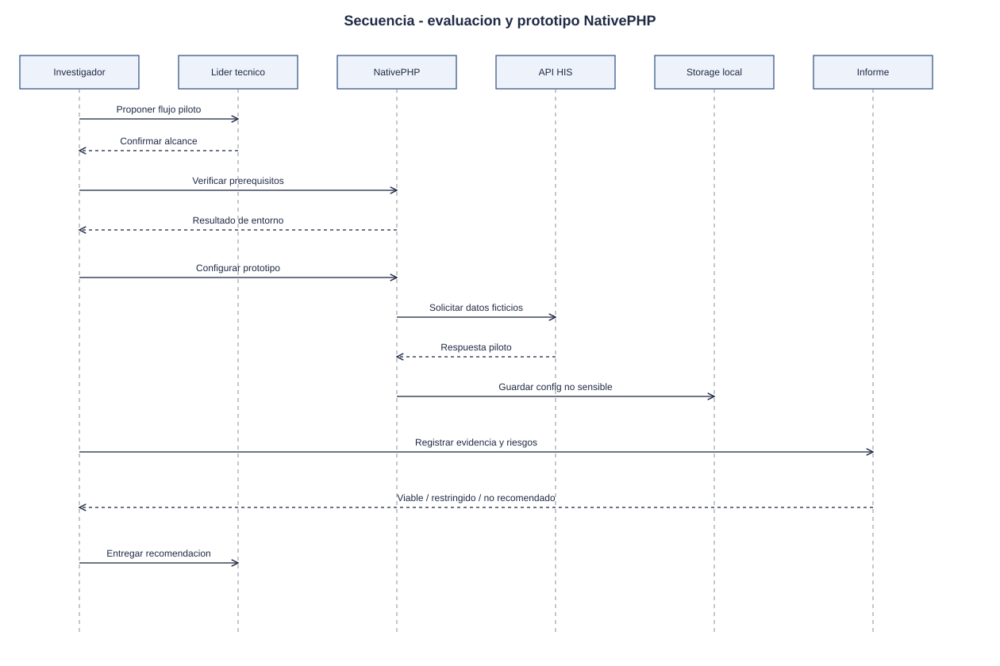

# Investigacion y prototipo NativePHP - Semana 1

## Ficha de la asignacion

- **Estudiante:** Orellana Veliz, Gerson Giovanni (`gioore`)
- **Email:** gorellanav1@miumg.edu.gt
- **Modulo:** Investigacion y prototipo NativePHP para extension movil/escritorio
- **Semana:** Semana 1 - Conceptos generales, orientacion a objetos y UML
- **Tarea individual:** Modele el proceso "evaluacion y prototipo acotado de un flujo HIS mediante NativePHP". Casos de uso: delimitar actores y objetivo; el de actividad debe incluir decisiones, excepciones y resultado; el de secuencia debe mostrar participantes, mensajes, validaciones y respuesta. Mantenga trazabilidad entre los tres diagramas.
- **Entregable / evidencia:** UML de casos de uso y narrativa de alcance.
- **Estructura:** Sistema Hospitalario Integrado 2026 | Semanas 1-15.

---

## Contexto arquitectonico

- **Backend base:** Laravel 12 (PHP 8.2+) con arquitectura HIS y API bajo `/api/v1`.
- **Extension propuesta:** NativePHP como contenedor de escritorio/movil para reutilizar conocimiento Laravel y evaluar una experiencia instalada.
- **Alcance inicial:** seleccionar un flujo HIS pequeño, demostrar navegacion, autenticacion simulada o controlada, consumo de datos de prueba y decision de viabilidad.
- **Seguridad:** no almacenar credenciales reales ni datos clinicos sensibles en el prototipo. Cualquier cache local debe ser justificada y limitada.
- **Resultado esperado:** evidencia tecnica para decidir si NativePHP conviene como extension complementaria, no reemplazo del HIS web.

## 1. Diagrama de casos de uso

[Abrir el diagrama de casos de uso en SVG](./01-casos-de-uso.svg)

### Descripcion

El diagrama delimita el objetivo del modulo: evaluar si NativePHP puede servir como extension de escritorio/movil para un flujo hospitalario acotado, documentando restricciones, riesgos y criterios de decision.

- **Actores principales:**
  - *Investigador tecnico:* instala, configura y evalua NativePHP.
  - *Usuario HIS piloto:* prueba el flujo acotado y aporta retroalimentacion.
  - *Lider tecnico:* revisa evidencia y decide continuidad.
- **Actores secundarios:** *API HIS*, *servicio de autenticacion* y *almacenamiento local del prototipo*.
- **Casos incluidos:** definir flujo piloto, configurar prototipo, ejecutar flujo, registrar hallazgos, evaluar seguridad/rendimiento y emitir decision de viabilidad.

## 2. Diagrama de actividades

[Abrir el diagrama de actividades en SVG](./02-actividad.svg)

### Descripcion

El flujo inicia con la seleccion de un caso HIS pequeno. Luego se revisan prerrequisitos de NativePHP, se construye o simula el prototipo, se ejecuta una prueba controlada y se registra evidencia. El resultado final puede ser viable, viable con restricciones o no recomendado.

## 3. Diagrama de secuencia

[Abrir el diagrama de secuencia en SVG](./03-secuencia.svg)

### Descripcion

El diagrama muestra la interaccion entre investigador, aplicacion NativePHP, API HIS, almacenamiento local y lider tecnico. Incluye validaciones de entorno, carga del flujo piloto, registro de hallazgos y emision del informe de viabilidad.

## 4. Narrativa de alcance y trazabilidad

La narrativa completa, con la tabla de trazabilidad UC - actividad - secuencia, esta en [narrativa-alcance-trazabilidad.md](./narrativa-alcance-trazabilidad.md).

## Fuentes editables

- Casos de uso: el SVG es editable en draw.io, Inkscape o un editor de texto.
- Actividad y secuencia: [`fuentes/02-actividad.mmd`](./fuentes/02-actividad.mmd) y [`fuentes/03-secuencia.mmd`](./fuentes/03-secuencia.mmd) (Mermaid; GitHub los renderiza y se pueden editar en mermaid.live).

## Declaracion de uso de IA

Se uso Codex/OpenAI para estructurar la evidencia, redactar el primer borrador y generar diagramas a partir del enunciado de Odoo y del repositorio del proyecto. El estudiante debe revisar nombres, reglas de negocio, trazabilidad y alcance antes de marcar la tarea como terminada en Odoo.
