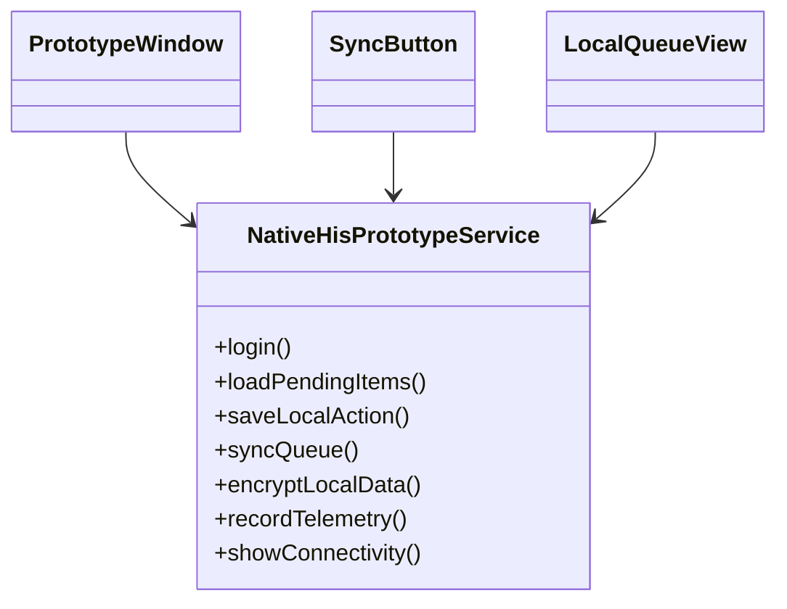
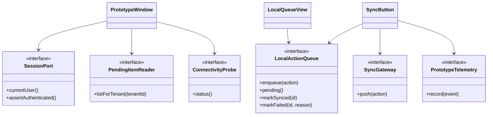

# Aplicacion de ISP - NativePHP

## Principio aplicado

ISP indica que ningun cliente debe depender de metodos que no usa. En un prototipo NativePHP para HIS, el riesgo principal es crear un servicio unico que mezcle autenticacion, consulta, almacenamiento local, sincronizacion, telemetria y seguridad. Eso complica la prueba del prototipo y oculta la viabilidad real de cada parte.

Fuente academica indicada por el curso: `https://mvpcluster.com/diseno-de-software-2/`.

## Diseno antes de ISP

### Problemas detectados

- La ventana principal depende de sincronizacion y cifrado aunque solo consulte datos.
- El boton de sincronizacion depende de autenticacion y renderizado.
- Las pruebas necesitan dobles con metodos que cada cliente no usa.
- Cambiar almacenamiento local afecta clientes que solo leen estado.

## Diseno despues de ISP

## Responsabilidades propuestas

| Contrato | Responsabilidad | Consumidor principal |
| --- | --- | --- |
| `SessionPort` | Exponer sesion local sin filtrar credenciales. | Ventana principal |
| `PendingItemReader` | Consultar datos semilla o cache por tenant. | Vista principal |
| `LocalActionQueue` | Administrar cola local de acciones pendientes. | Vista de cola y boton sync |
| `SyncGateway` | Simular envio a un API HIS. | Boton de sincronizacion |
| `ConnectivityProbe` | Informar modo online/offline simulado. | Barra de estado |
| `PrototypeTelemetry` | Registrar hallazgos tecnicos y resultados. | Flujo de sincronizacion |

## Beneficio verificable

- La vista principal puede probarse sin simular sincronizacion.
- La cola local puede probarse sin autenticacion real.
- El gateway de sincronizacion puede fallar sin romper la consulta local.
- El prototipo permite medir viabilidad por pieza: UI, almacenamiento, sync y seguridad.
