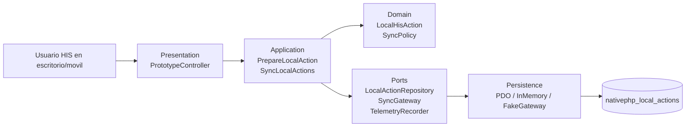
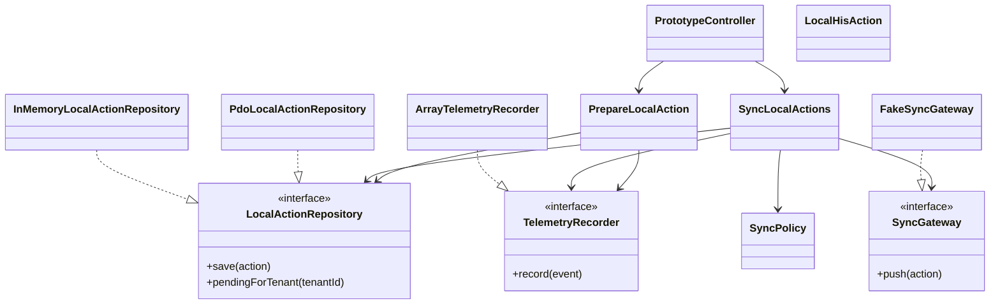

# Vista arquitectonica C4/UML

## Contexto

El micro-HIS evalua si una extension NativePHP podria preparar acciones HIS de forma local y sincronizarlas cuando exista conectividad. La implementacion se mantiene en PHP vanilla para mostrar las capas sin depender de NativePHP real en esta semana.

## Contenedores / capas

## Componentes

## Decisiones arquitectonicas

| Decision | Justificacion |
| --- | --- |
| PHP vanilla en `micro-his/` | Cumple la restriccion de no usar framework para esta semana. |
| Cola local como dominio | Representa el riesgo central de una extension offline/online. |
| `SyncPolicy` en Domain | Evita sincronizar cuando el prototipo esta offline. |
| Puertos para repositorio, gateway y telemetria | Permite evaluar almacenamiento, sync y observabilidad por separado. |
| PDO con `prepare/execute` | Evidencia persistencia segura si se conecta a almacenamiento local/SQL. |

## Trazabilidad hacia pruebas

| Requisito de la semana | Evidencia |
| --- | --- |
| Separar Presentation, Application, Domain y Persistence | Carpetas `src/Presentation`, `src/Application`, `src/Domain`, `src/Persistence`. |
| PDO con sentencias preparadas | `PdoLocalActionRepository::save` y `pendingForTenant`. |
| Camino feliz | `tests/run.php`, preparacion y sync online. |
| Regla de dominio | `tests/run.php`, intento de sync offline. |
| Error de persistencia | `tests/run.php`, repositorio anonimo que lanza excepcion. |
