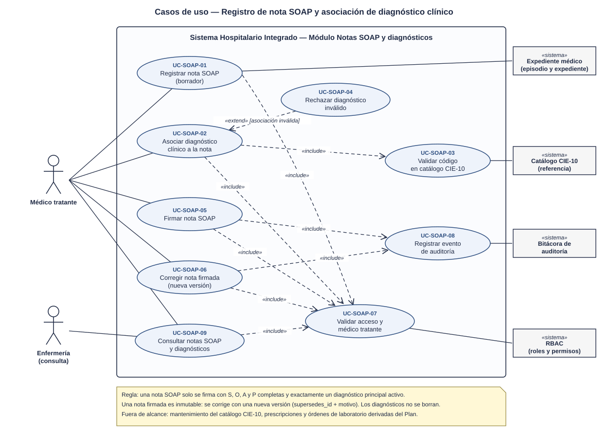
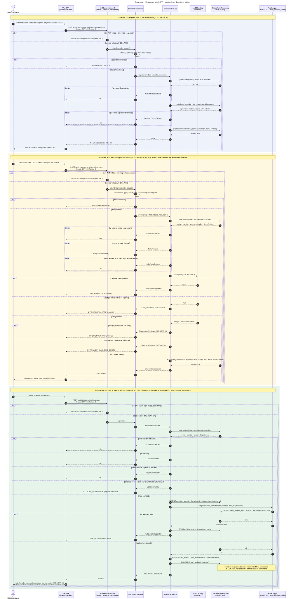

# Notas SOAP y diagnósticos — Semana 1

## Ficha de la asignación

- **Estudiante:** Hicho García, Josué Fernando (`Jhos-hgnu`)
- **Módulo:** ASII-11 — Notas SOAP y diagnósticos (módulo absorbido tras la reorganización del grupo a 9 integrantes)
- **Semana:** Semana 1 — Conceptos generales, orientación a objetos y UML
- **Tarea individual:** Modele el proceso «registro de nota SOAP y asociación de diagnóstico clínico». Casos de uso: delimitar actores y objetivo; el de actividad debe incluir decisiones, excepciones y resultado; el de secuencia debe mostrar participantes, mensajes, validaciones y respuesta. Mantenga trazabilidad entre los tres diagramas.
- **Entregable / evidencia:** UML de casos de uso y narrativa de alcance.
- **Estructura:** Sistema Hospitalario Integrado 2026 | Semanas 1–15.

---

## Contexto arquitectónico

- **Backend:** Laravel 12 (PHP 8.2+), JWT y RBAC por permisos (`notas_soap.crear`, `notas_soap.firmar`, `notas_soap.corregir`, `notas_soap.ver`, `diagnosticos.asociar`).
- **Base de datos HOSPITAL (PostgreSQL):** las tablas ya existen en la migración `2026_08_11_000400_create_medical_record_tables.php`:
  - `clinical_notes`: la nota SOAP se guarda con `note_type = 'soap'` y las cuatro secciones en `content`. Tiene estados `draft` / `signed`, es **inmutable una vez firmada** y se corrige con una nueva versión (`version_no`, `supersedes_id`, `correction_reason`).
  - `diagnoses`: `code`, `description`, `type` (`primary`, `secondary`, `differential`), `status` (`active`, `resolved`, `entered_in_error`) y `onset_date`. Se vincula a la nota con `clinical_note_id`.
  - Los triggers ya exigen que el autor sea **médico con asignación activa** en el episodio, que el diagnóstico tenga **el mismo episodio y autor que su nota** y que **no se borren** notas ni diagnósticos.
- **Multitenancy:** el hospital activo llega en `X-Tenant-ID`; la nota vive en la base de ese hospital.
- **Frontend:** Vue 3, Pinia y Axios (editor SOAP con buscador de diagnósticos CIE-10).
- **Endpoints preliminares** (se formalizan en la Semana 5):
  - `POST /api/v1/care-episodes/{episode}/soap-notes`
  - `GET /api/v1/care-episodes/{episode}/soap-notes`
  - `POST /api/v1/soap-notes/{note}/diagnoses`
  - `POST /api/v1/soap-notes/{note}/sign`
  - `POST /api/v1/soap-notes/{note}/corrections`

---

## 1. Diagrama de casos de uso

[Abrir el diagrama de casos de uso en SVG](./01-casos-de-uso.svg)

### Descripción

El objetivo es que **cada atención quede documentada en una nota SOAP firmada, con al menos un diagnóstico principal codificado y validado**, sin que la nota pueda alterarse después de la firma.

- **Actores principales:**
  - *Médico tratante:* registra la nota, asocia diagnósticos, firma, corrige y consulta.
  - *Enfermería:* solo consulta.
- **Actores secundarios (sistemas):** *Expediente médico* (episodio y expediente), *Catálogo CIE-10*, *Bitácora de auditoría* y *RBAC*.
- **UC-SOAP-01 (Registrar nota SOAP)** y **UC-SOAP-02 (Asociar diagnóstico)** incluyen `<<include>>` la validación de acceso y médico tratante (UC-SOAP-07).
- **UC-SOAP-02** incluye la validación del código en el catálogo CIE-10 (UC-SOAP-03). **UC-SOAP-04 (Rechazar diagnóstico inválido)** extiende `<<extend>>` a UC-SOAP-02 cuando el código no existe, ya está asociado a la nota o se intenta un segundo diagnóstico principal.
- **UC-SOAP-05 (Firmar)** y **UC-SOAP-06 (Corregir nota firmada)** incluyen la validación de acceso (UC-SOAP-07) y el registro de auditoría (UC-SOAP-08).
- **UC-SOAP-09 (Consultar)** incluye UC-SOAP-07 con el permiso `notas_soap.ver`.

## 2. Diagrama de actividades

[Abrir el diagrama de actividades en SVG](./02-actividad.svg)

### Descripción

Recorre el proceso en cuatro particiones, con sus decisiones, excepciones y resultados.

- **A · Registrar nota en borrador:** acceso (401/403), secciones válidas (422), médico asignado al episodio (403) y episodio y expediente abiertos (409). Resultado: nota `draft`, versión 1 (201).
- **B · Asociar diagnóstico:** acceso (401/403), datos válidos (422), nota existente y en borrador (404/409) y autor tratante (403). Si el catálogo CIE-10 no responde, **falla segura** (503). Rechazos de UC-SOAP-04: código inválido (422), duplicado (409) o segundo principal (409). Resultado: diagnóstico `active` (201).
- **C · Firmar:** acceso, nota en borrador, autor tratante y **completitud**: S, O, A y P con contenido y exactamente un diagnóstico principal activo (si no, `422 SOAP_INCOMPLETE` y la nota sigue en borrador). La firma y la auditoría van en la misma transacción: **si la auditoría falla, se revierte la firma** (500). Resultado: nota `signed`, inmutable (200).
- **D · Corregir una nota firmada:** solo la última versión firmada (409), con motivo obligatorio (422). Crea la versión n + 1 en borrador, que se completa con B y se firma con C.

## 3. Diagrama de secuencia

[Abrir el diagrama de secuencia en SVG](./03-secuencia.svg)

### Descripción

- **Participantes:** Vue (`SoapNoteEditor`), middlewares, `SoapNoteController`, `SoapNoteService`, `Icd10Catalog` «interfaz», `ClinicalNoteRepository` (HOSPITAL) y `AuditLogger`.
- **Dependencia como interfaz:** `Icd10Catalog` se modela como interfaz para que el servicio no dependa de cómo se cargue el catálogo (archivo de referencia, tabla o servicio externo). Esa decisión se desarrolla en la Semana 2 con el principio DIP.
- **Escenario A (registrar):** `alt` para 401/403 y 422; `break` para médico no tratante (403) y episodio o expediente cerrado (409); 201 con el `clinical_note_id`.
- **Escenario B (asociar diagnóstico):** `alt` para 401/403 y 422; `break` para 404, nota firmada (409) y autor no tratante (403); `alt` para catálogo no disponible (503), código inválido (422), duplicado (409), segundo principal (409) y asociación válida (201).
- **Escenario C (firmar):** `alt` para 404, 409, 403 y 422 `SOAP_INCOMPLETE`. La firma abre una transacción: si `AuditLogger` falla se hace `ROLLBACK` (500); si no, `COMMIT` y 200.

## 4. Narrativa de alcance y trazabilidad

La narrativa completa, con la tabla de trazabilidad UC ↔ actividad ↔ secuencia y los riesgos detectados en el esquema, está en [narrativa-alcance-trazabilidad.md](./narrativa-alcance-trazabilidad.md).

## Fuentes editables

- Casos de uso: el SVG es editable en draw.io o Inkscape.
- Actividad y secuencia: [`fuentes/02-actividad.mmd`](./fuentes/02-actividad.mmd) y [`fuentes/03-secuencia.mmd`](./fuentes/03-secuencia.mmd) (Mermaid; GitHub los renderiza y se pueden editar en mermaid.live).

## Declaración de uso de IA

Se usó Claude (Anthropic) para proponer la estructura de los diagramas, generar los SVG y redactar el primer borrador de este documento a partir del repositorio del proyecto (en particular, la migración de `clinical_notes` y `diagnoses`) y del enunciado de la tarea. El estudiante revisó los actores, las reglas clínicas (completitud SOAP, un diagnóstico principal, inmutabilidad tras la firma y falla segura) y la trazabilidad, y es responsable del contenido final.
