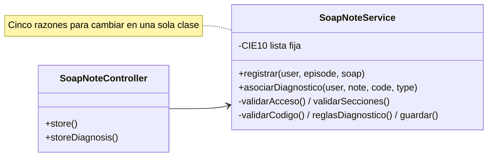
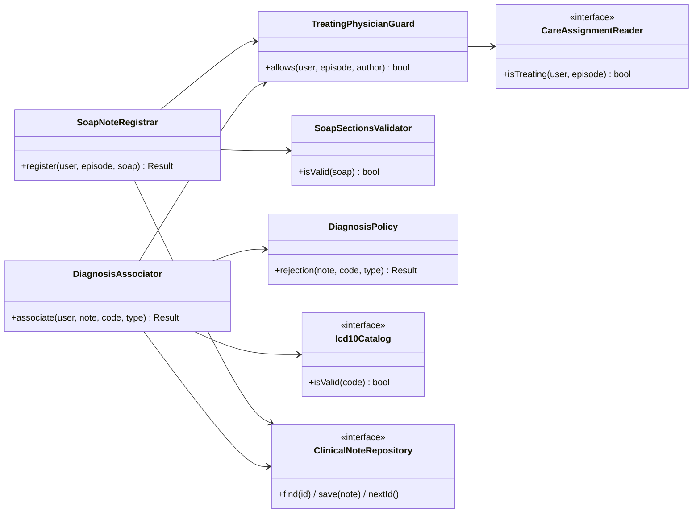

# Aplicación de SRP — Notas SOAP y diagnósticos

## Principio aplicado

> «Una clase debería tener una y sólo una razón para cambiar.» (Robert C. Martin, citado en Rodríguez González, L. M. *Principios básicos del diseño de software*. MVP Cluster. <https://mvpcluster.com/diseno-de-software-2/>)

La fuente lo ilustra con una clase `vendedor` que registra ofertas y cierra ventas: mezcla dos conceptos que cambian por motivos distintos. En este módulo pasa lo mismo con el flujo **A · Registrar nota** y **B · Asociar diagnóstico** de la Semana 1 (UC-SOAP-01 a UC-SOAP-04 y UC-SOAP-07).

## Diseño antes de SRP

**Razones de cambio mezcladas:** la regla de acceso (`care_assignment` y autor, la piden RBAC y Expediente), el formato de S, O, A y P y las reglas de diagnóstico (las pide el personal clínico), el origen del catálogo CIE-10 (lo decide el grupo) y la persistencia (Semanas 3 y 4). Todas obligan a editar `SoapNoteService`.

**Problemas:** cualquier cambio obliga a volver a probar todo el servicio; las reglas clínicas no se pueden probar sin base de datos ni catálogo; el catálogo fijo impide la falla segura (`503`) porque nunca "se cae".

## Diseño después de SRP

## Responsabilidades

| Clase | Única responsabilidad | Su única razón para cambiar |
|---|---|---|
| `SoapNoteRegistrar` | Orquestar UC-SOAP-01: autorizar, validar y guardar el borrador. | Cambia el flujo de registro |
| `DiagnosisAssociator` | Orquestar UC-SOAP-02: nota en borrador, autor, catálogo, reglas y guardado; `503` si el catálogo falla. | Cambia el flujo de asociación |
| `TreatingPhysicianGuard` | Decidir si el usuario es el autor y médico tratante del episodio. | Cambia la regla de acceso |
| `SoapSectionsValidator` | Validar el formato de S, O, A y P. | Cambia el formato de la nota |
| `DiagnosisPolicy` | Reglas clínicas: sin código repetido y un solo principal. | Cambia una regla clínica |
| `Icd10Catalog` «interfaz» | Decir si un código CIE-10 está vigente. | Cambia el origen del catálogo |
| `ClinicalNoteRepository` «interfaz» | Leer y guardar `clinical_notes` y `diagnoses` (HOSPITAL). | Cambia la persistencia |
| `CareAssignmentReader` «interfaz» | Leer `care_assignments` activos (módulo Expediente). | Cambia el origen de las asignaciones |

## Justificación de dependencias

- Los dos casos de uso dependen de **interfaces** para lo que pertenece a otros módulos o aún no se decide (catálogo, asignaciones, persistencia). Así el catálogo pasa de archivo a tabla sin tocar el caso de uso.
- `SoapNoteRegistrar` **no** depende del catálogo: registrar una nota no cambia cuando cambia el CIE-10.
- `DiagnosisPolicy` y `SoapSectionsValidator` no tienen dependencias: son reglas puras y se prueban sin base de datos.
- `TreatingPhysicianGuard` se comparte entre ambos casos de uso para que la regla de acceso viva en un solo lugar.
- La firma, la auditoría y el outbox (UC-SOAP-05 y 08) quedan en su propio `SoapNoteSigner`, fuera de este flujo.

## Beneficio verificable

La [demo ejecutable](./evidencia/demo-srp.php) comprueba que el diseño después responde igual que el antes en nueve casos, que la falla segura del catálogo solo requiere otra implementación de `Icd10Catalog` y que `DiagnosisPolicy` se prueba sola. La salida está en [evidencia-verificable.md](./evidencia-verificable.md).
