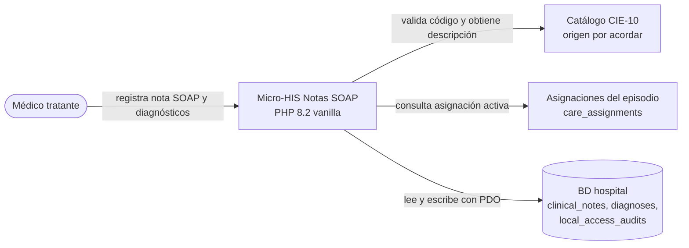
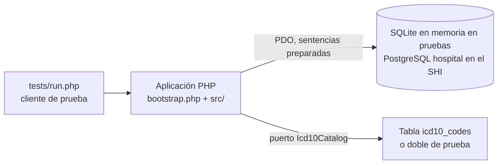
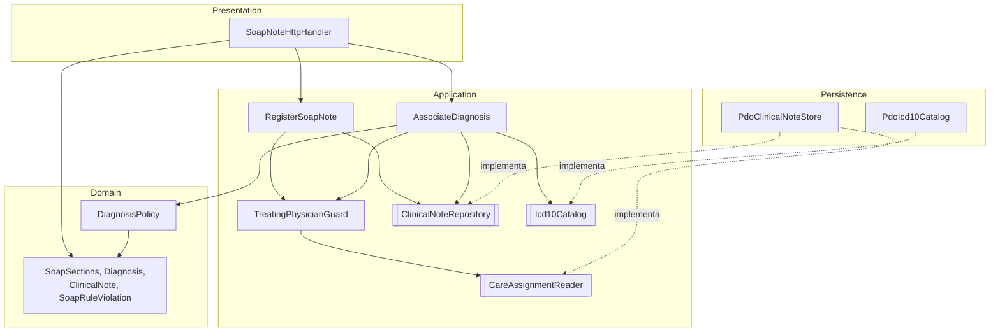
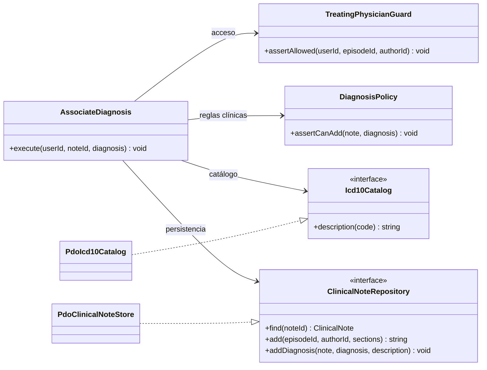

# Vista arquitectónica C4/UML — Micro-HIS Notas SOAP y diagnósticos

## Nivel 1: contexto

## Nivel 2: contenedores

En el prototipo el cliente es `tests/run.php`. En el SHI será la ruta HTTP con JWT y `X-Tenant-ID` (fuera de alcance esta semana).

## Nivel 3: componentes por capa

## UML de clases: una responsabilidad por clase (SRP de la Semana 2)

Cada razón de cambio de la Semana 2 tiene una sola clase: acceso (`TreatingPhysicianGuard`), formato (`SoapSections`), catálogo (`Icd10Catalog`), reglas clínicas (`DiagnosisPolicy`) y persistencia (`ClinicalNoteRepository`).

## Decisiones arquitectónicas

| Decisión | Justificación |
|---|---|
| Puertos en Application, adaptadores en Persistence | Inversión de dependencias: Application define lo que necesita y PDO queda en el borde. |
| `SoapSections` y `Diagnosis` como objetos de valor | Si se pueden construir, son válidos. Presentation no puede pasar secciones vacías ni tipos no permitidos al caso de uso. |
| `DiagnosisPolicy` sin dependencias | Las reglas de duplicado, principal único y nota firmada se prueban sin BD. |
| Falla segura del catálogo | `CatalogUnavailable` se traduce a `503 ICD10_UNAVAILABLE` antes de escribir: la nota queda igual (RF-SOAP-06). |
| Nota o diagnóstico y auditoría en una transacción | Si falla la auditoría no queda un registro clínico sin traza (rollback). |
