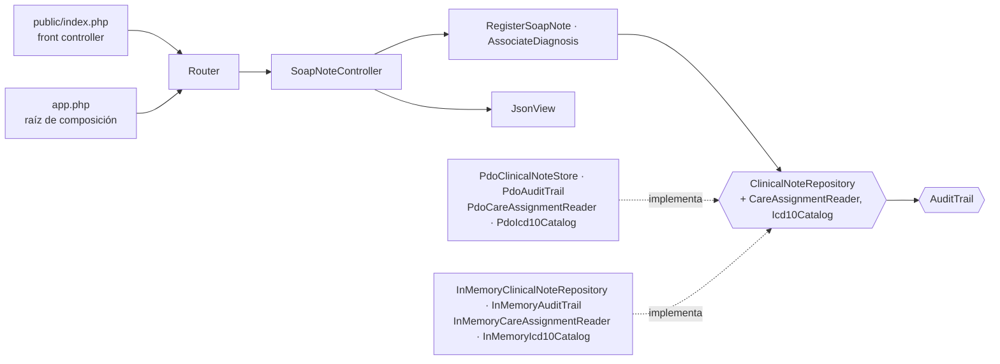

# Notas SOAP y diagnósticos — Semana 4

## Ficha de la asignación

- **Estudiante:** Hicho García, Josué Fernando (`Jhos-hgnu`)
- **Módulo:** ASII-11 — Notas SOAP y diagnósticos
- **Semana:** Semana 4 — Arquitectura en capas y patrón repositorio
- **Tarea individual:** Continúe el MISMO «Micro-HIS Notas SOAP y diagnósticos» y el flujo «registro de nota SOAP y asociación de diagnóstico clínico». Organice la entrada con MVC; defina una interfaz Repository en el límite apropiado y adaptadores PDO e InMemory. El controlador no tendrá SQL ni reglas de negocio. Además, analice y diagrame cómo un repositorio de datos compartido integraría este módulo.
- **Entregable / evidencia:** Capas, responsabilidades y objetos reutilizables. Código en [`micro-his/notas-soap/`](../../../micro-his/notas-soap/).

## Punto de partida

La Semana 3 dejó cuatro capas: `SoapNoteHttpHandler` como entrada y `PdoClinicalNoteStore` implementando `ClinicalNoteRepository` y `CareAssignmentReader`, con la auditoría escrita dentro del propio store. Esta semana se construye sobre las ramas `semana-03-...-core` (#128) y `semana-03-...-adapters-tests` (#129), que ya validan el tipo de cada campo de entrada (`422 PAYLOAD_INVALID`); ver [organización de la entrega](#organización-de-la-entrega).

## Qué cambió (implementado)



- **MVC:** `Router` elige la acción, `SoapNoteController` lee la `Request` (que rechaza con `422 PAYLOAD_INVALID` los campos que no son texto), llama al caso de uso (modelo) y entrega el resultado a `JsonView`. `SoapNoteHttpHandler` se reemplazó por el controlador.
- **Repository:** `ClinicalNoteRepository` (Application) es el contrato del agregado Nota. Lo implementan `PdoClinicalNoteStore` e `InMemoryClinicalNoteRepository`.
- **Auditoría por interfaz:** `AuditTrail` (Application) con `PdoAuditTrail` e `InMemoryAuditTrail`. El repositorio la invoca dentro de su escritura, así nota y auditoría siguen siendo todo o nada.
- **Lectura de asignaciones:** sale del store a `PdoCareAssignmentReader`, porque `care_assignments` es de otro módulo.
- **Composición:** `app.php` arma el mismo MVC con cualquiera de los dos juegos de adaptadores.

## Archivos de esta entrega

- [Capas, responsabilidades y contrato del Repository](./capas-y-repository.md)
- [Repositorio de datos compartido](./repositorio-compartido.md)
- [Declaración de uso de IA](./DECLARACION_IA.md)

## Cómo verificar

```bash
php micro-his/notas-soap/tests/run.php
php -S 127.0.0.1:8011 -t micro-his/notas-soap/public
```

`run.php` ejecuta la misma suite contra los dos adaptadores (prefijos `[pdo]` y `[memoria]`). Resultado con PHP 8.3.33 (código de salida 0), resumido a las líneas de un adaptador porque el otro repite los mismos 15 casos:

```text
OK: [pdo] camino feliz: POST /care-episodes/ep1/soap-notes -> 201 JSON en borrador, id UUID y auditoría
OK: [pdo] camino feliz: diagnóstico principal J18.9 -> 201 con descripción del catálogo
OK: [pdo] regla de dominio: sección vacía -> 422
OK: [pdo] regla de dominio: asignación terminada -> 403
OK: [pdo] regla de dominio: código repetido -> 409
OK: [pdo] regla de dominio: segundo principal -> 409
OK: [pdo] regla de dominio: código inactivo en el catálogo -> 422
OK: [pdo] regla de dominio: nota inexistente -> 404
OK: [pdo] validación: tipo de diagnóstico no permitido -> 422
OK: [pdo] validación de tipos: sección no string o encabezado no string -> 422 sin guardar
OK: [pdo] validación de tipos: código o tipo de diagnóstico no string -> 422 sin guardar
OK: [pdo] regla de dominio: nota firmada no acepta diagnósticos -> 409
OK: [pdo] ruta desconocida -> 404 ROUTE_NOT_FOUND
OK: [pdo] catálogo caído -> 503 y la nota queda sin diagnósticos
OK: [pdo] error de persistencia: auditoría caída -> 500 y sin nota a medias
(los mismos 15 casos con [memoria])
OK: regla de dominio pura (sin BD): la política rechaza un segundo principal
OK: MVC: el controlador solo recibe casos de uso y la vista, sin SQL ni PDO
Todas las pruebas pasaron.
```

Prueba manual del front controller con los adaptadores InMemory (sin `NOTAS_SOAP_DSN`):

```text
POST /care-episodes/ep1/soap-notes (X-User-ID: dra.lopez) -> 201 {"clinical_note_id":"<UUID v4>","status":"draft"}
POST con cuerpo '{mal'                                     -> 422 {"code":"PAYLOAD_INVALID"}
GET /x                                                      -> 404 {"code":"ROUTE_NOT_FOUND"}
```

El estado InMemory se reinicia en cada petición. Con `NOTAS_SOAP_DSN` el front controller usa los adaptadores PDO.

## Supuestos y límites

- **SD-SOAP-08:** autenticación, RBAC y tenant siguen fuera del micro-HIS; `X-User-ID` identifica al actor. El contrato que los agrega está en #374.
- **SD-SOAP-09:** firma y corrección (UC-SOAP-05 y 06) siguen sin implementar; las pruebas marcan la nota como firmada directamente en el adaptador.

## Organización de la entrega

Para respetar el límite de 400 líneas por PR, la semana se entrega en tres ramas con archivos que no se solapan:

| Rama | Contenido | Base | Orden de integración |
|---|---|---|---|
| `feature/asii-11-semana-04-notas-soap-repository-jhos-hgnu` (#376) | `AuditTrail`, adaptadores PDO e InMemory | `develop` + #128 + #129 | 1 |
| `feature/asii-11-semana-04-notas-soap-mvc-tests-jhos-hgnu` (#378) | `Router`, `SoapNoteController`, `Request`, `JsonView`, `app.php`, `public/index.php` y `tests/run.php` | rama 1 | 2 |
| `feature/asii-11-semana-04-notas-soap-docs-jhos-hgnu` | Esta documentación | `develop` | 3 |

#376 y #378 quedan en borrador hasta que entren #128 y #129, porque antes mostrarían también sus líneas. Después de cada merge se actualiza la rama con `origin/develop`, sin force push.
