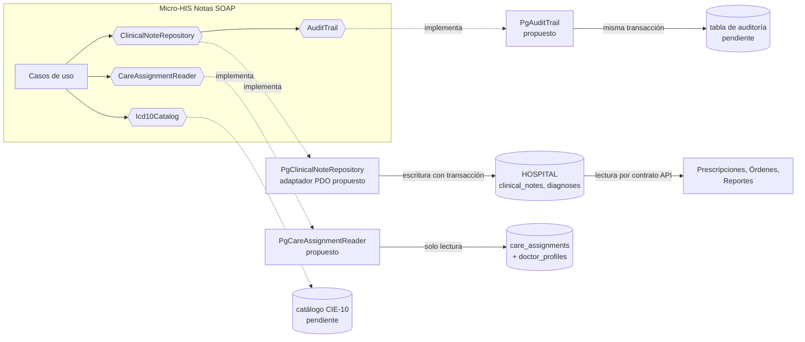

# Repositorio de datos compartido

## Situación actual

Las tablas del módulo ya viven en la base **HOSPITAL** que comparten los módulos clínicos: `clinical_notes` y `diagnoses` (`database/migrations/hospital/2026_08_11_000400_create_medical_record_tables.php`, líneas 21 y 32). Sus triggers dependen de datos de otros módulos:

| Dependencia | Cómo la usa Notas SOAP | Evidencia |
|---|---|---|
| Expediente (`medical_records`) | La nota exige un expediente del mismo paciente que el episodio. | migración `000400`, líneas 13 y 42 |
| Episodios / Admisión (`care_assignments`) | El autor debe tener asignación activa en el episodio (`clinical_notes_author_assignment_trigger`). | migración `000200`, línea 32; `000400`, línea 43 |
| Médicos (`doctor_profiles`) | La asignación se resuelve por `doctor_profile_id` del autor. | migración `000400`, líneas 43 y 56 |
| Usuarios (`local_user_refs`) | `author_user_ref_id` apunta a la referencia local del usuario. | migración `000400`, línea 23 |

## Integración propuesta

- El módulo no cambia: se agregan adaptadores nuevos de los mismos puertos. Controlador, casos de uso y dominio quedan igual, y el contrato se valida con la misma suite de `run.php`.
- **Escritura:** solo Notas SOAP escribe `clinical_notes` y `diagnoses`. Los demás módulos las consultan por el [contrato API](../semana-05/contrato-api.md), no por SQL.
- **Lectura de asignaciones:** `PgCareAssignmentReader` solo lee si hay asignación activa; nunca escribe en `care_assignments`.

## Correspondencia de datos

| Micro-HIS (`schema.sql`) | HOSPITAL (migración `000400`) | Diferencia que absorbe el adaptador |
|---|---|---|
| ids UUID v4 en `TEXT` | `uuid` con `gen_random_uuid()` | Mismo formato (R-01 de la revisión de BD); el adaptador PostgreSQL puede enviar el id o dejar que la base lo genere y leerlo con `RETURNING`. |
| `clinical_notes` sin `medical_record_id` | `medical_record_id uuid NOT NULL` | El adaptador deriva el expediente del paciente del episodio. |
| `care_assignments (care_episode_id, user_ref_id, status)` | Se relaciona por `doctor_profile_id`, con vigencia | `PgCareAssignmentReader` hace el join con `doctor_profiles` y filtra `valid_to IS NULL`. |
| Reglas en `TreatingPhysicianGuard` y `DiagnosisPolicy`; el doble SQLite replica nota firmada inmutable, coherencia nota-diagnóstico, sin borrados y fechas ISO | Además triggers de asignación del autor y FK a `medical_records` y `care_episodes` | Doble defensa: el adaptador traduce `RAISE EXCEPTION` (SQLSTATE `P0001`) a `403` o `409`; esas reglas se prueban contra PostgreSQL 16 (R-04, R-05). |
| `icd10_codes (code, description, active)` | **No existe** en las migraciones de `develop` | Ver SD-SOAP-10. |
| `local_access_audits` con las columnas del Anexo A de la Semana 1 | **No existe** en las migraciones hospital (entidad `local_access_audit`, slice H8) | Provisional; ver SD-SOAP-11. |

## Propiedad, consistencia y riesgos

| Tema | Decisión |
|---|---|
| Propiedad | Notas SOAP es dueño de `clinical_notes`, `diagnoses` y del significado de borrador, firma y diagnóstico principal. |
| Consistencia | Fuerte: nota, diagnóstico y auditoría en la misma base y la misma transacción. |
| Riesgo de acoplamiento | Los triggers leen columnas de Médicos y Episodios (`status`, `valid_from`, `valid_to`); renombrarlas rompe el registro de notas. |
| Borrado | Triggers `*_retention` impiden borrar: un error se corrige con una versión nueva o `entered_in_error`. |

- **SD-SOAP-10:** el catálogo CIE-10 no tiene tabla. Se pide a Javier (base de datos) `icd10_codes` o se acuerda un servicio externo; mientras tanto se usa detrás de `Icd10Catalog`.
- **SD-SOAP-11:** la tabla de auditoría local no existe. El doble sigue el Anexo A de la Semana 1 y es provisional hasta la migración del slice H8 (R-02); se pide a Javier junto con Médicos (ASII-04). El módulo la usa solo por `AuditTrail`.
- **SD-SOAP-13:** `clinical_notes_record_version_unique (medical_record_id, version_no)` no se replica: impediría una segunda nota original por expediente (riesgo R1 de la Semana 1). Se escala a Javier.
- **SD-SOAP-12:** la traducción de `P0001` a `403`/`409` es propuesta; el prototipo usa SQLite y no la ejercita.
