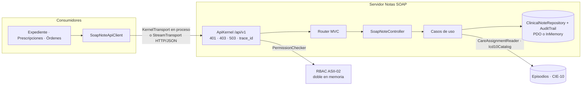

# Notas SOAP y diagnósticos — Semana 5

## Ficha de la asignación

- **Estudiante:** Hicho García, Josué Fernando (`Jhos-hgnu`)
- **Módulo:** ASII-11 — Notas SOAP y diagnósticos
- **Semana:** Semana 5 — Cliente-servidor, API REST, microservicios e integración
- **Tarea individual:** Evolucione el MISMO «Micro-HIS Notas SOAP y diagnósticos» y el flujo «registro de nota SOAP y asociación de diagnóstico clínico» hacia un diseño cliente-servidor y evalúe una frontera de microservicio. Especifique contrato API, propiedad de datos, comunicación, seguridad, resiliencia, observabilidad y consistencia; incluya diagramas y una migración razonada. Puede entregar diseño/prototipo: no construya infraestructura de producción ni divida el sistema sin una justificación medible.
- **Entregable / evidencia:** contrato API publicado antes del código (plan de integración del 17 al 23 de octubre), OpenAPI, prototipo cliente-servidor sobre el micro-HIS de la [Semana 4](../semana-04/README.md) y evaluación de la frontera. Código en [`micro-his/notas-soap/`](../../../micro-his/notas-soap/) (#404 servidor, #405 cliente).

## Vista cliente-servidor



Se agrega una capa de servidor delante del `Router` y un cliente para los consumidores, sin tocar el dominio. El único caso de uso nuevo es la lectura `GetSoapNote`.

## Archivos

- [Contrato API v1](./contrato-api.md): endpoints, campos, permisos `modulo.accion`, errores, propiedad de datos y consistencia.
- [OpenAPI 3.0](./openapi.yaml) de los endpoints implementados.
- [Frontera de microservicio](./frontera-microservicio.md): criterios medibles, decisión, migración razonada, comunicación, resiliencia, observabilidad y consistencia.
- [Declaración de uso de IA](./DECLARACION_IA.md)

## Cómo verificar

```bash
php micro-his/notas-soap/tests/api.php      # 19 casos: servidor, cliente y resiliencia
php micro-his/notas-soap/tests/run.php      # 34 casos de la Semana 4 contra PDO e InMemory
npx @apidevtools/swagger-cli@4.0.4 validate docs/notas-soap/semana-05/openapi.yaml
```

Resultado con PHP 8.3.33: las dos suites terminan con código 0 y `openapi.yaml is valid`. Prueba del cliente `StreamTransport` contra `php -S` con `NOTAS_SOAP_DSN` sobre SQLite:

```text
registerNote -> 166eb7c9-541e-4d2e-9bbf-22fadb5a6446
associateDiagnosis J18.9 primary -> ok
note (enf.ruiz) -> {"status":"draft","plan":"Amoxicilina","diagnoses":[{"code":"J18.9","type":"primary"}]}
registerNote (enf.ruiz) -> SoapNoteApiError 403 FORBIDDEN
```

En las dos escrituras, el `correlation_id` de `local_access_audits` es el `trace_id` de la bitácora de acceso.

## Revisión de base de datos (#376, Javier)

| Hallazgo | Estado |
|---|---|
| R-01 ids de 32 bits | Corregido: UUID v4 en los dos adaptadores. |
| R-02 diseño de `local_access_audits` | Corregido: el doble sigue el Anexo A de la Semana 1; provisional hasta la migración del slice H8. |
| R-03 `icd10_codes` fuera de las 27 entidades | Registrada por Javier como candidata; sigue detrás de `Icd10Catalog`. |
| R-04/R-05 reglas del esquema | El doble replica nota firmada inmutable, coherencia nota-diagnóstico, sin borrados y fechas ISO. Las FK a `medical_records` y a `care_episodes` quedan para el adaptador PostgreSQL 16. |
| R-06 unicidad de versión por expediente | No se replica: impediría una segunda nota por expediente (riesgo R1 de la Semana 1). Se escala a Javier. |

## Pendientes de integración

| Con quién | Qué |
|---|---|
| María (ASII-02, RBAC) | Alta de `notas_soap.crear`, `notas_soap.asociar_diagnostico`, `notas_soap.ver`, `notas_soap.firmar` y `notas_soap.corregir`, con la matriz propuesta |
| Javier (base de datos) | Migración de `local_access_audits` (slice H8), decisión sobre `icd10_codes` y sobre `clinical_notes_record_version_unique` |
| Episodios / Admisión | Lectura de `care_assignments` activas por `doctor_profile_id` |
