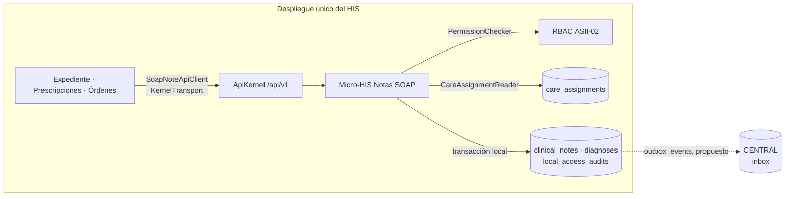

# Frontera de microservicio — Notas SOAP

## Pregunta

¿Conviene sacar Notas SOAP del HIS como un microservicio con su propia base, o mantenerlo como módulo con contrato API dentro del mismo despliegue?

## Criterios medibles

| Criterio | Situación actual (migración `000400`) | ¿Favorece separar? |
|---|---|---|
| Acoplamiento de datos | `clinical_notes` tiene FK a `medical_records`, `care_episodes` y `local_user_refs`; sus triggers leen `doctor_profiles` y `care_assignments` en cada INSERT. | **No.** Con base propia se pierden 3 FK y 2 triggers de integridad, y cada escritura validaría la asignación por red. |
| Consistencia exigida | Nota, diagnóstico y auditoría van en una transacción; la firma no puede quedar sin traza (Semana 1, flujo C). | **No.** Separar obliga a un saga u outbox para algo que hoy resuelve un `COMMIT`. |
| Escala independiente | Una nota por consulta; decenas por médico al día. No hay una carga medida. | **No.** |
| Equipo dueño | Un integrante; el HIS se despliega junto. | **No.** Suma operación sin quien la sostenga. |
| Seguridad y privacidad | Dato clínico sensible: menos saltos de red y menos copias reducen la superficie. | **No.** |
| Aislamiento de fallas | Si el HIS cae, nadie registra notas en ningún caso. | Neutro. |

## Decisión

**Notas SOAP sigue como módulo del HIS** (monolito modular), con una frontera lógica clara:

1. Solo este módulo escribe `clinical_notes` y `diagnoses`. Los demás leen por el [contrato API v1](./contrato-api.md) o por `SoapNoteApiClient`, nunca por SQL.
2. Lee los datos ajenos solo por puertos: `CareAssignmentReader` (Episodios), `Icd10Catalog` (catálogo) y `PermissionChecker` (RBAC).
3. `SoapNoteApiClient` funciona igual en proceso (`KernelTransport`) que por red (`StreamTransport`): si algún día se separa, los consumidores cambian el transporte, no su código.

Se reevalúa si se mide alguno de estos disparadores (umbrales propuestos, pendientes de validar con el grupo): más de 20 escrituras por segundo sostenidas en un hospital, un segundo equipo dueño del módulo, o una red de hospitales que comparta un expediente central.

## Migración razonada (si se activa un disparador)

| Paso | Qué cambia | Por qué en este orden |
|---|---|---|
| 1. Contrato y cliente (hecho) | API v1, OpenAPI y `SoapNoteApiClient` en proceso. | Fija la frontera sin mover datos. |
| 2. Consumidores solo por API | Expediente y Prescripciones dejan cualquier SQL directo sobre notas. | Hasta que nadie lea las tablas, separar la base rompería a otros. |
| 3. Eventos por outbox | La firma escribe `outbox_events` en la misma transacción (Anexo A, slice H8); los consumidores reaccionan a `nota_soap.firmada`. | Quita dependencias síncronas antes del corte. |
| 4. Base y proceso propios | `StreamTransport`, `CareAssignmentReader` por HTTP y triggers de autor reemplazados por esa validación. | Es el paso caro y se hace al final, con el resto ya desacoplado. |

## Comunicación, resiliencia, observabilidad y consistencia

| Tema | Diseño |
|---|---|
| Comunicación | HTTP/JSON síncrono con `/api/v1`; eventos asíncronos solo para notificar a CENTRAL (outbox, propuesto). |
| Seguridad | `401` sin actor; `403 FORBIDDEN` sin permiso RBAC; `403 NOT_TREATING_PHYSICIAN` sin asignación activa; falla cerrada si RBAC cae (`503`). |
| Resiliencia | Timeout de 2 s en `StreamTransport`; un solo reintento y solo en `GET`; los `POST` nunca se reintentan para no duplicar notas. Catálogo caído: `503 ICD10_UNAVAILABLE` sin guardar. |
| Observabilidad | `trace_id` UUID en cuerpo y `X-Trace-Id`, guardado como `correlation_id` en la auditoría; bitácora de acceso por petición sin cuerpo clínico. |
| Consistencia | Fuerte dentro del hospital (una transacción); eventual hacia CENTRAL vía outbox, sin transacciones entre bases. |
