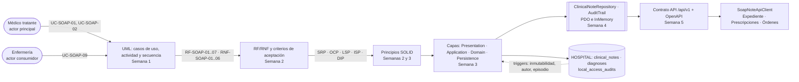

# Notas SOAP y diagnósticos — Semana 6: primera evaluación parcial

## Ficha de la asignación

- **Estudiante:** Hicho García, Josué Fernando (`Jhos-hgnu`)
- **Módulo:** ASII-11 — Notas SOAP y diagnósticos
- **Semana:** Semana 6 — Primera evaluación parcial
- **Tarea individual:** Defienda la arquitectura propuesta para «registro de nota SOAP y asociación de diagnóstico clínico» en Notas SOAP y diagnósticos: conecte actores, UML, RF/RNF, principio SOLID, capas, Repository y contrato API. Responda un cambio práctico considerando notas SOAP, diagnósticos, autoría clínica, versionado y expediente.
- **Entregable / evidencia:** defensa teórica de la arquitectura de las Semanas 1 a 5, con evidencia verificable, y respuesta a un cambio práctico con impacto por capa.
- **Issue:** Refs #22
- **Alcance de la semana:** evaluación y defensa. **No se implementa código**: la propuesta del caso práctico es el insumo de la Semana 7 (componentes y refactorización).

## Tesis arquitectónica

En el flujo «registro de nota SOAP y asociación de diagnóstico clínico» **la nota SOAP no es un formulario: es un documento clínico con autoría, versión y firma**. De esa idea salen las tres garantías que defiendo en esta evaluación:

1. **Autoría y acceso en dos niveles.** El permiso RBAC de la ruta (`modulo.accion`) autoriza *la acción*; la regla clínica de médico tratante (`care_assignment` activa en el episodio) autoriza *el episodio*. Tener el permiso no basta: un médico con `notas_soap.crear` que no atiende ese episodio recibe `403 NOT_TREATING_PHYSICIAN`. Y si RBAC no responde, la ruta falla cerrada (`503 AUTHORIZATION_UNAVAILABLE`) sin tocar la base.
2. **Todo o nada.** Nota, diagnóstico y su traza de auditoría se escriben en **una sola transacción** de la conexión `hospital`. Si la auditoría falla, no queda una nota sin traza: `ROLLBACK` y `500 SOAP_PERSISTENCE_ERROR`.
3. **Una nota firmada es inmutable.** El cambio posterior no edita: crea una **versión nueva** (`supersedes_id` + `correction_reason`, `version_no = n + 1`) que vuelve a borrador y se firma aparte. La inmutabilidad la garantiza el trigger `clinical_notes_signed_immutable` de la migración `000400`, no el código de aplicación.

De la tercera se sigue la tesis que el caso práctico pone a prueba: **la autoría clínica no es un campo de la nota, es una cadena**, igual que la versión es una cadena. Hoy el modelo solo conoce el primer eslabón (un `author_user_ref_id`); el caso muestra qué hay que cambiar, en qué capa y qué se le pide a la base de datos para que el segundo eslabón exista sin perder evidencia.

## Trazabilidad: del actor al contrato



| Elemento | Dónde vive | Evidencia verificable |
|---|---|---|
| Actores | `docs/notas-soap/semana-01/` | Diagrama de casos de uso: médico tratante (principal), enfermería (consulta) y sistemas (Expediente, CIE-10, bitácora, RBAC) |
| UML | `docs/notas-soap/semana-01/` | Casos de uso, actividad (decisiones y excepciones) y secuencia (participantes, mensajes, validaciones y respuesta), con tabla de trazabilidad UC ↔ actividad ↔ secuencia |
| RF/RNF | `docs/notas-soap/semana-02/rf-rnf-criterios.md` | RF-SOAP-01..07 con criterio de aceptación y RNF-SOAP-01..06 medibles, más escenarios en Gherkin |
| SOLID | `docs/notas-soap/semana-02/solid-srp.md` y `docs/notas-soap/semana-03/arquitectura-c4.md` | Demo `evidencia/demo-srp.php` (cambiar el origen del catálogo no toca otras clases) y diagrama de clases por responsabilidad |
| Capas | `docs/notas-soap/semana-03/arquitectura-c4.md` y `docs/notas-soap/semana-04/capas-y-repository.md` | C4 de tres niveles y tabla de responsabilidades (qué hace y qué no hace cada capa) |
| Repository | `docs/notas-soap/semana-04/capas-y-repository.md` | Contrato del puerto `ClinicalNoteRepository` con la garantía de cada adaptador; misma batería de 34 verificaciones contra PDO e InMemory |
| Contrato API | `docs/notas-soap/semana-05/contrato-api.md` y `openapi.yaml` | Endpoints, permisos, códigos de error, `trace_id`, propiedad de datos y consistencia; OpenAPI validado |
| Implementación | `micro-his/notas-soap/` | PR #404 (servidor `ApiKernel`), #405 (cliente `SoapNoteApiClient`) |

> Las entregas de las Semanas 2 a 5 y el código del micro-HIS viven en sus propios PRs (#65, #130, #128, #129, #379, #376, #378, #374, #404 y #405). Esta rama solo añade la evaluación de la Semana 6; los enlaces por ruta resuelven cuando esa cadena esté integrada en `develop`.

## Qué aportó cada semana

| Semana | Qué aportó | Evidencia |
|---|---|---|
| 1 | Actores, UC-SOAP-01..09, actividad y secuencia sobre la migración HOSPITAL `000400`; narrativa de alcance y riesgos R1–R4 | `docs/notas-soap/semana-01/` (PR #8, integrado en `develop`) |
| 2 | RF/RNF con criterios de aceptación y la primera regla SOLID (SRP) con demo ejecutable | `docs/notas-soap/semana-02/` (PR #65) |
| 3 | Vista C4/UML en tres niveles, mapa de dependencias y micro-HIS por capas con PDO y falla segura | `docs/notas-soap/semana-03/` (PR #130), código en PR #128 y #129 |
| 4 | MVC (Router, controlador, vista JSON), Repository con adaptadores PDO e InMemory y auditoría por interfaz | `docs/notas-soap/semana-04/` (PR #379), código en PR #376 y #378 |
| 5 | Contrato API v1 publicado antes del código, OpenAPI, frontera de microservicio con criterios medibles, servidor y cliente | `docs/notas-soap/semana-05/` (PR #374), código en PR #404 y #405 |
| 6 | Esta evaluación: tesis, decisiones defendidas y caso práctico | `docs/notas-soap/semana-06/` |

## Decisiones que defiendo

| Decisión | Por qué | Evidencia verificable |
|---|---|---|
| La nota es un **documento versionado**, no un registro editable | Editar una nota firmada destruye la evidencia clínica de la atención | Trigger `clinical_notes_signed_immutable` (migración `000400`) replicado en el doble; prueba «nota firmada no acepta diagnósticos → `409 NOTE_SIGNED`» |
| El diagnóstico **cuelga de la nota**, no del episodio | Un diagnóstico sin nota firmada no tiene contexto ni autor; el episodio solo puede tener muchas notas | Trigger `diagnoses_note_episode_author_trigger`: mismo episodio y mismo autor que su nota |
| Un solo diagnóstico `primary` por nota | Es la regla clínica que la firma comprueba (completitud SOAP) | `DiagnosisPolicy` sin dependencias: prueba «segundo principal → `409 PRIMARY_DIAGNOSIS_EXISTS`» |
| **Falla segura** del catálogo CIE-10 | Un código no validado es peor que un diagnóstico ausente | «catálogo CIE-10 caído → `503 ICD10_UNAVAILABLE` y la nota queda sin diagnósticos» |
| Auditoría en la **misma transacción** que la escritura | No puede existir nota sin traza, ni traza sin nota | «error de persistencia: auditoría caída → `500` y sin nota a medias» |
| **Dos niveles** de autorización (permiso + médico tratante) | El permiso dice qué puede hacer el rol; la asignación dice sobre qué episodio | «enfermería sin `notas_soap.crear` → `403 FORBIDDEN`» y «permiso sin asignación activa → `403 NOT_TREATING_PHYSICIAN`» |
| **Falla cerrada** si RBAC no responde | Ante la duda se niega el acceso; nunca se escribe sin verificar | «RBAC caído → `503 AUTHORIZATION_UNAVAILABLE` y no se guarda nada» |
| El Repository es un **puerto**, no una clase | La aplicación define lo que necesita; PDO queda en el borde | Misma batería (34 verificaciones) contra `PdoClinicalNoteStore` e `InMemoryClinicalNoteRepository` |
| El **contrato se publica antes del código** | Los consumidores fijan la forma de los datos y no leen SQL | `openapi.yaml` de la Semana 5 + `SoapNoteApiClient` con `KernelTransport`/`StreamTransport` intercambiables |
| Notas SOAP es **módulo del HIS, no microservicio** | Con base propia se pierden 3 FK y 2 triggers de integridad, y una firma quedaría sin outbox | `docs/notas-soap/semana-05/frontera-microservicio.md`: criterios medibles, decisión y migración razonada en 4 pasos |

## SOLID, principio por principio

| Principio | Cómo se cumple en este módulo | Evidencia |
|---|---|---|
| **SRP** | Cada razón de cambio tiene una clase: `SoapSections` (formato), `DiagnosisPolicy` (reglas clínicas), `Icd10Catalog` (origen del catálogo), `TreatingPhysicianGuard` (acceso), `ClinicalNoteRepository` (persistencia), `AuditTrail` (trazabilidad) | Demo de la Semana 2: cambiar el origen del CIE-10 solo cambia `Icd10Catalog`; `DiagnosisPolicy` y el guard no se modifican |
| **OCP** | Las reglas clínicas viven en políticas sin dependencias (`DiagnosisPolicy`), no en el controlador ni en el SQL; el servidor (`ApiKernel`) decide el orden de los cortes sin tocar los casos de uso | `DiagnosisPolicy` se prueba sin base de datos; el caso práctico de esta semana propone **extraer** `AuthorshipPolicy` para que el relevo se agregue como una regla más |
| **LSP** | `PdoClinicalNoteStore` e `InMemoryClinicalNoteRepository` implementan el mismo puerto con las **mismas** garantías (todo o nada, auditoría, UUID v4) | La batería de pruebas corre contra los dos adaptadores con los mismos datos y el mismo router |
| **ISP** | Puertos pequeños y específicos: `CareAssignmentReader` (¿es tratante?), `Icd10Catalog` (descripción del código), `PermissionChecker` (permiso de la ruta), `AuditTrail` (registrar evento) | Ningún puerto obliga a implementar un método que el caso de uso no usa |
| **DIP** | Application define los puertos; Persistence y los dobles dependen de las interfaces, nunca al revés | `ClinicalNoteRepository`, `AuditTrail`, `CareAssignmentReader` e `Icd10Catalog` viven en `src/Application/`; los PDO en `src/Persistence/` |

## Capas, Repository y contrato API: la misma frontera en tres vistas

| Vista | Qué garantiza | Qué NO hace |
|---|---|---|
| **Capas** | `Presentation` traduce HTTP ↔ casos de uso; `Application` orquesta contra puertos; `Domain` decide; `Persistence` guarda | El controlador no decide reglas: `SoapRuleViolation` ya trae el estado sugerido por el dominio |
| **Repository** | `find` devuelve la nota con episodio, autor, estado y diagnósticos `active`; `add` y `addDiagnosis` escriben **nota + auditoría** todo o nada | El puerto no conoce SQL, HTTP ni tenants; cada adaptador cumple la misma garantía |
| **Contrato API** | `/api/v1` con permiso por ruta, `trace_id` en toda respuesta (cuerpo y `X-Trace-Id`), `correlation_id` igual a la auditoría, errores con `code` estable | El contrato no filtra el detalle interno de una excepción ni texto clínico; nunca expone el cuerpo en la bitácora de acceso |

Las tres vistas cuentan lo mismo: **el módulo es dueño de `clinical_notes` y `diagnoses`; los datos ajenos entran por puertos y salen por contrato.**

## Lo implementado y lo propuesto

| Pieza | Estado | Dónde |
|---|---|---|
| Registrar nota SOAP (`201`) | Implementado | `RegisterSoapNote`, ruta `POST /api/v1/care-episodes/{id}/soap-notes` |
| Asociar diagnóstico (`201`) | Implementado | `AssociateDiagnosis`, ruta `POST /api/v1/soap-notes/{id}/diagnoses` |
| Leer nota (`200`) | Implementado | `GetSoapNote`, ruta `GET /api/v1/soap-notes/{id}` |
| Autorización en dos niveles, `trace_id`, bitácora de acceso, falla cerrada y falla segura | Implementado | `ApiKernel` (#404) y cliente (#405) |
| **Firmar** la nota (`200`) | Propuesto | Contrato v1; es la Semana 7 |
| **Corregir** una nota firmada (`201`) | Propuesto | Contrato v1; es la Semana 7 |
| Listar notas de un episodio (`200`) | Propuesto | Contrato v1 |
| `SoapNoteApiClient` con reintento único solo en lectura | Implementado | #405 |

Lo digo con todas sus letras en la defensa: **el versionado de la corrección todavía no está en código**. Está en el contrato, en el modelo (`version_no`, `supersedes_id`) y en los triggers de la base, y se implementa en la Semana 7. El caso práctico de esta semana no lo da por hecho: trabaja sobre lo que existe y sobre lo que hay que pedir.

## Caso práctico: el relevo de guardia

### El pedido

Un hospital pide que, cuando el médico que abrió la nota **ya no es el tratante del episodio**, el relevo pueda **completarla y firmarla**:

> La Dra. López registra la nota SOAP del episodio `EP-1` en borrador y asocia `J18.9` como diagnóstico principal. Antes de firmar, sale de turno: su `care_assignment` pasa a `ended` y entra el Dr. Ramírez, que sí tiene asignación activa en `EP-1`. La institución pide que el Dr. Ramírez pueda asociar el diagnóstico secundario `I10`, firmar la nota y que quede constancia de **quién la escribió y quién la firmó**. Además, ese mismo paciente vuelve en `EP-2`, dentro del **mismo expediente**, y necesita una **segunda nota original** (otra consulta), no una corrección.

El pedido toca los cinco ejes que exige la tarea:

| Eje | Qué exige el pedido |
|---|---|
| Notas SOAP | La nota en borrador de `EP-1` la termina otro profesional |
| Diagnósticos | El relevo debe poder asociar diagnósticos a una nota que no escribió |
| Autoría clínica | Deben quedar **dos** firmas: autor original y autor vigente, sin perder ninguna |
| Versionado | La firma crea la versión 1 y la cierra; la corrección (si la hay) crea la versión 2 de **esa** cadena |
| Expediente | El mismo `medical_record_id` puede tener dos notas originales en episodios distintos |

### Lo que hoy impide responderlo

| Lo que pasa hoy | Evidencia en el código o en la base |
|---|---|
| El relevo recibe `403 NOT_TREATING_PHYSICIAN` al asociar un diagnóstico | `TreatingPhysicianGuard::assertAllowed($userId, $note->episodeId, $note->authorId)` compara el actor con `$note->authorId` (micro-his/notas-soap/src/Application/TreatingPhysicianGuard.php) |
| aunque se relajara el código, la base lo rechazaría | `clinical_notes_author_assignment_trigger` exige que el **autor de la fila** tenga asignación activa; `diagnoses_note_episode_author_trigger` exige que el diagnóstico tenga **el mismo autor que su nota** |
| una segunda nota original en el mismo expediente es imposible | `clinical_notes_record_version_unique UNIQUE (medical_record_id, version_no)` con el trigger `clinical_notes_version_coherence_trigger` (`version_no = 1` en toda nota original) |
| la firma no puede «cambiar de autor» | `clinical_notes_signed_immutable` bloquea cualquier UPDATE de una nota firmada |

Es decir: **la obstructive no es el código de aplicación, es el modelo de datos**, que hoy trata la autoría como un atributo inmutable de la fila.

### Impacto por capa

| Capa o pieza | ¿Cambia? | Qué cambia |
|---|---|---|
| **Domain** | Sí, un objeto nuevo y una política nueva | La autoría deja de ser un `string` y pasa a ser `NoteAuthorship` (autor original, autor vigente, cadena de traspasos). La regla «quién puede actuar sobre esta nota» sale del guard de Application al dominio como `AuthorshipPolicy`: **el relevo es una regla más, no un `if` en el evaluador** (OCP). `DiagnosisPolicy` no cambia: los diagnósticos siguen colgando de la nota y con un solo principal |
| **Application** | Sí, un caso de uso y una línea cambiada | Nuevo `TransferNoteAuthorship` (autor original o vigente que transfiere, con motivo obligatorio). `AssociateDiagnosis` deja de comparar el actor con `$note->authorId` y pasa a preguntar al guard por el **autor vigente**. El futuro `SignSoapNote` usa la misma política |
| **Repository** | Sí, un método y una garantía más | `ClinicalNoteRepository::transferAuthorship(note, fromUser, toUser, reason)`: escribe el traspaso, actualiza el autor vigente y registra `nota_soap.autoria_transferida`, todo o nada. El puerto sigue siendo el que define la garantía, no el adaptador |
| **Persistence** | Sí, los dos adaptadores | `PdoClinicalNoteStore` lo resuelve en la transacción real; `InMemoryClinicalNoteRepository` restaura el estado anterior. La batería de pruebas corre contra los dos, como hasta ahora, para que la garantía no dependa del backend |
| **Base HOSPITAL** | **Sí: una entidad nueva y dos triggers** | Ver la petición a Javier más abajo. `clinical_notes` conserva `author_user_ref_id` como **autor original** (evidencia) y el historial de traspasos vive en su propia tabla |
| **Contrato API** | Sí, **aditivo** | `POST /api/v1/soap-notes/{id}/authorship-transfers` con permiso `notas_soap.transferir_autoria`; `GET /api/v1/soap-notes/{id}` suma `current_author_user_ref_id` y `authorship_history`. Sigue en `/api/v1`: son rutas y campos nuevos. `/api/v2` solo si se llegara a cambiar la semántica de `author_user_ref_id` |
| **Consumidores** | Solo Expediente | Muestra «autor original / autor vigente» y la cadena de correcciones. Prescripciones y Órdenes no cambian: leen la nota ya firmada |
| **RBAC** | Un permiso más | `notas_soap.transferir_autoria`, que se propone a María (ASII-02) con la matriz de la Semana 5 |

### Lo que NO cambia

- La **falla segura** del catálogo CIE-10: si el catálogo cae, `503` y no se asocia nada.
- La **falla cerrada** de RBAC: si RBAC no responde, `503` sin escribir.
- La **atomicidad**: traspaso, nota y auditoría en la misma transacción.
- La **inmutabilidad** de la nota firmada: una corrección sigue creando una versión nueva.
- El **versionado de la API**: sigue en `/api/v1` porque el cambio es aditivo.
- El **reintento único solo en lecturas** del cliente: las escrituras nunca se reintentan.

### Conclusión del caso

El cambio entra por el dominio y por un endpoint nuevo; **no toca la regla clínica de diagnósticos, ni la transacción, ni el contrato de lectura**. Lo que sí exige es una decisión de la base de datos: sin historial de autoría, la evidencia clínica del relevo no existe. Por eso la petición a Javier es explícita y va con alternativa.

## Petición a la base de datos (Javier)

| # | Qué pido | Por qué | Dónde |
|---|---|---|---|
| 1 | **Entidad nueva** `clinical_note_authorship_transfers` (HOSPITAL, solo inserciones) | La autoría es evidencia: no puede guardarse reescribiendo `clinical_notes`, y `clinical_notes_signed_immutable` impide tocar una nota firmada | Propuesta de SQL abajo |
| 2 | **Cambiar dos triggers** para reconocer al autor vigente | `clinical_notes_author_assignment_trigger` y `diagnoses_note_episode_author_trigger` exigen que el autor de la fila tenga asignación activa; con el relevo, el autor original deja de ser tratante | `database/migrations/hospital/2026_08_11_000400_create_medical_record_tables.php` |
| 3 | **Unicidad por cadena de corrección**, no por expediente | `clinical_notes_record_version_unique (medical_record_id, version_no)` deja **una sola nota original por expediente**: un paciente no podría tener dos consultas documentadas. Es el riesgo R1 de la Semana 1, escalado como R-06 en la revisión de #376 | La misma migración |

Propuesta para el punto 1 (sigue las convenciones de las migraciones HOSPITAL: `uuid` con `gen_random_uuid()`, FK locales con `ON DELETE RESTRICT`, `timestamptz` y solo inserciones):

```sql
CREATE TABLE clinical_note_authorship_transfers (
    transfer_id      uuid PRIMARY KEY DEFAULT gen_random_uuid(),
    clinical_note_id uuid NOT NULL REFERENCES clinical_notes(clinical_note_id) ON DELETE RESTRICT,
    from_user_ref_id uuid NOT NULL REFERENCES local_user_refs(local_user_ref_id) ON DELETE RESTRICT,
    to_user_ref_id   uuid NOT NULL REFERENCES local_user_refs(local_user_ref_id) ON DELETE RESTRICT,
    reason           text NOT NULL CHECK (btrim(reason) <> ''),
    occurred_at      timestamptz NOT NULL DEFAULT now(),
    CONSTRAINT clinical_note_authorship_transfers_distinct_actors CHECK (from_user_ref_id <> to_user_ref_id)
);
CREATE INDEX clinical_note_authorship_transfers_note_index ON clinical_note_authorship_transfers (clinical_note_id, occurred_at);
CREATE TRIGGER clinical_note_authorship_transfers_append_only BEFORE UPDATE OR DELETE ON clinical_note_authorship_transfers
    FOR EACH ROW EXECUTE FUNCTION preserve_clinical_record();
```

Reutiliza la función `preserve_clinical_record()` que ya existe en la migración `000400` (append-only); si el slice H8 trae su propia función de inmutabilidad para la auditoría, esa es la que se usa en su lugar.

**Alternativa mínima**, si el grupo prefiere no crear la entidad: dos columnas en `clinical_notes` (`current_author_user_ref_id`, `authorship_transferred_at`). No la defiendo: se pierde el historial y el motivo, y con él la evidencia de *por qué* cambió la autoría. Lo dejo como opción, no como recomendación.

**Lo que no le pido:** tabla nueva para diagnósticos (siguen en `diagnoses`), cambios en `local_access_audits` (la trazabilidad reutiliza `AuditTrail` con la acción `nota_soap.autoria_transferida`), ni cambios en `medical_records` o `care_assignments` (el traspaso no crea ni cierra asignaciones).

## Riesgos que sigo defendiendo como abiertos

| Riesgo | Impacto | Estado / a quién |
|---|---|---|
| Unicidad de versión por expediente (R1 / R-06) | Impide una segunda nota original por expediente | Pendiente de Javier (punto 3 de la petición) |
| `icd10_codes` no está entre las 27 entidades del esquema | No hay fuente de códigos; el catálogo vive detrás de `Icd10Catalog` con un doble | Registrada por Javier como tabla candidata; el módulo no se bloquea |
| `local_access_audits` sin migración (slice H8) | La auditoría existe como doble con las columnas del Anexo A; la garantía de «misma transacción» queda provisional | Pendiente de la migración del slice H8 |
| RBAC es un doble en memoria y el actor llega en `X-User-ID` | No es autoritativo; en Laravel saldrá del JWT y del tenant | Pendiente de ASII-02 (María) |
| Permisos nuevos fuera del catálogo | `notas_soap.transferir_autoria` (y el resto de `notas_soap.*`) no están en el catálogo | Propuestos a María con la matriz de la Semana 5 |
| La lectura exige asignación activa en el episodio | Enfermería tiene `notas_soap.ver`, pero el `GET` exige asignación: hoy solo lee quien figura asignado | Decisión pendiente con Admisión/Episodios: lectura de contexto vs. lectura clínica |
| Firma y corrección sin implementar | El versionado está en el contrato y en la base, no en el código | Semana 7 |

## Cómo verificar

```bash
php micro-his/notas-soap/tests/run.php      # 34 verificaciones: dominio, PDO e InMemory
php micro-his/notas-soap/tests/api.php       # 19 casos: servidor, seguridad, resiliencia y cliente
npx @apidevtools/swagger-cli@4.0.4 validate docs/notas-soap/semana-05/openapi.yaml
```

Las dos suites terminan con código 0 en PHP 8.3.33 y el OpenAPI es válido. Esta semana no agrega código: la evidencia es la trazabilidad de cada decisión a una prueba o a una línea de la migración `000400`.

## Archivos

- [Guion de la defensa](./presentacion.md): el orden de la exposición y las preguntas que preparo.
- [Declaración de uso de IA](./DECLARACION_IA.md).
