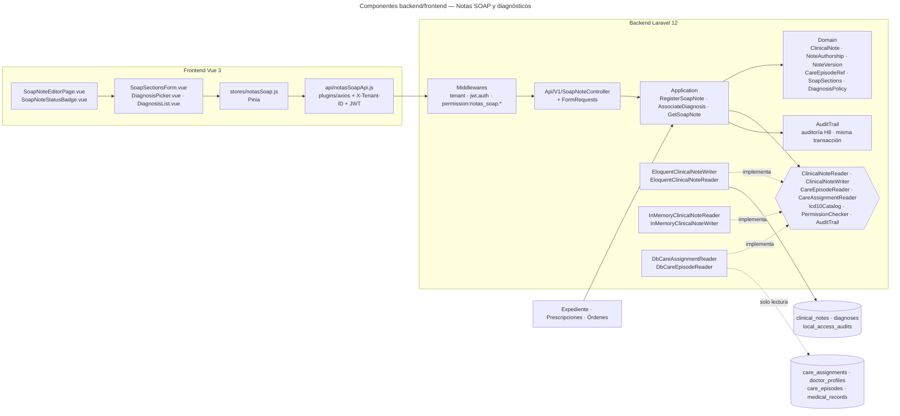

# Notas SOAP y diagnósticos — Semana 7: componentes backend/frontend y propuesta de refactorización

**Estudiante:** Hicho García, Josué Fernando (`Jhos-hgnu`) · **Módulo:** ASII-11 — Notas SOAP y diagnósticos · **Entrega:** diagrama de componentes y propuesta de refactorización.

## Ficha de la asignación

- **Semana:** Semana 7 — Diseño de componentes y refactorización
- **Tarea individual:** Diseñe los componentes backend y frontend propios de Notas SOAP y diagnósticos para «registro de nota SOAP y asociación de diagnóstico clínico». Refactorice conceptualmente el punto con mayor acoplamiento entre notas SOAP, diagnósticos, autoría clínica, versionado y expediente, separando UI, aplicación, dominio y persistencia sin ampliar el módulo.
- **Issue:** Refs #22
- **Alcance:** diseño. **No se implementa código**: el código Laravel/Vue queda **propuesto** para la integración, igual que en la [Semana 7 de ASII-04](../../medicos-especialidades/semana-07/README.md), con la que esta entrega comparte enunciado.

## Objetivo

Diseñar los componentes del flujo «registro de nota SOAP y asociación de diagnóstico clínico» dentro del HIS real (Laravel 12 y Vue 3, ya presentes en `develop`), separando UI, aplicación, dominio y persistencia. El diseño reutiliza el dominio y los casos de uso del micro-HIS de las Semanas 3 a 5 sin reescribirlos, y concentrates el trabajo en **un solo punto**: donde hoy se cruzan las cinco áreas del enunciado.

[Fuente Mermaid](./fuentes/01-componentes.mmd) · [SVG](./01-componentes.svg)

## Componentes backend

| Componente | Responsabilidad | Dónde está hoy |
|---|---|---|
| Middlewares `tenant` y `jwt.auth` | Resolver el hospital (`X-Tenant-ID`) y el usuario del JWT | En `develop`: `TenantMiddleware` y `JwtAuth`, con alias en `bootstrap/app.php` |
| Middleware `permission:notas_soap.*` | Proteger cada ruta con su permiso de RBAC | `spatie/laravel-permission` y `config/permission.php` están; **falta el alias `permission`** (María, ASII-02) y el catálogo con `notas_soap.crear`, `notas_soap.asociar_diagnostico` y `notas_soap.ver` |
| `Api/V1/SoapNoteController` + `StoreSoapNoteRequest`, `StoreDiagnosisRequest` | Controller delgado: el FormRequest valida tipos y obligatorios, el controller llama al caso de uso y traduce `SoapRuleViolation` | No (propuesto) |
| Application: `RegisterSoapNote` · `AssociateDiagnosis` · `GetSoapNote` | Orquestan los casos de uso; se copian del micro-HIS sin cambios de lógica | Micro-HIS, `src/Application` (PR #128, #404) |
| Domain: `ClinicalNote` (raíz de agregado) · `NoteAuthorship` · `NoteVersion` · `CareEpisodeRef` · `SoapSections` · `Diagnosis` · `DiagnosisPolicy` | Invariantes clínicas: un principal, sin duplicados, nota firmada no admite diagnósticos, el diagnóstico hereda episodio, autoría y expediente | Micro-HIS, `src/Domain` (PR #128), con el agregado refactorizado |
| Puertos: `ClinicalNoteReader` · `ClinicalNoteWriter` · `CareEpisodeReader` · `CareAssignmentReader` · `Icd10Catalog` · `PermissionChecker` · `AuditTrail` | La aplicación define lo que necesita; PDO y Eloquent quedan en el borde | Micro-HIS, `src/Application` (PR #128, #376): hoy un solo puerto `ClinicalNoteRepository` |
| `EloquentClinicalNoteWriter` · `EloquentClinicalNoteReader` | Persistencia real sobre `DB::connection('hospital')`, con `RETURNING`, `gen_random_uuid()` y la auditoría en la **misma transacción** | Micro-HIS: `PdoClinicalNoteStore` (PR #376), un solo adaptador para leer y escribir |
| `InMemoryClinicalNoteReader` · `InMemoryClinicalNoteWriter` | Dobles para las pruebas: la misma batería corre contra los dos adaptadores | Micro-HIS, `src/Persistence` (PR #376) |
| `DbCareAssignmentReader` · `DbCareEpisodeReader` | Leer la asignación activa y el expediente del episodio, **solo lectura** | Micro-HIS: `PdoCareAssignmentReader` simplifica `doctor_profile_id` a `user_ref_id` (Semana 3, `dependencias.md`) |
| `EloquentAuditTrail` | Traza de alta, asociación y firma en `local_access_audits`, sin texto clínico | Micro-HIS: `PdoAuditTrail` (PR #376); la tabla es la del slice H8, aún sin migración |

## Componentes frontend

| Componente | Responsabilidad | Dónde está hoy |
|---|---|---|
| `modules/notas-soap/pages/SoapNoteEditorPage.vue` | Pantalla del editor de nota: alta de las cuatro secciones, asociación de diagnósticos y lectura de la nota | No (propuesto), en `resources/js/modules/notas-soap/`, como el módulo `auth` |
| `modules/notas-soap/components/SoapSectionsForm.vue` | Los cuatro campos S, O, A y P con el límite de 4000 caracteres y el contador | No (propuesto) |
| `modules/notas-soap/components/DiagnosisPicker.vue` | Buscador de códigos CIE-10 con el tipo (`primary`, `secondary`, `differential`) | No (propuesto) |
| `modules/notas-soap/components/DiagnosisList.vue` | Diagnósticos asociados: código, descripción, tipo y estado | No (propuesto) |
| `modules/notas-soap/components/SoapNoteStatusBadge.vue` | Muestra el estado de la nota (`draft` o `signed`) como solo lectura | No (propuesto) |
| `stores/notasSoap.js` (Pinia) | Estado del editor: secciones, diagnósticos, `trace_id` del último error y acción en curso | En `develop`: `stores/auth.js` y el plugin `axios` ya existentes |
| `modules/notas-soap/api/notasSoapApi.js` | Llamadas HTTP con el plugin `axios` (JWT y `X-Tenant-ID` ya se agregan solos) | En `develop`: `resources/js/plugins/axios.js` |
| Ruta `/notas-soap/:careEpisodeId` | Enlace del router con `meta: { requiresAuth: true }` | En `develop`: `resources/js/router/index.js` con `authGuard`; falta la entrada y el enlace en `AppLayout.vue` |

Reglas de UI que heredan el contrato, no la inventa:

- El botón «Registrar» se deshabilita mientras el POST está en curso. **Los POST no se reintentan**: no son idempotentes, así que un fallo se muestra con su `code` y su `trace_id` y el médico decide repetir. La lectura sí se puede repetir.
- Un `503 ICD10_UNAVAILABLE` se muestra como «el catálogo CIE-10 no está disponible», **nunca** como «no hay diagnósticos»: es la falla segura de la Semana 2 hecha visible.
- Los errores se pintan por `code` del contrato (`FORBIDDEN`, `NOT_TREATING_PHYSICIAN`, `NOTE_SIGNED`, `PRIMARY_DIAGNOSIS_EXISTS`, `PAYLOAD_INVALID`…), no con el texto crudo de la excepción.

## Rutas protegidas

`bootstrap/app.php` ya monta `routes/api.php` con el prefijo `api/v1`, así que las rutas coinciden con el [contrato de la Semana 5](../semana-05/contrato-api.md) y no cambian:

| Método | Ruta | Permiso | Estado en el micro-HIS |
|---|---|---|---|
| `POST` | `/api/v1/care-episodes/{care_episode_id}/soap-notes` | `notas_soap.crear` | Implementado (PR #404) |
| `POST` | `/api/v1/soap-notes/{clinical_note_id}/diagnoses` | `notas_soap.asociar_diagnostico` | Implementado (PR #404) |
| `GET` | `/api/v1/soap-notes/{clinical_note_id}` | `notas_soap.ver` | Implementado (PR #405) |
| `POST` | `/api/v1/soap-notes/{clinical_note_id}/sign` | `notas_soap.firmar` | Propuesto en el contrato, sin componente todavía |
| `POST` | `/api/v1/soap-notes/{clinical_note_id}/corrections` | `notas_soap.corregir` | Propuesto en el contrato, sin componente todavía |

Las dos últimas **no se diseñan en esta semana**: la firma y la corrección son la Semana 8 del módulo (componentes de backend y frontend con el versionado ya resuelto), y este diseño deja el hueco listo sin ampliar nada.

## Punto de mayor acoplamiento: la frontera de la nota clínica

Es el único punto donde se cruzan las cinco áreas del enunciado —**notas SOAP, diagnósticos, autoría clínica, versionado y expediente**— y el acoplamiento se puede señalar en el código:

1. **La invariante central está triplicada.** «El diagnóstico herede el mismo episodio y el mismo autor que su nota» vive en tres lugares a la vez: en Application, `TreatingPhysicianGuard::assertAllowed($userId, $note->episodeId, $note->authorId)` compara al actor con `$note->authorId`; en Persistence, `PdoClinicalNoteStore::addDiagnosis()` copia `$note->authorId` y `$note->episodeId` al `INSERT`; y en la base, el trigger `diagnoses_note_episode_author_trigger` la exige. Cambiar la regla obliga a tocar tres capas.
2. **El dominio no modela la autoría ni el episodio.** `Domain/ClinicalNote` solo tiene `id`, `episodeId`, `authorId`, `status`, `diagnoses` y `sections`: son cadenas sueltas, no invariantes. `DiagnosisPolicy` recibe la nota y la compara, pero no sabe qué es «el mismo episodio» ni «el mismo autor».
3. **El expediente no existe en ninguna capa.** En la migración `000400`, `clinical_notes.medical_record_id` es `NOT NULL` con FK a `medical_records`, y el `INSERT` del adaptador **no lo incluye**; el doble SQLite tampoco tiene esa columna. El micro-HIS, tal como está, no podría escribir en PostgreSQL: le falta el expediente.
4. **El versionado es un metadato, no un dato.** `version_no` solo aparece en la auditoría (`['version_no' => 1]`); `find()` no lee `version_no` ni `supersedes_id`, y no existe ninguna ruta que cree una versión 2. El corrector de la Semana 1 está en el contrato y en los triggers, pero no en el código.
5. **Un solo puerto para tres operaciones.** `ClinicalNoteRepository` mezcla lectura (`find`), escritura de nota (`add`) y escritura de diagnóstico (`addDiagnosis`), y `app.php` inyecta ese mismo puerto en los tres casos de uso. Cada escritura mezcla, en el mismo método, el SQL, la auditoría y la derivación del episodio: no hay forma de cambiar la persistencia sin tocar la lógica clínica.

### Refactorización conceptual por capa

| Capa | Antes | Después |
|---|---|---|
| **UI** | — (el micro-HIS solo devuelve JSON) | `SoapNoteEditorPage.vue` y sus componentes pintan lo que llega; no deciden tipos, no calculan completitud y no conocen el CIE-10 ni el expediente: solo el `careEpisodeId` de la ruta y el `code` del contrato |
| **Aplicación** | `AssociateDiagnosis` orquesta **y** compara: busca la nota, valida el acceso, valida la política, consulta el catálogo y delega la escritura, con cinco colaboradores | Solo orquesta: pide la nota al `ClinicalNoteReader`, delega la decisión al agregado (`ClinicalNote::addDiagnosis()`) y la escritura al `ClinicalNoteWriter`. El guard de acceso se conserva, pero consume la autoría del agregado en vez de compararla por su cuenta |
| **Dominio** | `ClinicalNote` con `authorId`/`episodeId` sueltos; `DiagnosisPolicy` aparte; el diagnóstico hereda los datos por copia en el SQL | `ClinicalNote` como raíz de agregado con `NoteAuthorship` (quién escribió y quién puede actuar), `NoteVersion` (versión y cadena de correcciones) y `CareEpisodeRef` (episodio **y** expediente). `ClinicalNote::addDiagnosis()` concentra las invariantes: duplicado, principal único, nota firmada, mismo episodio, misma autoría y mismo expediente |
| **Persistencia** | `PdoClinicalNoteStore` implementa un puerto con lectura y dos escrituras; `version_no` implícito; sin `medical_record_id`; SQL directo | `ClinicalNoteReader` y `ClinicalNoteWriter` separados. `EloquentClinicalNoteWriter` deriva el `medical_record_id` del episodio por el puerto `CareEpisodeReader` (Expediente), escribe `version_no` explícito, usa `RETURNING` y deja la auditoría en la **misma transacción** |

**Por qué este punto y no otro.** Registrar la nota (UC-SOAP-01) solo cruza dos áreas: autorización y formato. Consultar la nota (UC-SOAP-09) solo lee. Asociar el diagnóstico (UC-SOAP-02) es el único caso de uso donde coinciden la nota, el diagnóstico, la autoría clínica, la regla de versión y el expediente, y es el único que hoy tiene la invariante partida en tres capas. Además, es el punto que el caso práctico de la [Semana 6](../semana-06/README.md) dejó marcado: el relevo de autoría choca exactamente contra esta frontera, porque `author_user_ref_id` es un atributo inmutable de la fila.

### Sin ampliar el módulo

El refactor mueve responsabilidades; no agrega funcionalidades:

| Invariante | Cómo se respeta |
|---|---|
| Mismos endpoints y mismo contrato `/api/v1` | No se crea ninguna ruta; las tres existentes conservan método, permiso, cuerpo y estado |
| Mismos `code` de error y mismo `trace_id` | `SoapRuleViolation` y el `trace_id` del `ApiKernel` no cambian; en Laravel pasan a `withExceptions` y a un middleware común |
| Mismas reglas clínicas | Un principal, sin duplicados, nota firmada no admite diagnósticos, código no validado no se guarda, catálogo caído → `503` sin escribir |
| Misma atomicidad | Nota o diagnóstico **y** su auditoría, en una sola transacción de la conexión `hospital` |
| Ninguna tabla, estado ni columna nueva | El refactor no toca el esquema; lo que falta en el esquema (expediente, versión) se resuelve con puertos, no con DDL |
| Las pruebas siguen valiendo | Las 34 verificaciones de `tests/run.php` y los 19 casos de `tests/api.php` deben pasar sin cambios de contrato |

Lo que **queda fuera** de esta semana: firmar y corregir (Semana 8 del módulo), el traspaso de autoría (petición a Javier de la Semana 6) y el origen del catálogo CIE-10 (`icd10_codes` sin definir). Ninguno se implementa aquí.

## Ajustes para integrar en el HIS Laravel

| En el micro-HIS (Semanas 3 a 5) | Problema al integrar | Refactor propuesto |
|---|---|---|
| `ApiKernel` valida `X-User-ID` y consulta `PermissionChecker` | Duplica `JwtAuth` y el middleware de permisos; `X-User-ID` no es autoritativo | El actor sale de `auth()->user()` y el permiso se exige con `permission:notas_soap.*`, cuando María publique el alias y el catálogo |
| `Router` con un `match` de rutas | Laravel ya enruta | Una acción por método en el controller y las rutas en `routes/api.php` dentro del grupo `['tenant', 'jwt.auth']` |
| `Request::text()` lanza `422 PAYLOAD_INVALID` | Laravel tiene FormRequest con errores por campo | Los FormRequest validan tipo (`string`), obligatoriedad y `max:4000`; el dominio conserva las reglas de negocio |
| `SoapRuleViolation` mapeada en el controller | Cada controller repetiría el mapeo | Renderizarla en `withExceptions` de `bootstrap/app.php` con el mismo `code` y estado del contrato |
| `PdoClinicalNoteStore` con PDO directo, UUID generado en PHP y sin `medical_record_id` | Otra conexión; las PK reales son `uuid`; `medical_record_id` es `NOT NULL` | `EloquentClinicalNoteWriter` con `DB::connection('hospital')`, `gen_random_uuid()`, `RETURNING clinical_note_id` y el expediente desde `CareEpisodeReader` |
| `JsonView` | Laravel serializa | `response()->json()`; el `trace_id` lo agrega un middleware común |
| `PdoCareAssignmentReader` con `user_ref_id` | La tabla real usa `doctor_profile_id` | `DbCareAssignmentReader` con `join` a `doctor_profiles` |
| `SoapNoteApiClient` | Dentro del HIS, Expediente, Prescripciones y Órdenes están en el mismo proceso | Llaman al caso de uso o al endpoint; el cliente HTTP queda para cuando el módulo se separe (Semana 5) |

## Plan de la refactorización

1. Crear `app/Modules/NotasSoap/Domain/` con el agregado refactorizado (`ClinicalNote`, `NoteAuthorship`, `NoteVersion`, `CareEpisodeRef`) y trasladar las pruebas de dominio del micro-HIS.
2. Crear `app/Modules/NotasSoap/Application/` con los casos de uso y los puertos separados (`ClinicalNoteReader`, `ClinicalNoteWriter`, `CareEpisodeReader`).
3. Crear `app/Modules/NotasSoap/Infrastructure/` con `EloquentClinicalNoteWriter`/`Reader`, `DbCareAssignmentReader`, `DbCareEpisodeReader` y `EloquentAuditTrail`, más los dobles InMemory; enlazarlos a los puertos en un ServiceProvider del módulo.
4. Crear el controller, los FormRequests y las rutas con `permission:`; renderizar `SoapRuleViolation` en `withExceptions`.
5. Crear las páginas y componentes Vue, el store, `api/notasSoapApi.js` y la entrada del router.
6. Correr la batería del micro-HIS (34 + 19 casos) contra los adaptadores nuevos y, cuando exista PostgreSQL, contra la conexión `hospital`.

**Estado:** este PR es diseño; el código Laravel/Vue queda **propuesto** para la integración. Uso de IA: [DECLARACION_IA.md](./DECLARACION_IA.md).

## Dependencias y pendientes

| # | Con quién | Qué se necesita | Mientras tanto |
|---|---|---|---|
| 1 | María (ASII-02, RBAC) | El alias `permission` en `bootstrap/app.php` y el catálogo con `notas_soap.crear`, `notas_soap.asociar_diagnostico` y `notas_soap.ver` (propuestos en la Semana 5) | `PermissionChecker` como doble en memoria, como en el micro-HIS |
| 2 | Javier (base de datos) | Lo pedido en la [Semana 6](../semana-06/README.md): la entidad `clinical_note_authorship_transfers`, los dos triggers que reconocen al autor vigente y la unicidad por cadena de corrección | El diseño no lo contradice: `NoteAuthorship` deja el hueco listo sin tocar el esquema |
| 3 | Expediente / Admisión | El dato del expediente (`medical_record_id`) del episodio, que el módulo necesita para escribir en `clinical_notes` | `CareEpisodeReader` queda como puerto; el doble resuelve el caso de pruebas |
| 4 | Catálogo CIE-10 | El origen real de los códigos (`icd10_codes` no está entre las 27 entidades) | `Icd10Catalog` con el doble en memoria, con la falla segura de la Semana 2 |

## Archivos

- [Diagrama de componentes](./01-componentes.svg) y su [fuente Mermaid](./fuentes/01-componentes.mmd).
- [Declaración de uso de IA](./DECLARACION_IA.md).

> Los enlaces a las Semanas 2 a 6 y al micro-HIS resuelven cuando la cadena de PRs (#65, #130, #128, #129, #379, #376, #378, #374, #404, #405 y #411) esté integrada en `develop`; esta rama solo añade el diseño de la Semana 7.
