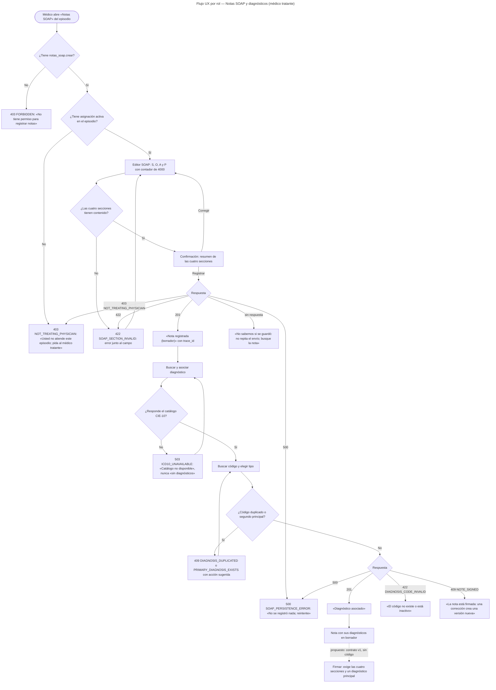
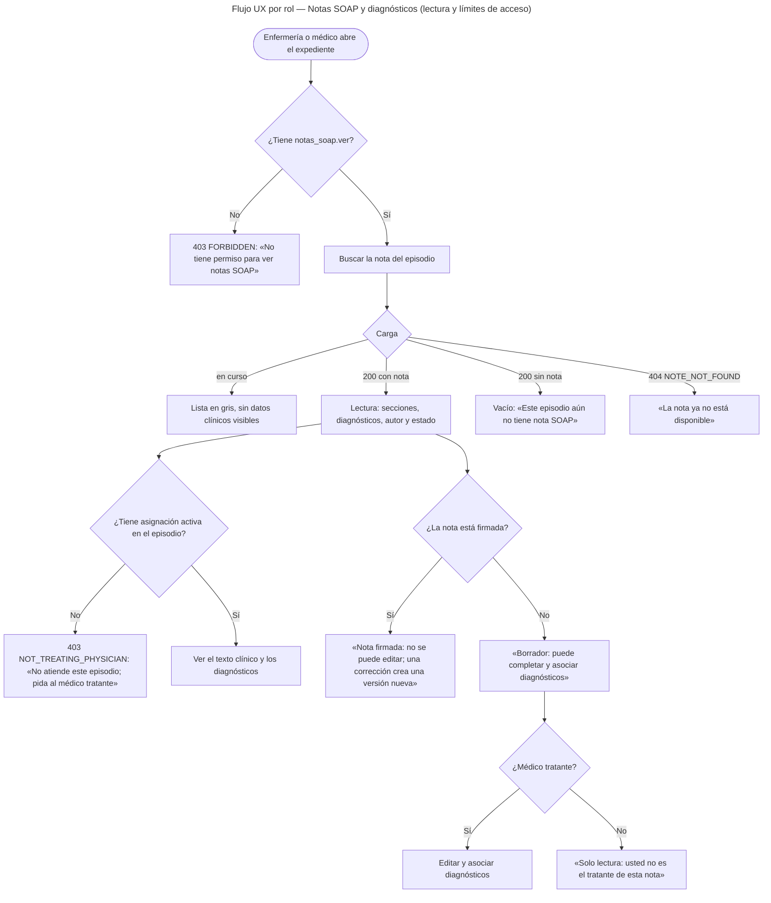

# Notas SOAP y diagnósticos — Semana 8: flujo UX por rol

**Estudiante:** Hicho García, Josué Fernando (`Jhos-hgnu`) · **Módulo:** ASII-11 — Notas SOAP y diagnósticos · **Entrega:** user flow por rol, wireframes anotados y reglas de interacción.

## Ficha de la asignación

- **Semana:** Semana 8 — Diseño de experiencia de usuario
- **Tarea individual:** Diseñe el flujo UX de «registro de nota SOAP y asociación de diagnóstico clínico» por sus roles autorizados. Incluya inicio, decisión, confirmación, estados vacío/carga/éxito, errores recuperables, ayuda contextual y protección de datos vinculados con notas SOAP, diagnósticos, autoría clínica, versionado y expediente.
- **Entregable / evidencia:** user flow por rol y 4–6 wireframes anotados con estados, mensajes, validaciones y reglas de interacción.
- **Issue:** Refs #22
- **Alcance:** diseño. **No se implementa código**: los componentes Vue de la [Semana 7](../semana-07/README.md) quedan *propuestos*, y aquí se define cómo se comportan.

## Objetivo

Diseñar la experiencia del flujo «registro de nota SOAP y asociación de diagnóstico clínico» para los roles autorizados, con inicio, decisión, confirmación, estados vacío, carga, éxito y error recuperable, y con mensajes que usan los códigos reales del [contrato API](../semana-05/contrato-api.md). El diseño respeta dos reglas que vienen de las semanas anteriores y no se negocian: **la nota firmada no se edita** y **el catálogo CIE-10 que no responde no es «no hay diagnósticos»**.

Los wireframes, anotados, están en la parte 2 de esta entrega (#427).

## Roles y permisos

| Rol | Objetivo en el flujo | Permisos |
|---|---|---|
| **Médico tratante** | Registrar la nota del episodio, asociar diagnósticos, leerla | `notas_soap.crear` · `notas_soap.asociar_diagnostico` · `notas_soap.ver` (+ `notas_soap.firmar` y `notas_soap.corregir`, propuestos) |
| **Enfermería** | Consultar la nota del episodio, sin escribirla | `notas_soap.ver` |
| **Sin asignación** | Cualquiera que tenga permiso pero no atienda el episodio | Permiso sí, episodio no: `403 NOT_TREATING_PHYSICIAN` |

`admin_hospital` **no** entra al flujo: según la matriz de la Semana 5 no lee notas, porque es dato clínico y el acceso se limita a quien atiende al paciente.

## User flow por rol

### Flujo 1 — Médico tratante: registrar la nota y asociar diagnósticos

SVG: en la parte 2 (#427) · [Fuente Mermaid](./fuentes/01-user-flow.mmd)

### Flujo 2 — Lectura por rol: médico tratante y enfermería

SVG: en la parte 2 (#427) · [Fuente Mermaid](./fuentes/02-user-flow-lectura.mmd)

## Estados de la pantalla

| Estado | Qué ve el usuario |
|---|---|
| **Inicio** | Cada rol entra a su tarea: el médico tratante, al editor del episodio; enfermería, a la consulta de la nota. Si la URL no trae episodio, la pantalla pide elegir el episodio de la lista del paciente |
| **Decisión** | «Registrar» o «Asociar diagnóstico» solo se ofrecen con el permiso correspondiente; la autorización en dos niveles decide en el servidor y la UI solo refleja el resultado |
| **Confirmación** | Antes de registrar, un resumen de las cuatro secciones con «Corregir» (vuelve al formulario sin perder lo escrito) y «Registrar». Antes de descartar un borrador, una confirmación explícita |
| **Vacío** | «Este episodio aún no tiene nota SOAP» (es un `200` con lista vacía, no un error) y «Sin diagnósticos asociados todavía» en la nota recién creada |
| **Carga** | El editor muestra los contadores y guarda lo escrito; el botón «Registrar» queda deshabilitado y con texto «Registrando…» mientras la petición está en curso. En lectura, el esqueleto en gris **no** muestra texto clínico provisional |
| **Éxito** | «Nota registrada (borrador)» con el `clinical_note_id` y el `trace_id`; «Diagnóstico asociado» con el código y el tipo. La nota firmada muestra un distintivo y no ofrece «Editar» |
| **Error recuperable** | Panel con el mensaje en lenguaje claro, el `code` del contrato y el `trace_id` en letra pequeña. El texto escrito se conserva: el error no borra el formulario |
| **Sin permiso (403 FORBIDDEN)** | «No tiene permiso para registrar notas» / «para ver notas SOAP», con el permiso faltante a la vista. El botón no se muestra si el rol no lo tiene |
| **Sin asignación (403 NOT_TREATING_PHYSICIAN)** | «Usted no atiende este episodio; pida al médico tratante». Es distinto del 403 de permiso: el permiso existe, la relación con el episodio no |
| **Conflicto (409)** | «Este código ya está asociado a la nota» (`DIAGNOSIS_DUPLICATED`) o «La nota ya tiene un diagnóstico principal» (`PRIMARY_DIAGNOSIS_EXISTS`), con la acción que lo resuelve: cambiar el tipo a secundario o elegir otro código |
| **Validación (422)** | Error junto al campo: sección vacía o mayor a 4000 (`SOAP_SECTION_INVALID`), código vacío o tipo inválido (`DIAGNOSIS_INVALID`), código inexistente o inactivo (`DIAGNOSIS_CODE_INVALID`), tipo de dato incorrecto (`PAYLOAD_INVALID`) |
| **Servicio caído (503)** | `ICD10_UNAVAILABLE`: «El catálogo CIE-10 no está disponible. Intente de nuevo.» `AUTHORIZATION_UNAVAILABLE`: «No se pudo verificar su permiso. No se registró nada.» Nunca se muestra un vacío que parezca «no hay diagnósticos» |
| **Sin respuesta** | «No sabemos si se guardó: no repita el envío; busque la nota». Los POST no son idempotentes, así que la UI **no** reintenta sola |

## Ayuda contextual

| Dónde | Ayuda |
|---|---|
| Título del editor | «Esta nota documenta la atención del episodio. Queda en borrador hasta que se firme y no se puede editar después.» |
| Cada sección (S, O, A, P) | «Describa aquí…» + contador `0/4000`. Un objetivo, un análisis, un plan: cada sección es obligatoria para registrar la nota |
| Contador de caracteres | Al llegar a 3600, el contador pasa a ámbar: «quedan 400 caracteres». No se corta el texto, se avisa |
| Buscador de diagnósticos | «Busque por código (J18.9) o por descripción. El tipo define el papel del diagnóstico: principal, secundario o diferencial.» |
| Tipo del diagnóstico | «Solo puede haber un diagnóstico principal por nota. Los demás van como secundarios o diferenciales.» |
| Estado vacío de diagnósticos | «Sin diagnósticos asociados todavía. Una nota sin diagnóstico principal no se puede firmar.» |
| Nota firmada | «Esta nota está firmada desde el 12/10/2026. No se puede editar: para corregirla se crea una versión nueva con su motivo.» |
| Botón «Descartar borrador» | «Se perderá lo escrito. Esta acción no se puede deshacer.» |
| Mensajes de error | Cada mensaje dice qué pasó y qué hacer, y muestra el `trace_id` para que soporte lo encuentre en la bitácora |
| authorship (autor) | «Usted es el autor de esta nota. Solo el autor tratante puede completarla y asociarle diagnósticos.» |

## Protección de datos

- **Notas SOAP.** El texto clínico (S, O, A, P) se muestra solo a quien tiene `notas_soap.ver` **y** asignación activa en el episodio. La UI no lo muestra en ninguna vista previa para roles sin asignación: en ese caso se ve el mensaje de `403 NOT_TREATING_PHYSICIAN`, no un texto oculto.
- **Diagnósticos.** Se muestran código, descripción y tipo; el `description` viene del catálogo, nunca del texto libre del usuario. Un diagnóstico solo se lista si está `active`: los `resolved` y `entered_in_error` quedan en el historial, no en la lista de la nota.
- **Autoría clínica.** La pantalla muestra el autor con nombre legible, no el `author_user_ref_id` crudo. En una nota en borrador, el médico ve «Usted es el autor»; en una nota ajena, ve «Solo lectura: usted no es el tratante». El traspaso de autoría no existe todavía (petición a Javier de la Semana 6): si llega, la UI distingue «autor original» de «autor vigente» sin permitir que uno se edite al otro.
- **Versionado.** La UI muestra el estado de la nota y, cuando exista, la cadena de versiones («versión 2, corrección de la versión 1»). Una nota firmada no ofrece edición ni permite cambiar su estado; la corrección se presenta como **crear una versión nueva**, nunca como «deshacer».
- **Expediente.** El paciente y el expediente salen del contexto (ruta y sesión); el editor **no** tiene selector de paciente ni de expediente, así que una nota no puede quedar anclada al expediente equivocado. El identificador del episodio viaja en la ruta, no en parámetros de consulta, y no se guarda nada del texto clínico en `localStorage` ni en la URL: lo escrito vive en la memoria de la página.
- **Errores sin datos internos.** El usuario ve el mensaje, el `code` y el `trace_id`; el detalle técnico de la excepción y el texto clínico no salen nunca al navegador. La auditoría (`local_access_audits`) guarda identificadores, código y acción, nunca el texto de las secciones (RNF-SOAP-05).
- **Trazabilidad visible.** Cada alta y cada asociación quedan auditadas con su actor; el `trace_id` que muestra la pantalla es el mismo `correlation_id` de la auditoría, para que soporte pueda unir la pantalla con la bitácora.

## Reglas de interacción

- «Registrar» y «Asociar diagnóstico» se deshabilitan mientras la petición está en curso: no son idempotentes y un doble clic intentaría duplicar la nota o el diagnóstico.
- La UI **nunca** reintenta sola un POST. Ante una caída, muestra «no sabemos si se guardó» y ofrece buscar la nota; la lectura sí se puede repetir.
- El tipo del diagnóstico se elige antes de guardar, no se deduce: por defecto viene «secundario» y el principal se marca a mano, para que un doble principal sea una decisión visible.
- El catálogo CIE-10 se consulta **antes** de asociar; si está caído, la pantalla lo dice y no deja escribir un código a mano.
- Una nota que no es del actor no muestra los botones de edición ni de asociación, ni siquiera deshabilitados: no hay un camino que termine en `403`.
- Los errores de validación se muestran junto al campo y no borran lo escrito; el foco vuelve al primer campo con problema.
- `trace_id` visible en cada error, en letra pequeña, para que soporte lo correlate con la bitácora de acceso.
- Los mensajes usan el `code` del contrato como fuente de verdad: la UI mapea `code` → texto; nunca muestra el texto crudo de una excepción.

## Pendientes

| # | Con quién | Qué se necesita |
|---|---|---|
| 1 | María (ASII-02) | Permisos `notas_soap.*` en el catálogo y el alias `permission`: sin ellos, la UI no puede decidir qué botones mostrar y siempre acaba en `403` |
| 2 | Javier (base de datos) | La entidad de traspaso de autoría: la pantalla de autoría clínica necesita distinguir «autor original» de «autor vigente» |
| 3 | Expediente / Admisión | El `medical_record_id` del episodio, para que la nota se ancle al expediente y la UI pueda mostrar «nota de este episodio» |
| 4 | Catas CIE-10 | El origen real del catálogo (`icd10_codes`): la búsqueda de diagnósticos depende de él |
| 5 | Módulo | Firma y corrección: los mensajes de `NOTE_SIGNED` y la cadena de versiones están diseñados, pero el flujo de firma depende de los endpoints propuestos en la Semana 5 |

## Archivos

- Wireframes anotados: seis pantallas con estados, mensajes, validaciones y reglas, en la parte 2 (#427).
- Flujo 1: SVG en la parte 2 (#427) y [fuente Mermaid](./fuentes/01-user-flow.mmd).
- Flujo 2: SVG en la parte 2 (#427) y [fuente Mermaid](./fuentes/02-user-flow-lectura.mmd).
- [Declaración de uso de IA](./DECLARACION_IA.md).

> Los enlaces a las Semanas 2 a 7 y al micro-HIS resuelven cuando la cadena de PRs (#65, #130, #128, #129, #379, #376, #378, #374, #404, #405, #411 y #421) esté integrada en `develop`; esta rama solo añade el diseño de la Semana 8.
