# Notas SOAP y diagnósticos — Semana 11: prototipo navegable desktop y móvil

**Estudiante:** Hicho García, Josué Fernando (`Jhos-hgnu`) · **Módulo:** ASII-11 — Notas SOAP y diagnósticos · **Entrega:** prototipo navegable, mapa de navegación y capturas del camino feliz y del error crítico.

## Ficha de la asignación

- **Semana:** Semana 11 — Mejores prácticas para diseño móvil/web
- **Tarea individual:** Construya un prototipo navegable desktop y móvil del flujo principal de Notas SOAP y diagnósticos, cubriendo camino feliz y un error crítico relacionado con notas SOAP, diagnósticos, autoría clínica, versionado y expediente; mantenga consistencia de roles, estados y accesibilidad.
- **Entregable / evidencia:** enlace o archivo del prototipo, mapa de navegación y capturas desktop/móvil del camino feliz y del error crítico.
- **Issue:** Refs #22
- **Alcance:** prototipo de diseño en un solo archivo HTML, **sin servidor ni datos reales**. No toca el HIS ni el micro-HIS. Implementa las pantallas de la [Semana 8](../semana-08/wireframes.md) y de la [Semana 10](../semana-10/pantallas.md) y las correcciones P0/P1 de la [Semana 9](../semana-09/backlog.md).

## Cómo abrir el prototipo

Archivo: [`prototipo.html`](./prototipo.html). Se abre con doble clic en cualquier navegador; no necesita instalación. Un solo archivo con HTML, CSS y JavaScript, sin dependencias externas.

- **Desktop:** ventana de 768 px o más: editor con las cuatro secciones visibles.
- **Móvil:** ventana de menos de 768 px (o el modo dispositivo del navegador, 390 × 844): editor por pasos, barra de acción inferior y hojas inferiores.
- **Rol:** el selector «Rol» de la cabecera alterna entre *Médico tratante* y *Enfermería*; las acciones cambian con el rol.
- **Error crítico:** la casilla «Simular error crítico» al pie de la página hace que el siguiente «Asociar a la nota» falle como si otra persona hubiera firmado la nota.
- **Atajos para revisar** (precargan datos de ejemplo): `prototipo.html?demo#/diagnostico`, `?demo=dx#/episodio`, `?demo#/error` y `?demo=dx&rol=enfermeria#/episodio`.

## Mapa de navegación

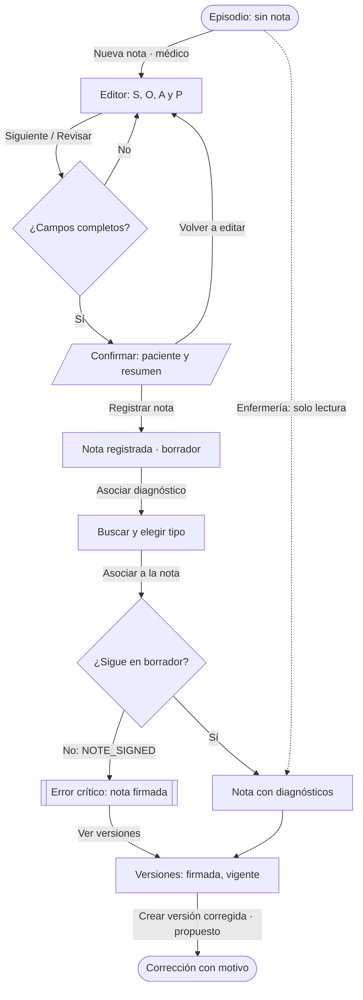

| Ruta (`#/…`) | Pantalla | Rol |
|---|---|---|
| `episodio` | Vacío o nota con diagnósticos | Médico y enfermería |
| `editor/0…3` | Editor de la nota (en móvil, un paso por pantalla) | Médico |
| `confirmar` | Hoja de confirmación con el paciente | Médico |
| `exito` | Nota registrada (borrador) | Médico |
| `diagnostico` | Búsqueda CIE-10, tipo y asociación | Médico |
| `error` | Error crítico `NOTE_SIGNED` | Médico |
| `versiones` | Versión vigente y corrección | Médico (corrige), enfermería (lee) |

## Camino feliz

Registrar la nota y asociar un diagnóstico principal, de «episodio sin nota» a «nota con diagnósticos».

| Paso | Desktop | Móvil |
|---|---|---|
| 1. Episodio sin nota | 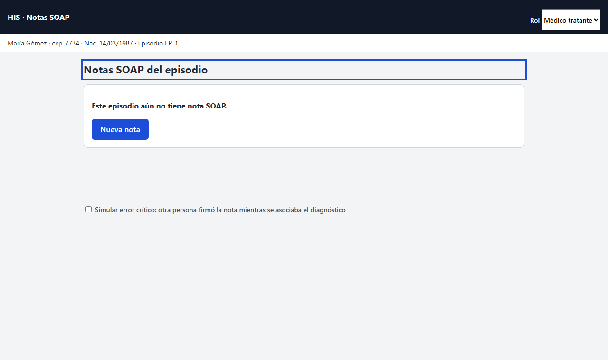 | 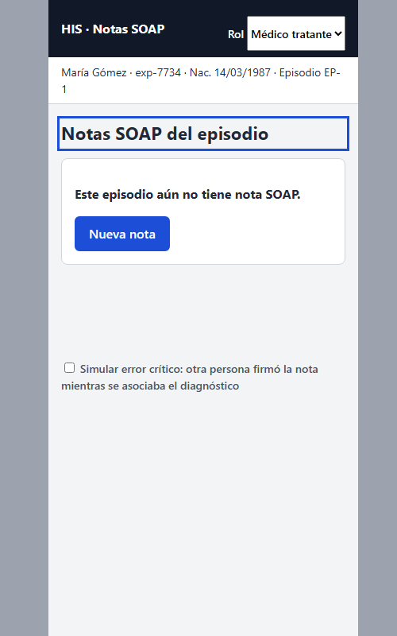 |
| 2. Editor de la nota | 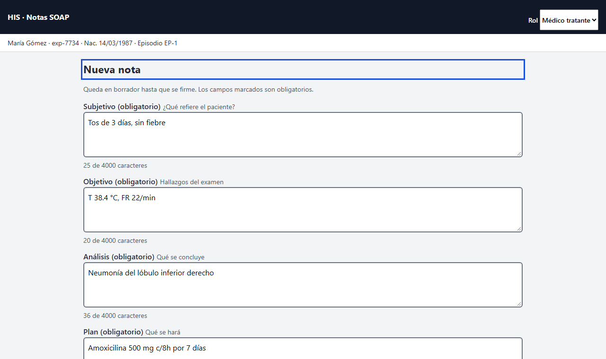 | 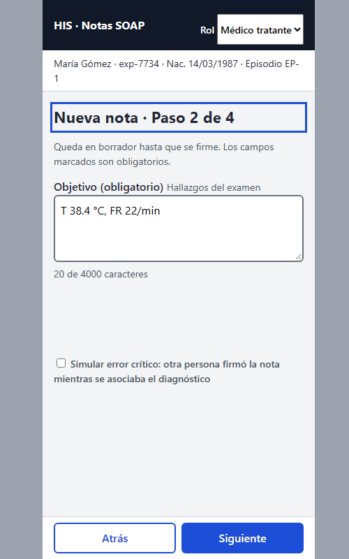 |
| 3. Confirmación con paciente | 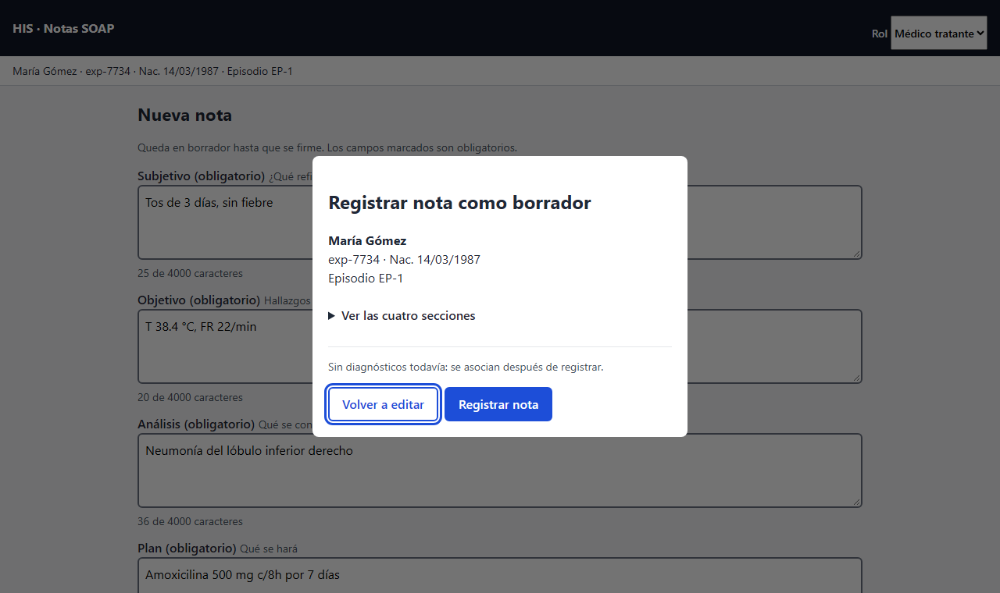 | 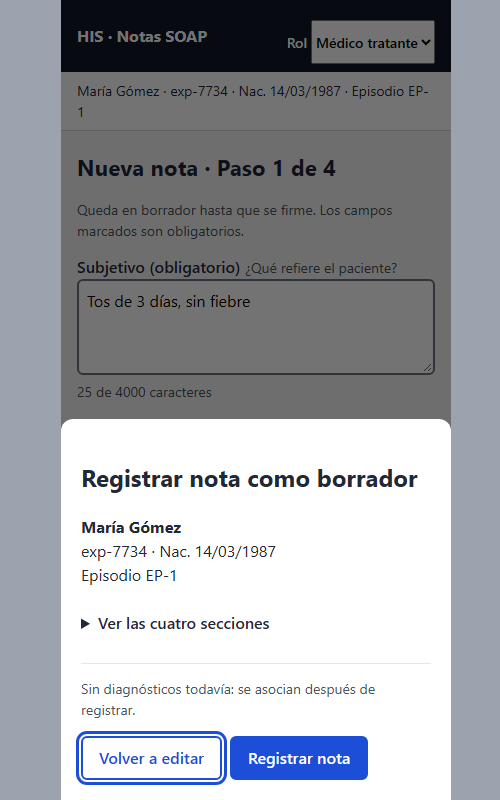 |
| 4. Buscar y tipificar el diagnóstico | 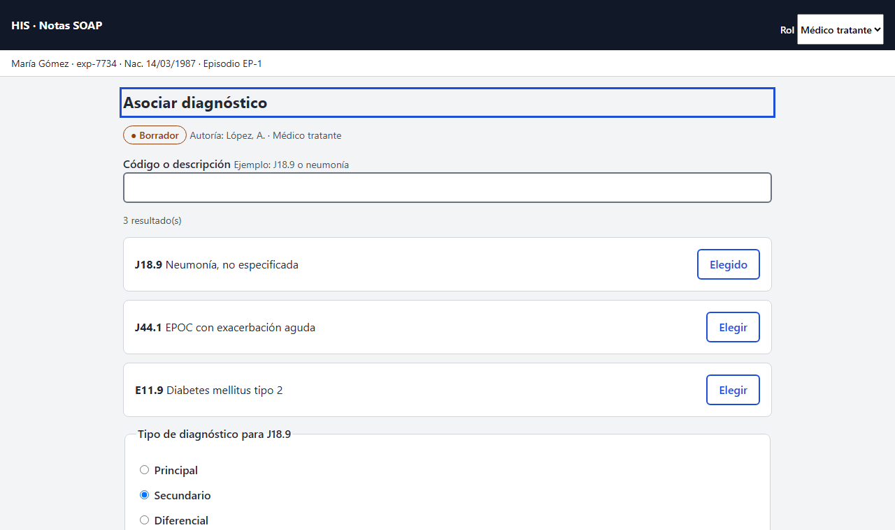 | 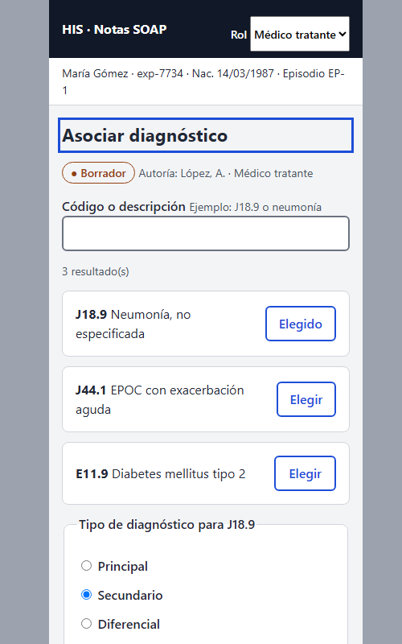 |
| 5. Nota con diagnósticos | 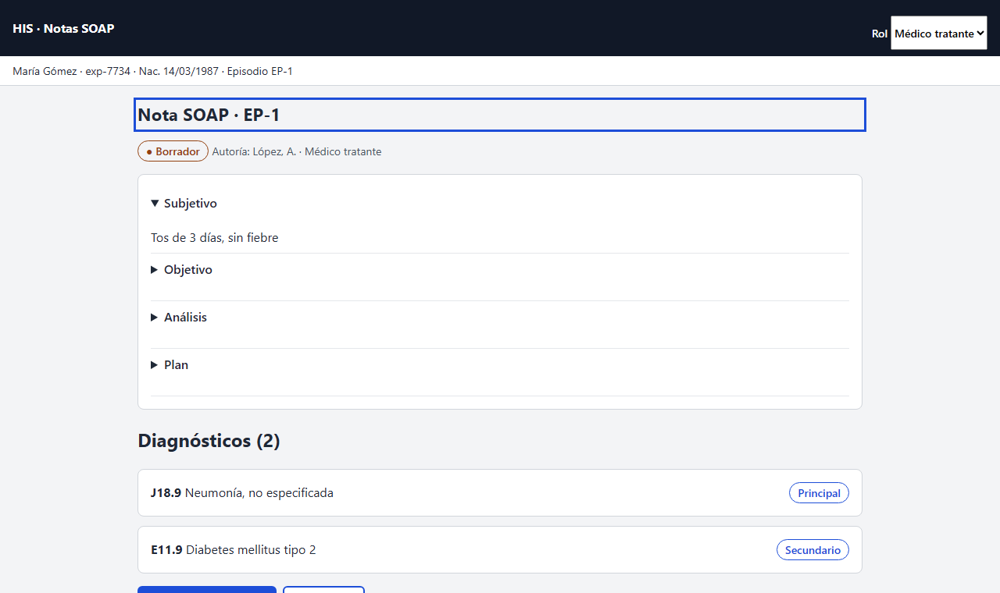 | 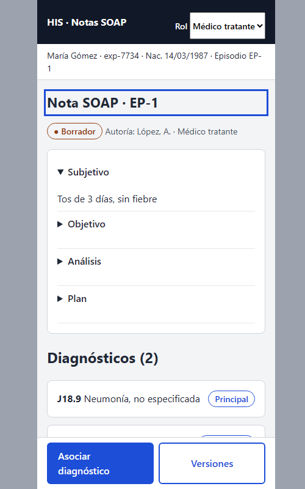 |

## Error crítico: la nota se firmó mientras se asociaba el diagnóstico

Es el peor fallo del flujo: el médico cree que el diagnóstico quedó en la nota y no quedó. Toca las cinco áreas: **nota** (ya firmada), **diagnóstico** (no guardado), **autoría** (quién firmó), **versionado** (la corrección es una versión nueva) y **expediente** (el paciente sigue a la vista).

| Pantalla | Desktop | Móvil |
|---|---|---|
| Error `NOTE_SIGNED` | 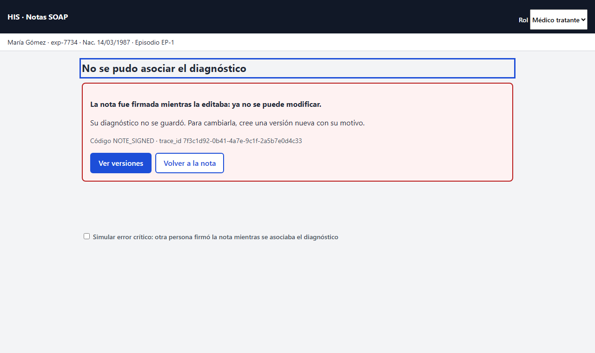 | 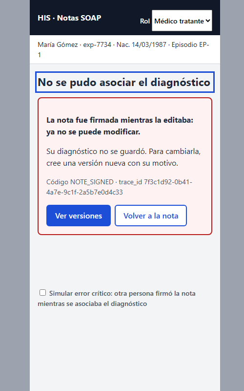 |
| Versiones: firmada y vigente | 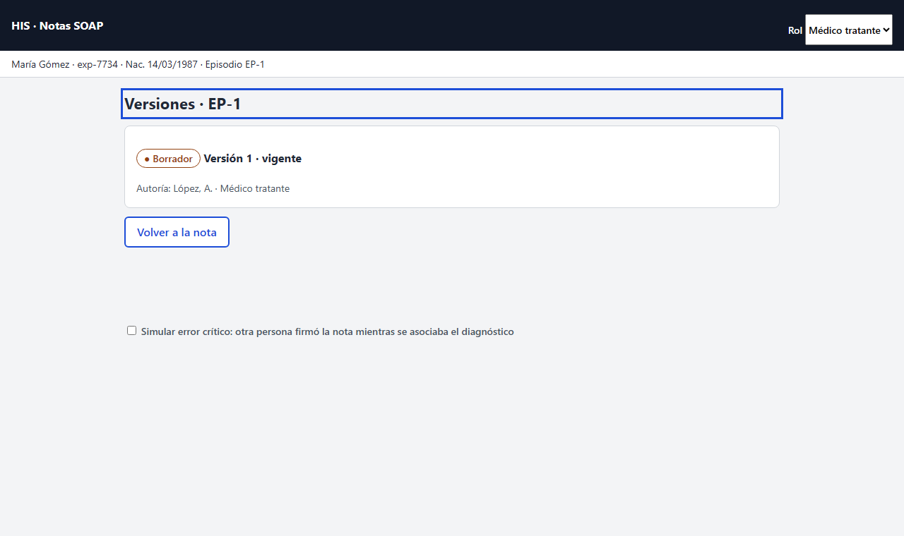 | 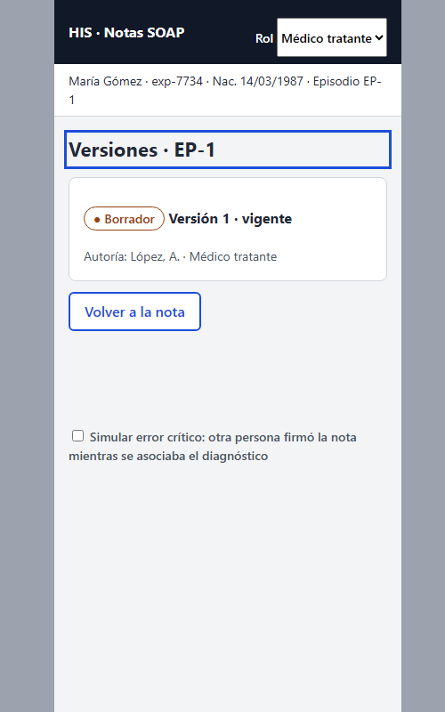 |
| Misma nota, rol enfermería | 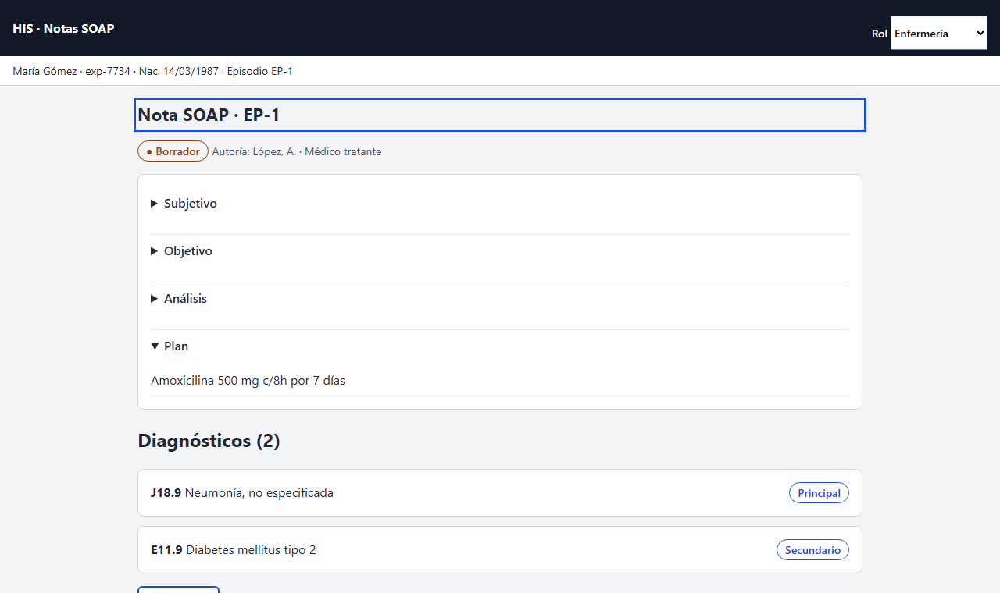 | 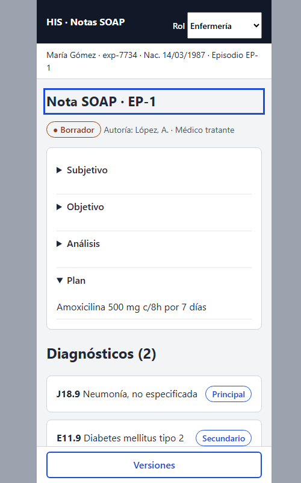 |

**Decisiones del error**

- El mensaje dice qué pasó («La nota fue firmada mientras la editaba»), qué consecuencia tiene («Su diagnóstico no se guardó») y qué hacer («cree una versión nueva con su motivo»).
- Es un `role="alert"`: el lector de pantalla lo anuncia sin mover el foco; el foco pasa al título.
- Muestra `NOTE_SIGNED` y el `trace_id` en 14 px para que soporte lo ubique en la bitácora.
- El paciente sigue en la barra fija: el error no ocurre «en el vacío».
- La nota queda firmada y sin acciones de edición; la única salida hacia adelante es «Ver versiones».
- El diagnóstico **no** se reintenta solo: sería asociarlo a una nota que ya no es del médico.

## Consistencia de roles y estados

| Aspecto | Médico tratante | Enfermería |
|---|---|---|
| Episodio sin nota | «Nueva nota» | «Su rol es de solo lectura» |
| Nota en borrador | «Asociar diagnóstico», «Versiones» | Solo «Versiones»; sin controles de edición, ni deshabilitados |
| Nota firmada | Sin edición; «Crear versión corregida» en Versiones | Sin edición; no se ofrece corregir |
| Sección abierta por defecto | Subjetivo | Plan (la tarea de enfermería es administrar) |

Los estados llevan siempre texto y símbolo, nunca solo color: «● Borrador» y «✔ Firmada · Versión 1».

## Accesibilidad

| Criterio | Cómo se resuelve en el prototipo |
|---|---|
| Teclado | Todo es `<a>`, `<button>`, `<input>` o `
`; sin controles hechos con `
` |
| Foco | Contorno de 3 px (`:focus-visible`); al cambiar de pantalla el foco va al título; en la confirmación, a «Volver a editar», no a «Registrar» |
| Contraste | Texto y bordes por encima de 4.5:1 (`#1d4ed8`, `#b91c1c`, `#92400e`, `#166534`, `#4b5563` sobre blanco); el ámbar del contador es `#92400e`, no `#f59e0b` (B-10) |
| Etiquetas | `<label>` visible en cada campo, con «(obligatorio)» en el texto, no solo `*` (B-11) |
| Mensajes | `role="alert"` para errores y `role="status"` para éxito y resultados (B-07) |
| Prevención | La confirmación repite al paciente (B-01); «Principal» se deshabilita con su razón si ya existe uno (B-09); un único grupo de radios en español (B-05) |
| Validación | «Siguiente» no se deshabilita: muestra el error junto al campo y enfoca el primero (B-06) |
| Objetivos táctiles | Botones de 44 px mínimo; barra de acción inferior con `safe-area-inset-bottom` |
| Saltar al contenido | Enlace «Saltar al contenido» como primer elemento |

Prueba funcional: se ejecutó en Chrome el camino completo (episodio vacío → editor → validación → confirmación → registro → diagnóstico → error simulado) y se comprobó la ruta, el título y la presencia de `role="alert"` en cada paso. El foco volvió al primer campo vacío tras un envío incompleto.

## Límites del prototipo

- Los datos son de ejemplo y viven en memoria; recargar los borra. Es intencional: no se guarda texto clínico en el navegador (RNF-SOAP-05).
- No hay llamadas al servidor: los errores se simulan.
- La corrección y la firma siguen *propuestas*: «Crear versión corregida» solo anuncia que pedirá un motivo.
- No se revisó con lector de pantalla ni con axe: queda para la regresión de ASII-28.
- El borrador en servidor (`clinical_note_drafts`) sigue pendiente de Javier (ASII-09).

## Archivos

- [Prototipo navegable](./prototipo.html)
- [Capturas](./capturas/): 8 pantallas × 2 (desktop 1280 px y móvil 390 px).
- [Declaración de uso de IA](./DECLARACION_IA.md)

> Los enlaces a las Semanas 8, 9 y 10 resuelven cuando los PR #427, #441 y #525 estén integrados en `develop`; esta rama solo añade el prototipo de la Semana 11.
