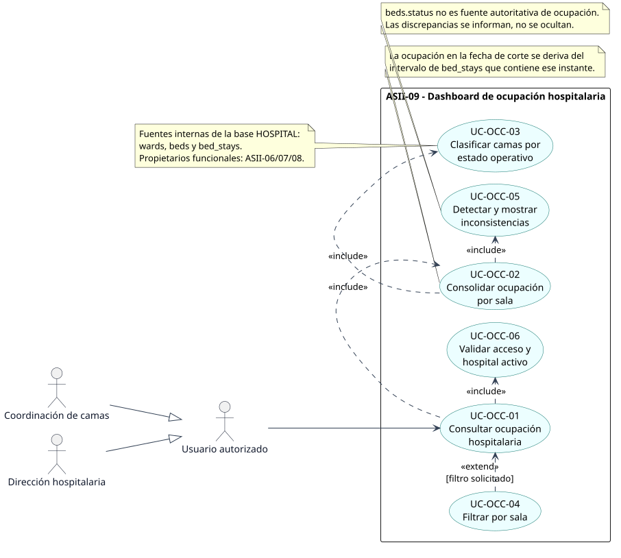
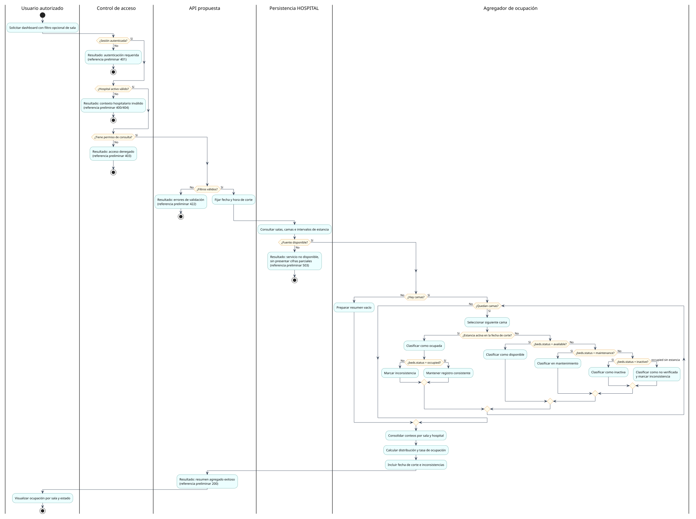
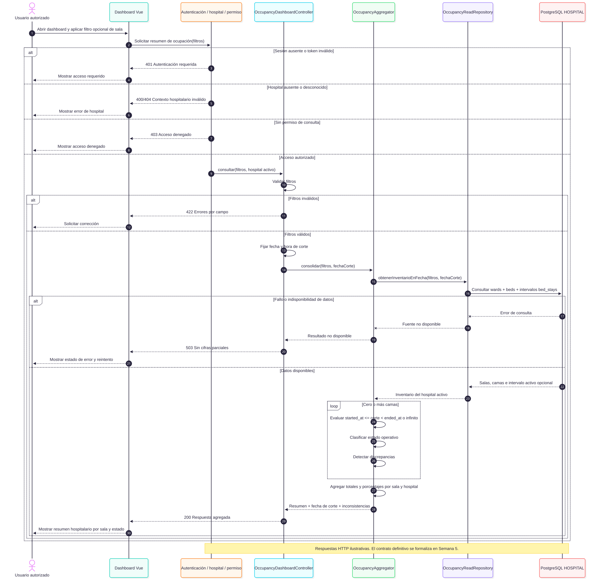

# Dashboard de ocupación hospitalaria - Semana 1

## Ficha de la asignación

- **Estudiante:** FAJARDO LÓPEZ, JAVIER ALEXANDER
- **GitHub:** [`Javifa2324`](https://github.com/Javifa2324)
- **Correo:** `jfajardol3@miumg.edu.gt`
- **Identificador:** `ASII-09`
- **Issue:** [#36](https://github.com/compilations-teams/sistema-hospitalario-integrado-SistenasII-2026-G3/issues/36)
- **Módulo:** Dashboard de ocupación hospitalaria
- **Semana:** Semana 1 - Conceptos generales, orientación a objetos y UML
- **Proceso:** consolidación y consulta de ocupación por sala y estado de cama
- **Estructura:** Sistema Hospitalario Integrado 2026 | Semanas 1-15

## Objetivo

Modelar cómo un usuario autorizado consulta una fotografía de ocupación del hospital, consolidada por sala y estado de cama, con validaciones de acceso, manejo de errores y detección explícita de inconsistencias.

La ocupación se deriva del intervalo de `bed_stays` activo en la fecha de corte; `beds.status` representa el estado operativo y no se usa por sí solo como prueba de ocupación.

## Índice

1. [Introducción](#introducción)
2. [Diagramas](#diagramas)
3. [Evidencia documental](#evidencia-documental)
4. [Fuentes editables y regeneración](#fuentes-editables-y-regeneración)
5. [Evidencia técnica y Git](#evidencia-técnica-y-git)
6. [Conclusión](#conclusión)
7. [Bibliografía](#bibliografía)

## Introducción

La disponibilidad de camas no puede deducirse de una etiqueta aislada. El esquema HOSPITAL conserva el catálogo operativo en `wards` y `beds`, mientras los intervalos clínicos de ocupación se registran en `bed_stays`. Esta entrega modela la consulta agregada de ambas perspectivas, protege el hospital activo y hace visibles las discrepancias para apoyar decisiones sin exponer datos identificables de pacientes.

## Diagramas

### Casos de uso



[Abrir SVG](./01-casos-de-uso.svg) | [Fuente PlantUML](./fuentes/01-casos-de-uso.puml)

Delimita al usuario autorizado y sus especializaciones, las fuentes internas y seis casos de uso trazables. Consultar ocupación incluye validar el acceso, consolidar por sala, clasificar camas y detectar discrepancias.

### Actividad



[Abrir SVG](./02-actividad.svg) | [Fuente PlantUML](./fuentes/02-actividad.puml)

Incluye particiones UML y decisiones de autenticación, hospital, permiso, filtros, disponibilidad, inventario vacío, intervalo de estancia y estado operativo. Los códigos HTTP son referencias preliminares; el contrato se formalizará en Semana 5.

### Secuencia



[Abrir SVG](./03-secuencia.svg) | [Fuente Mermaid](./fuentes/03-secuencia.mmd)

Presenta al usuario, interfaz Vue, middleware, controller, agregador, repositorio de lectura y PostgreSQL HOSPITAL. Los nombres de componentes son una propuesta de análisis, no una afirmación de código ya implementado.

## Evidencia documental

- [Narrativa de alcance y matriz de trazabilidad](./narrativa-alcance-trazabilidad.md)
- [Declaración de uso de IA](./DECLARACION_IA.md)

## Fuentes editables y regeneración

Requisitos: Java con `plantuml.jar`, Node.js y acceso a `npx`.

```bash
java -jar <ruta-a-plantuml.jar> -tsvg docs/ocupacion-hospitalaria/semana-01/fuentes/01-casos-de-uso.puml -o ..
java -jar <ruta-a-plantuml.jar> -tsvg docs/ocupacion-hospitalaria/semana-01/fuentes/02-actividad.puml -o ..
npx -y @mermaid-js/mermaid-cli -i docs/ocupacion-hospitalaria/semana-01/fuentes/03-secuencia.mmd -o docs/ocupacion-hospitalaria/semana-01/03-secuencia.svg -b "#FFFFFF"
```

## Evidencia técnica y Git

- Rama: [`feature/asii-09-semana-01-dashboard-ocupacion-javifa2324`](https://github.com/compilations-teams/sistema-hospitalario-integrado-SistenasII-2026-G3/tree/feature/asii-09-semana-01-dashboard-ocupacion-javifa2324/docs/ocupacion-hospitalaria/semana-01)
- Issue principal: [#36](https://github.com/compilations-teams/sistema-hospitalario-integrado-SistenasII-2026-G3/issues/36)
- Los comandos, resultados y commit evaluado se registran en [`EVIDENCIA.md`](./EVIDENCIA.md).

## Conclusión

Los tres diagramas describen el mismo proceso y separan la ocupación clínica del estado operativo. La fecha de corte evita contar estancias futuras, el camino vacío produce un resultado válido y las inconsistencias permanecen visibles. El diseño limita el dashboard a lectura agregada y deja las operaciones sobre camas y estancias en sus módulos propietarios.

## Bibliografía

- Object Management Group. *Unified Modeling Language (UML), Version 2.5.1*. https://www.omg.org/spec/UML/2.5.1/About-UML
- PlantUML. *Use Case Diagram*. https://plantuml.com/use-case-diagram
- PlantUML. *Activity Diagram (New Syntax)*. https://plantuml.com/activity-diagram-beta
- Mermaid. *Sequence diagrams*. https://mermaid.js.org/syntax/sequenceDiagram.html
- Sistema Hospitalario Integrado 2026. Migración y pruebas HOSPITAL citadas en la [narrativa](./narrativa-alcance-trazabilidad.md#fuentes-del-repositorio).

## Estado

Entrega documental de Semana 1. No implementa API, modelos ni interfaz; esos componentes se desarrollarán en las semanas correspondientes. El PR debe dirigirse a `develop` y usar `Refs #36`.
