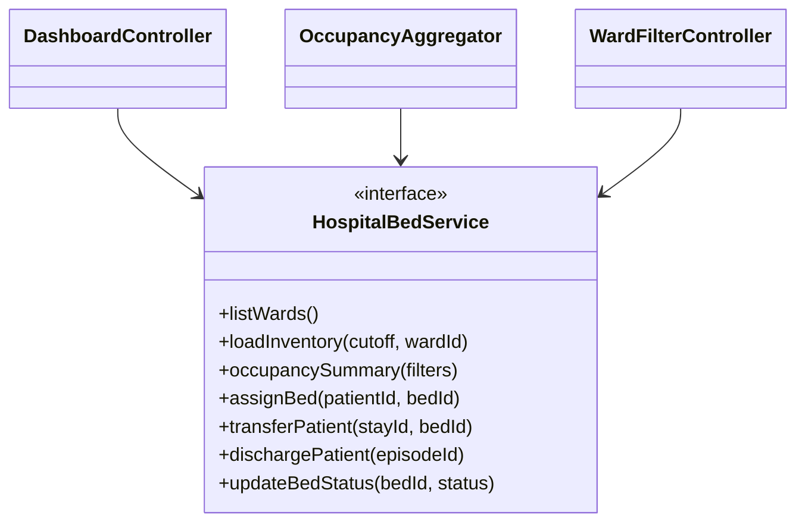
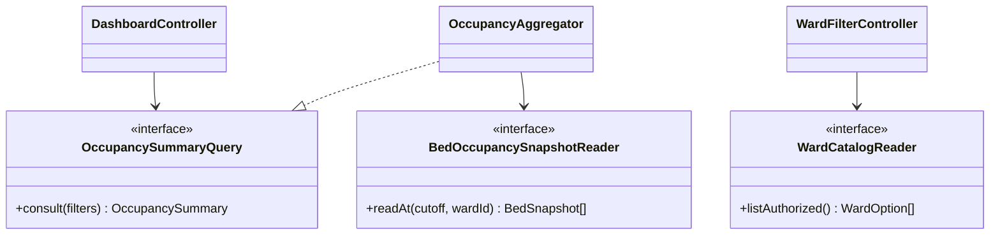

# Aplicación de ISP al dashboard de ocupación

## Principio aplicado

ISP recomienda crear interfaces pequeñas con pocos métodos para evitar que una clase dependa de operaciones que no necesita. La fuente obligatoria explica que ningún cliente debe quedar obligado a implementar métodos ajenos a su responsabilidad.

Fuente: Rodríguez González, L. M. *Principios básicos del diseño de software*. MVP Cluster. <https://mvpcluster.com/diseno-de-software-2/>.

## Diseño antes de ISP: anti-patrón descartado

Este escenario hipotético representa una integración directa con los módulos ASII-06, ASII-07 y ASII-08. No describe código existente ni reemplaza el diseño de Semana 1; hace visible el acoplamiento que ISP evita antes de implementar.

[Fuente Mermaid editable](./fuentes/01-diseno-antes-isp.mmd)

### Problemas

- El dashboard de solo lectura depende de asignación, traslado, alta y actualización de camas que no utiliza.
- Un cambio en ASII-06, ASII-07 o ASII-08 obliga a cambiar el contrato consumido por ASII-09.
- Los dobles de prueba deben implementar métodos de escritura irrelevantes.
- El contrato grande facilita que el dashboard invada responsabilidades de otros módulos.

## Diseño después de ISP

[Fuente Mermaid editable](./fuentes/02-diseno-despues-isp.mmd)

## Responsabilidades y dependencias

| Contrato o consumidor | Responsabilidad única dentro del flujo | No conoce |
|---|---|---|
| `OccupancySummaryQuery` | Consultar un resumen agregado con filtro y fecha de corte. | SQL, asignaciones, traslados o altas. |
| `BedOccupancySnapshotReader` | Leer camas e intervalos en una consulta única o transacción de aislamiento repetible. | HTTP, porcentajes o presentación. |
| `WardCatalogReader` | Proveer las salas que el usuario puede consultar en el hospital activo. | Estancias, reglas de ocupación o cambios de estado. |
| `DashboardController` | Validar la entrada y solicitar el resumen. | Métodos de escritura y persistencia. |
| `OccupancyAggregator` | Fijar `T`, clasificar cada cama, detectar discrepancias y calcular agregados. | Vue y operaciones clínicas. |
| `WardFilterController` | Entregar opciones autorizadas al selector. | Consolidación y estados de estancia. |

`OccupancyAggregator` implementa el contrato que necesita el controller y depende del lector mínimo que requiere para consolidar. El lector debe devolver una fotografía atómica: compartir `T` no basta si camas y estancias se consultan por separado mientras ocurre un traslado. Aunque una implementación concreta pudiera ofrecer varios contratos, cada consumidor recibe únicamente su interfaz especializada.

La segregación preserva la propiedad funcional: ASII-06 administra salas y camas, ASII-07 admite y ASII-08 traslada o da de alta. ASII-09 solo consume proyecciones de lectura. La selección del adaptador PostgreSQL corresponde a las semanas de implementación y no cambia estos contratos.

## Beneficio verificable

- Cambiar una operación de traslado no modifica ni invalida `OccupancySummaryQuery`.
- El controller se prueba con un doble de un solo método.
- El agregador no puede asignar o liberar camas por accidente.
- Las tres interfaces tienen un único método dirigido a su consumidor, como verifica la evidencia.
