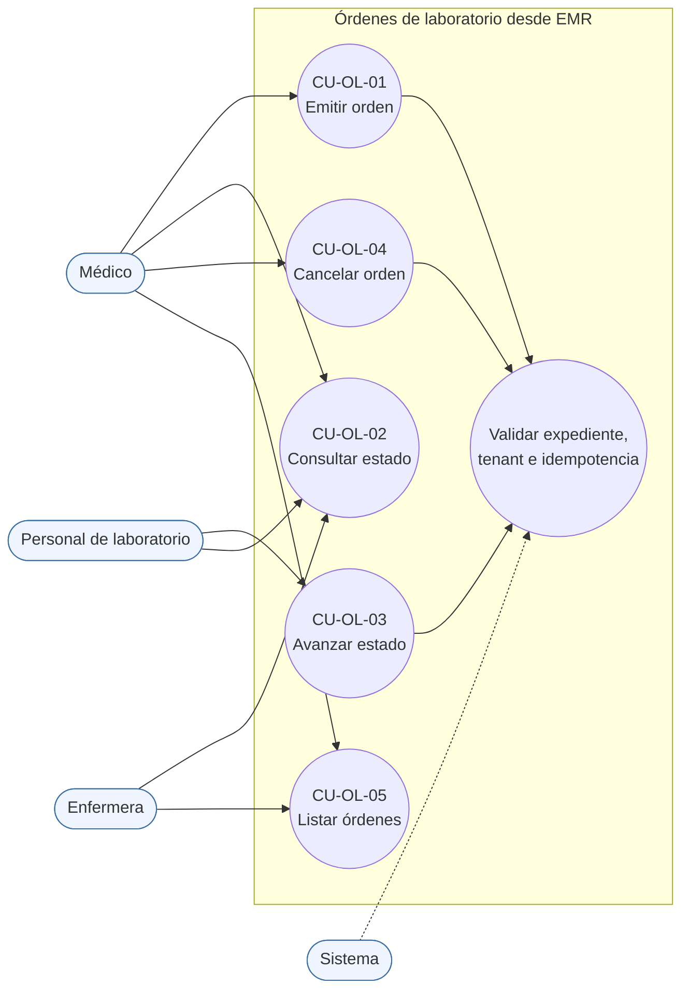
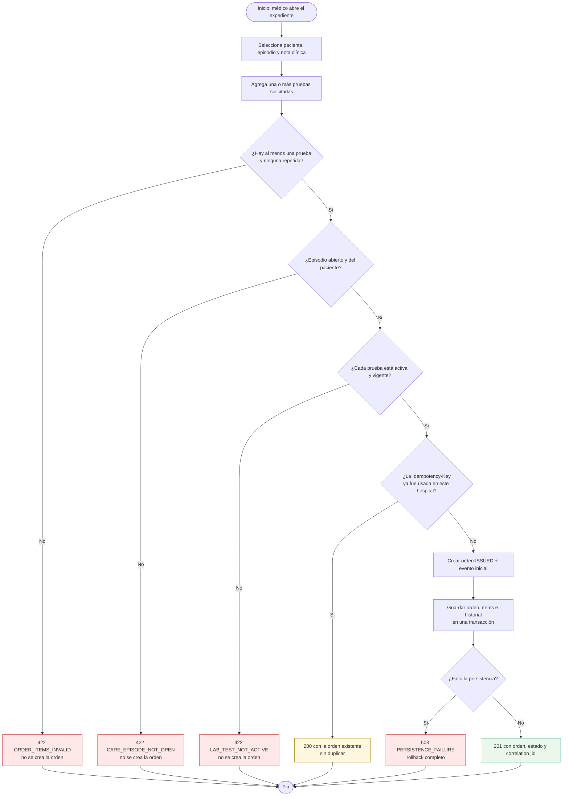
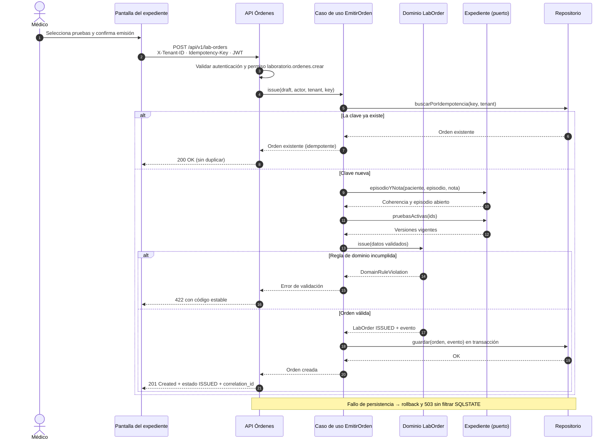

# Órdenes de laboratorio desde EMR — Semana 1: UML y narrativa de alcance

**Módulo:** Órdenes de laboratorio desde EMR (ASII-16) · **Entrega académica:** Fajardo López, Javier Alexander (`Javifa2324`, ASII-09)
**Flujo:** «emisión de orden desde el expediente y seguimiento de su estado»
**Narrativa completa:** [`narrativa-alcance-trazabilidad.md`](./narrativa-alcance-trazabilidad.md)

## 1. Alcance

El módulo convierte una decisión clínica tomada dentro del expediente en una **orden de laboratorio
trazable** y permite seguir su estado hasta la validación del resultado. Esta entrega modela el
proceso; no implementa todavía el micro-HIS.

| Dentro del alcance | Fuera del alcance (otros dueños) |
|---|---|
| Emitir la orden desde un paciente, episodio y nota clínica | Catálogo y versiones de pruebas (`lab_tests`, ASII-17) |
| Validar coherencia expediente–episodio–prueba y permisos | Toma y recepción física de muestras (`specimens`) |
| Registrar y consultar los estados de la orden | Captura, validación y publicación de resultados (`lab_result_versions`) |
| Cancelar mientras el proceso lo permita | Notificaciones y alertas críticas (ASII-21) |
| Dejar rastro de cada transición (quién, cuándo, por qué) | Infraestructura de identidad, RBAC y auditoría global |

## 2. Actores y permisos

| Actor | Objetivo | Permiso propuesto |
|---|---|---|
| Médico del expediente | Emitir la orden con las pruebas indicadas | `laboratorio.ordenes.crear` |
| Médico o enfermera | Consultar la orden y su estado | `laboratorio.ordenes.ver` |
| Personal de laboratorio | Avanzar el estado (tomada, en proceso, con resultado) | `laboratorio.ordenes.actualizar` |
| Médico autorizado | Cancelar una orden que aún no terminó | `laboratorio.ordenes.cancelar` |
| Sistema | Validar tenant, idempotencia, transiciones y auditoría | — |

Los nombres `laboratorio.ordenes.*` son **propuestos**: el catálogo RBAC de `develop` todavía no los
define (`PENDIENTES-INTEGRACION.md`, punto 2). El micro-HIS los representa con roles locales y nunca
modifica el RBAC del sistema completo.

## 3. Casos de uso

| ID | Caso de uso | Actor primario | Resultado |
|---|---|---|---|
| CU-OL-01 | Emitir orden desde el expediente | Médico | Orden `ISSUED` con ítems y evento inicial |
| CU-OL-02 | Consultar el estado de una orden | Médico / enfermera | Orden, ítems e historial de estados |
| CU-OL-03 | Avanzar el estado de la orden | Personal de laboratorio | Nueva transición válida registrada |
| CU-OL-04 | Cancelar una orden | Médico autorizado | Orden `CANCELLED` con motivo y actor |
| CU-OL-05 | Listar órdenes por paciente o episodio | Médico / enfermera | Órdenes del tenant, filtradas y paginadas |

### 3.1 Diagrama de casos de uso

### 3.2 Diagrama de actividad

Incluye las decisiones, las excepciones y el resultado del flujo principal.

### 3.3 Diagrama de secuencia

Muestra participantes, mensajes, validaciones y respuesta.

## 4. Trazabilidad entre los tres diagramas

| Caso de uso | Nodo de actividad | Mensajes de secuencia | Regla o excepción |
|---|---|---|---|
| CU-OL-01 Emitir | B → C → D → F → H → L → M | `POST /lab-orders` → `issue` → `guardar` | Ítems, episodio abierto, prueba vigente, idempotencia |
| CU-OL-02 Consultar | Lectura de orden e historial | `GET /lab-orders/{id}` → `buscar` | Aislamiento por tenant; 404 si es de otro hospital |
| CU-OL-03 Avanzar | Transición de estado permitida | `PATCH /lab-orders/{id}/status` | Solo transiciones del catálogo; actor autorizado |
| CU-OL-04 Cancelar | Decisión de cancelación y motivo | `POST /lab-orders/{id}/cancel` | No cancelar una orden ya validada; motivo obligatorio |
| CU-OL-05 Listar | Filtro por paciente o episodio | `GET /lab-orders?patient=…` | Paginación limitada y tenant obligatorio |

La narrativa detalla cada decisión, los supuestos y los límites: [`narrativa-alcance-trazabilidad.md`](./narrativa-alcance-trazabilidad.md).

## 5. Evidencia y honestidad

- Los tres diagramas son fuentes Mermaid versionadas en este mismo README; GitHub las renderiza.
- Esta semana es **diseño**: no hay código ejecutado ni capturas que presentar.
- La declaración de uso de IA está en [`DECLARACION_IA.md`](./DECLARACION_IA.md) y queda pendiente de validación humana.
