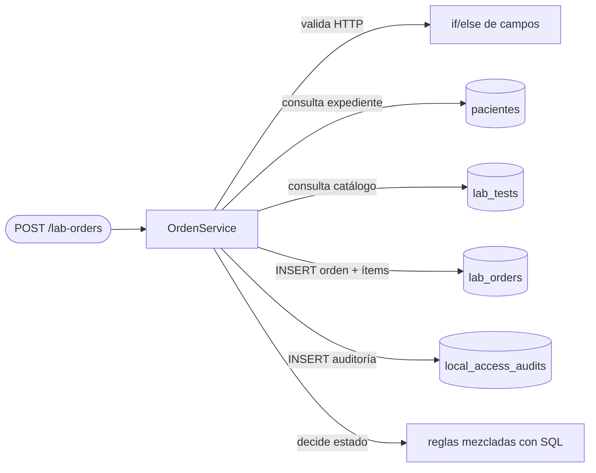
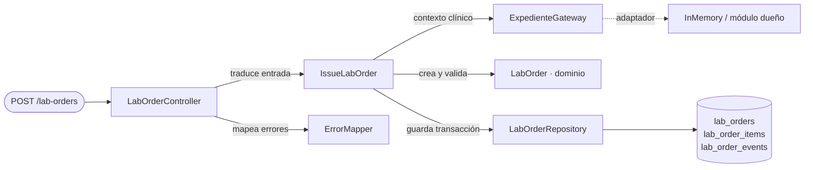

# Órdenes de laboratorio desde EMR — Semana 2: proceso, SOLID y criterios

**Módulo:** Órdenes de laboratorio desde EMR (ASII-16) · **Entrega académica:** Fajardo López, Javier Alexander (`Javifa2324`, ASII-09)
**Base:** [Semana 1](../semana-01/README.md) · **RF/RNF:** [`rf-rnf-criterios.md`](./rf-rnf-criterios.md) · **SRP:** [`solid-srp.md`](./solid-srp.md)

## 1. Proceso y modelo de diseño

El proceso se modela como **cuatro responsabilidades separables** alrededor de una misma orden:

| Responsabilidad | Pregunta que responde | Cambia cuando… |
|---|---|---|
| Entrada (Controlador) | ¿Cómo llega la petición y cómo se responde? | cambia HTTP, formato o código de estado |
| Aplicación (Caso de uso) | ¿Qué pasos y en qué orden? | cambia el flujo, la idempotencia o la coordinación |
| Dominio (Orden) | ¿Qué es una orden válida y qué transiciones existen? | cambia una regla clínica o de estado |
| Persistencia (Repositorio) | ¿Cómo se guarda y se recupera? | cambia el motor, el esquema o la transacción |

El expediente y el catálogo de pruebas **no pertenecen** al módulo: se consultan a través de un
puerto (`ExpedienteGateway`) con adaptador en memoria mientras sus dueños publican los contratos.

## 2. Diseño antes / después (SRP)

### 2.1 Antes: una clase que hace todo

Problemas: cuatro motivos de cambio en una clase, SQL y reglas clínicas mezclados, imposible probar
la regla de estado sin base de datos y el controlador conoce detalles de persistencia.

### 2.2 Después: responsabilidades separadas

Cada clase tiene **una razón para cambiar** y una frontera comprobable. El detalle del refactor y la
justificación de dependencias están en [`solid-srp.md`](./solid-srp.md).

## 3. Requisitos y criterios

Los RF/RNF completos, con criterio de aceptación verificable, están en
[`rf-rnf-criterios.md`](./rf-rnf-criterios.md). Resumen:

- **12 requisitos funcionales:** emisión, coherencia del expediente, vigencia del catálogo,
  idempotencia, consulta, transiciones, cancelación, listado, tenant, trazabilidad, errores y permisos.
- **10 requisitos no funcionales:** atomicidad, falla segura, rendimiento medible, seguridad,
  auditabilidad, portabilidad PHP 8.2+, pruebas sin framework, accesibilidad, paginación y mantenibilidad.

## 4. Evidencia verificable de esta semana

| Evidencia | Cómo se comprueba |
|---|---|
| SRP aplicado | Diagramas antes/después y tabla de responsabilidades de `solid-srp.md` |
| Justificación de dependencias | Dirección de dependencias: Entrada → Aplicación → Dominio; Persistencia implementa el puerto |
| Criterios observables | Cada RF/RNF tiene un «entonces» que puede convertirse en prueba |
| Coherencia con el proyecto | Nombres `lab_orders`, `lab_order_items`, `lab_tests`, `specimens` y permisos del contrato #343 |

Esta semana sigue siendo de **diseño**. La ejecución real de pruebas comienza en la semana 3 con el
micro-HIS; no se presentan resultados inventados.

## 5. Declaración de IA

[`DECLARACION_IA.md`](./DECLARACION_IA.md), con validación humana pendiente.
