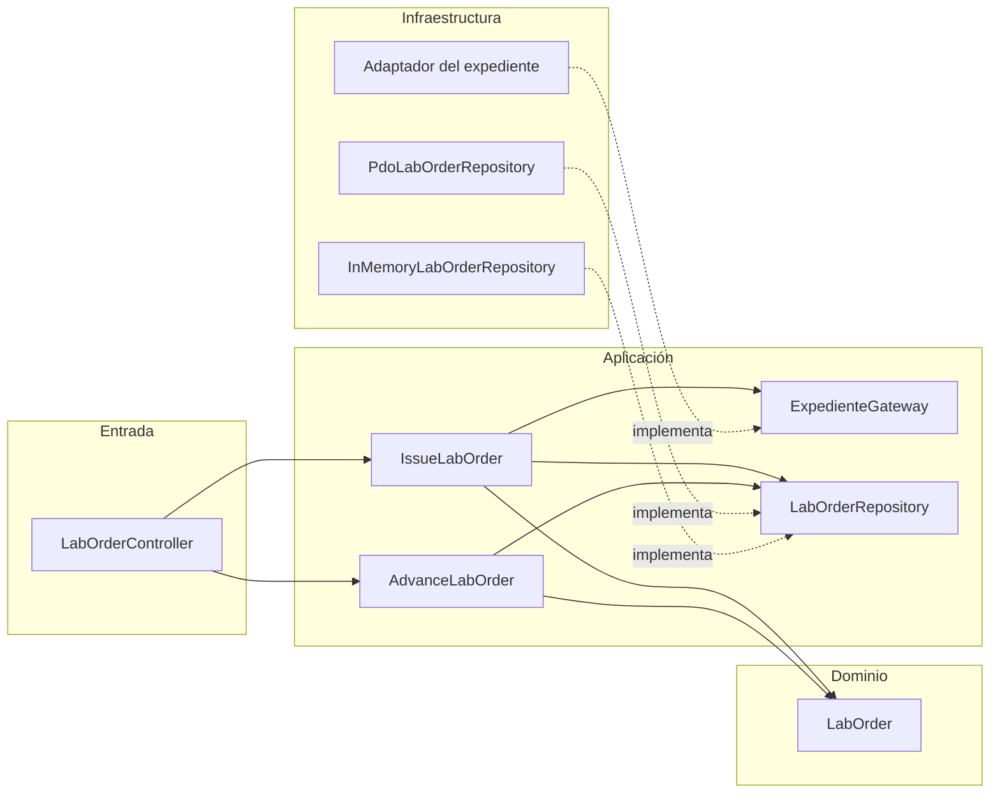

# SRP aplicado al flujo de órdenes de laboratorio

**Semana 2 · Principio:** Single Responsibility Principle (SRP) y dirección de dependencias.

## 1. Punto de partida

La propuesta inicial concentraba en un solo servicio la traducción HTTP, la validación de campos, la
consulta del expediente, la consulta del catálogo, la decisión de estado, el SQL y la auditoría:

```php
final class OrdenService
{
    public function crear(array $input, ?string $token): array
    {
        // 1. valida token, tenant y campos
        // 2. consulta pacientes / episodios con SQL
        // 3. consulta lab_tests con SQL
        // 4. decide si la orden nace ISSUED
        // 5. INSERT en lab_orders, lab_order_items y auditoría
        // 6. arma la respuesta HTTP y traduce errores
    }
}
```

Esa clase tenía **seis razones para cambiar**. Probar una regla clínica exigía una base de datos y
un token, y cualquier cambio de esquema obligaba a tocar el mismo archivo que la respuesta HTTP.

## 2. Refactor propuesto

| Clase / interfaz | Responsabilidad única | Depende de |
|---|---|---|
| `LabOrderController` | Traducir la petición y elegir la respuesta HTTP | Casos de uso y `ErrorMapper` |
| `ErrorMapper` | Convertir errores de dominio/aplicación a códigos HTTP estables | Nada |
| `IssueLabOrder` | Orquestar la emisión: idempotencia, contexto, dominio, guardado | `ExpedienteGateway`, `LabOrderRepository` |
| `AdvanceLabOrder` | Orquestar una transición de estado | Repositorio y dominio |
| `LabOrder` | Invariantes de la orden y catálogo de transiciones | Nada |
| `ExpedienteGateway` (puerto) | Obtener coherencia y vigencia del expediente/catálogo | Nada (lo implementa el adaptador) |
| `LabOrderRepository` (puerto) | Guardar y recuperar órdenes, ítems y eventos | Nada |
| `PdoLabOrderRepository` | Implementar el puerto con PDO y transacción | PDO, dominio |
| `InMemoryLabOrderRepository` | Implementar el puerto para pruebas | Dominio |

## 3. Dirección de dependencias



Las flechas de dependencia apuntan hacia el dominio y los puertos. La infraestructura queda afuera y
se inyecta al armar la aplicación, igual que en `micro-his/catalogo-pruebas-lab` del proyecto.

## 4. Antes / después de una operación

**Antes:** un método de 120 líneas dentro del controlador, con `prepare()` intercalado y reglas de
estado en `if` anidados.

**Después:**

```php
// Entrada: solo traduce y delega.
final class LabOrderController
{
    public function __construct(private readonly IssueLabOrder $issue) {}

    public function store(array $input, string $actor, string $tenant): array
    {
        try {
            $order = $this->issue->execute($input, $actor, $tenant);
            return [201, ['lab_order' => $order->toArray()]];
        } catch (DomainRuleViolation $e) {
            return [422, ['error' => $e->code, 'field' => $e->field]];
        } catch (PersistenceFailure) {
            return [503, ['error' => 'PERSISTENCE_FAILURE']];
        }
    }
}
```

```php
// Aplicación: orquesta sin SQL ni HTTP.
final class IssueLabOrder
{
    public function execute(array $input, string $actor, string $tenant): LabOrder
    {
        $context = $this->expediente->contextFor($tenant, $input['local_patient_id'], $input['care_episode_id']);
        $this->expediente->assertOpen($context, $input['clinical_note_id'] ?? null);
        $this->expediente->assertTestsActive($tenant, array_column($input['items'], 'lab_test_id'));

        return $this->repository->save($tenant, LabOrder::issue($input, $actor));
    }
}
```

```php
// Dominio: no sabe de HTTP, PDO ni tenant físico.
$rule = match (true) {
    $items === [] => ['ORDER_ITEMS_INVALID', 'items'],
    count($items) !== count(array_unique(array_column($items, 'lab_test_id'))) => ['ORDER_ITEMS_INVALID', 'items'],
    !in_array($priority, ['ROUTINE', 'URGENT', 'STAT'], true) => ['PRIORITY_UNSUPPORTED', 'priority'],
    default => null,
};
```

## 5. Por qué este refactor y no otro

- **Acoplamiento señalado:** el controlador era el punto con más dependencias (HTTP + validación +
  SQL + auditoría). Separarlo es el cambio de mayor impacto y menor riesgo.
- **No se amplía el módulo:** no se agregan pantallas ni tablas; solo se distribuyen
  responsabilidades que ya existían.
- **Se conserva el contrato:** los endpoints y códigos de error no cambian.
- **Se puede verificar:** cada clase se prueba por separado; el repositorio en memoria permite la
  batería sin PostgreSQL, y el adaptador PDO se prueba contra una base real en las semanas 3 y 4.

## 6. Límites

No se crean abstracciones para alertas, resultados ni auditoría global: sus contratos no existen en
`develop` y crearlas ahora violaría la regla de no inventar integraciones ajenas. El módulo deja el
puerto de expediente listo para conectar el adaptador real cuando su dueño lo publique.
