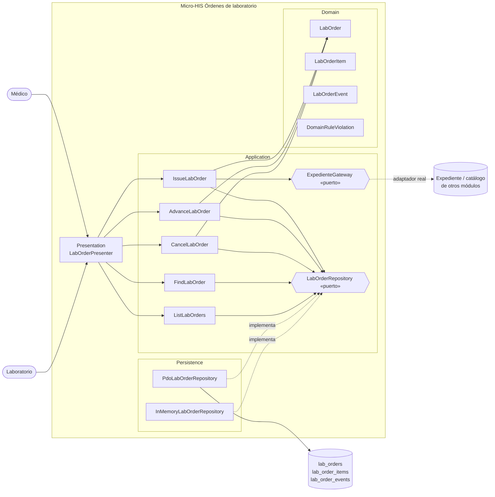

# Órdenes de laboratorio desde EMR — Semana 3: Micro-HIS por capas

**Módulo:** Órdenes de laboratorio desde EMR (ASII-16) · **Entrega académica:** Fajardo López, Javier Alexander (`Javifa2324`, ASII-09)
**Código:** [`micro-his/ordenes-laboratorio`](../../../micro-his/ordenes-laboratorio/)
**Flujo:** emisión de orden desde el expediente y seguimiento de su estado.

## 1. Arquitectura (C4, nivel 3)



| Capa | Responsabilidad | No debe |
|---|---|---|
| Presentation | Formatear respuestas y mapear errores a códigos estables | Decidir reglas clínicas ni ejecutar SQL |
| Application | Orquestar idempotencia, coherencia del expediente y guardado | Conocer HTTP, SQL o detalles de PDO |
| Domain | Invariantes de la orden y transiciones permitidas | Depender de framework, PDO o tenant físico |
| Persistence | Guardar y recuperar con PDO preparado y transacciones | Contener reglas de negocio |

## 2. Modelo de dominio

- **`LabOrder`**: nace `ISSUED`; catálogo cerrado de estados y transiciones.
  `ISSUED → COLLECTED → IN_PROCESS → RESULTED → VALIDATED`, con `CANCELLED` desde los estados no
  terminales.
- **`LabOrderItem`**: guarda `lab_test_id` y una instantánea (`code`, `name`) del catálogo.
- **`LabOrderEvent`**: `from_status`, `to_status`, actor, fecha, `correlation_id` y motivo. El
  historial es **append-only**.
- **`ExpedienteGateway`**: puerto hacia expediente y catálogo; en esta entrega lo implementa un doble
  en memoria. No se crean tablas de otros módulos.
- **`LabOrderRepository`**: puerto con `create`, `updateStatus`, `find`, `findByIdempotency` y
  `search`; dos adaptadores, PDO e InMemory.

## 3. Decisiones de diseño

1. **Una orden referencia, no copia, el expediente**: se validan paciente, episodio y nota contra el
   puerto, pero no se persisten datos clínicos del paciente.
2. **Idempotencia en la base**: `UNIQUE (tenant_id, idempotency_key)`; la carrera entre dos
   peticiones se resuelve devolviendo la orden ya creada.
3. **Atomicidad**: orden, ítems y eventos se escriben en una transacción; un fallo no deja una orden
   parcial.
4. **Historial inmutable**: `updateStatus` actualiza la cabecera e inserta exactamente un evento; no
   hay `UPDATE` ni `DELETE` sobre `lab_order_events`.
5. **Portabilidad**: el `schema.sql` usa `TEXT`, `CHECK` y claves explícitas, compatible con
   PostgreSQL 13+ y SQLite; las pruebas corren con ambos motores.

## 4. Evidencia ejecutada (22-oct-2026)

Pruebas locales sin framework, con la misma batería sobre tres adaptadores:

```text
$ php micro-his/ordenes-laboratorio/tests/run.php
== InMemory ==
PASS  emisión válida nace ISSUED
...
PASS  fallo de persistencia no deja orden a medias
OK: todas las verificaciones aprobadas

== PDO/SQLite ==
...
OK: todas las verificaciones aprobadas
```

Contra PostgreSQL 16.15 real (`bd-hospital`, puerto 55433, base temporal `his_lab_orders_verify`):

```text
$ podman run ... php tests/run.php
== PDO/PostgreSQL ==
PASS  emisión válida nace ISSUED
...
PASS  el presentador mapea una caída a 503
OK: todas las verificaciones aprobadas
```

Resultado: **25 verificaciones por adaptador, 75 en total, todas aprobadas**. La base temporal se
elimina al terminar; no se toca `his_hospital_test`.

## 5. Trazabilidad con el proyecto

- Nombres de entidad `lab_orders`, `lab_order_items` y `lab_tests` alineados con el contrato #343 y
  con la especificación H6/H7 de `openspec/`.
- No se crean migraciones Laravel ni tablas de otros módulos; el esquema vive dentro del micro-HIS.
- Los estados compartidos con muestras y resultados siguen pendientes de acuerdo y se documentan como
  propuesta en [`../PENDIENTES-INTEGRACION.md`](../PENDIENTES-INTEGRACION.md).

## 6. Declaración de IA

[`DECLARACION_IA.md`](./DECLARACION_IA.md), con validación humana pendiente.
