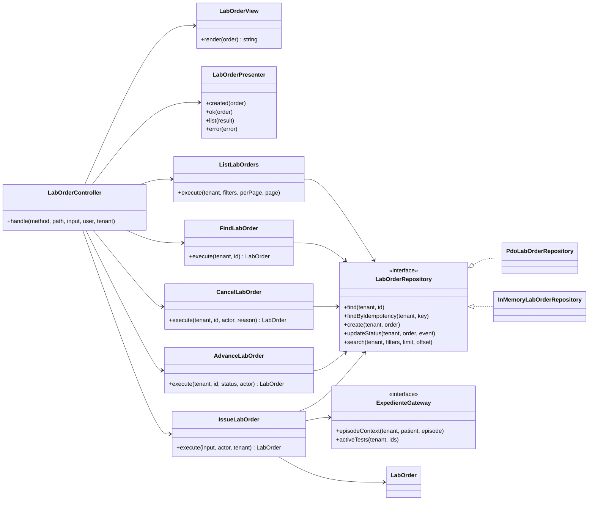
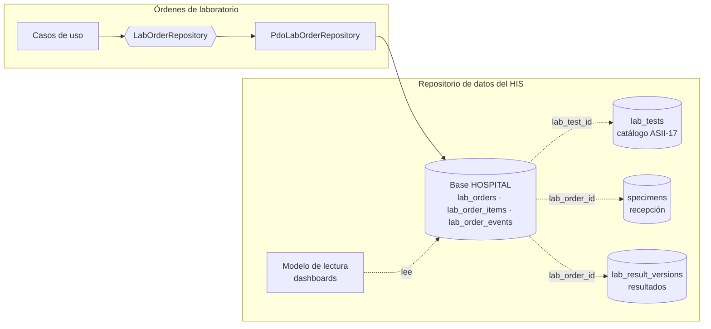

# Órdenes de laboratorio desde EMR — Semana 4: MVC y patrón Repository

**Módulo:** Órdenes de laboratorio desde EMR (ASII-16) · **Entrega académica:** Fajardo López, Javier Alexander (`Javifa2324`, ASII-09)
**Código:** [`micro-his/ordenes-laboratorio`](../../../micro-his/ordenes-laboratorio/) · **Semana anterior:** [Semana 3](../semana-03/README.md)

Sobre el **mismo** micro-HIS de la semana 3, esta entrega formaliza la entrada con **MVC** y demuestra
que el **Repository** admite dos adaptadores intercambiables (`PDO` e `InMemory`) sin cambiar los
casos de uso.

## 1. Mapa MVC

| Rol | Clase | Qué hace | Qué no hace |
|---|---|---|---|
| Model | `Domain/LabOrder`, `Domain/LabOrderItem`, `Domain/LabOrderEvent`, casos de uso y `LabOrderRepository` | Reglas de la orden y acceso a datos a través del puerto | No sabe de HTTP ni de HTML |
| View | `Presentation/LabOrderView` | Representa la orden y su historial en HTML y escapa todo texto | No consulta datos ni decide estados |
| Controller | `Presentation/LabOrderController` | Traduce método/ruta/entrada, delega en casos de uso y elige JSON o HTML | No tiene SQL ni reglas de negocio |
| Front controller | `public/index.php` (semana 5) | Arma dependencias y lee la petición real | No contiene lógica clínica |

## 2. Diagrama de clases



## 3. Contrato del Repository

| Método | Responsabilidad | Garantía |
|---|---|---|
| `find(tenant, id)` | Recuperar una orden con ítems y eventos | Aísla por tenant; `null` si no existe |
| `findByIdempotency(tenant, key)` | Resolver reintentos | Devuelve la orden ya creada o `null` |
| `create(tenant, order)` | Insertar cabecera, ítems y eventos | Transacción atómica; duplicado → `PersistenceFailure` |
| `updateStatus(tenant, order, event)` | Cambiar estado y añadir el evento | Historial append-only |
| `search(tenant, filters, limit, offset)` | Listar por paciente, episodio o estado | Paginación acotada |

Los dos adaptadores superan la **misma batería de contrato**; ninguna prueba conoce detalles de PDO.

## 4. Refactor de entrada: antes / después

| Antes (semana 3) | Después (semana 4) |
|---|---|
| `LabOrderPresenter` era el único punto de entrada y mezclaba formato con despacho | `LabOrderController` despacha rutas; `LabOrderView` renderiza HTML; `LabOrderPresenter` sigue mapeando JSON y errores |
| No existía vista de la orden | La orden y su historial se representan en HTML escapado |
| Las pruebas llamaban a los casos de uso | Las pruebas recorren el controlador como lo haría la API |

El controlador **no contiene SQL ni reglas**: solo `match` de rutas, llamadas a casos de uso y
traducción de errores. Esa separación es la que permite probar la regla sin HTTP y el HTTP sin base.

## 5. ¿Cómo integraría un repositorio de datos compartido?

El módulo ya está preparado para compartir datos sin compartir tablas:



Reglas de integración:

1. **Un dueño por tabla:** órdenes es dueño de sus tres tablas; catálogo, muestras y resultados son
   dueños de las suyas. Se referencian por ID lógico, no con escrituras cruzadas.
2. **El puerto es el contrato:** cualquier consumidor interno usa `LabOrderRepository`; el adaptador
   decide si lee de la base del hospital o de una vista/materialización.
3. **Transacción por operación:** crear orden + ítems + evento ocurre en una transacción; los otros
   módulos reaccionan a eventos, no a escrituras compartidas.
4. **Lecturas separadas de escrituras:** un dashboard puede leer un modelo de consulta sin acoplarse
   al dominio de órdenes.
5. **Sin migraciones ajenas:** este módulo no crea `lab_tests`, `specimens` ni
   `lab_result_versions`; esas migraciones las publican sus dueños.

## 6. Evidencia ejecutada

```text
$ php micro-his/ordenes-laboratorio/tests/mvc.php
PASS  sin usuario → 401
PASS  el controlador delega la emisión → 201
PASS  consulta JSON de la orden → 200
PASS  la View HTML lista las pruebas
PASS  la View escapa el texto dinámico
PASS  PATCH a COLLECTED → 200
PASS  transición inválida → 409
PASS  cancelación con motivo → 200 CANCELLED
PASS  orden inexistente → 404
PASS  ruta desconocida → 404
PASS  listado filtrado por estado → 1
PASS  per_page fuera de rango → 422
OK: verificaciones MVC aprobadas
```

La batería de contrato de la semana 3 sigue en verde con los tres adaptadores (25 verificaciones por
adaptador, 75 en total), incluida PostgreSQL 16 real.

## 7. Declaración de IA

[`DECLARACION_IA.md`](./DECLARACION_IA.md), con validación humana pendiente.
