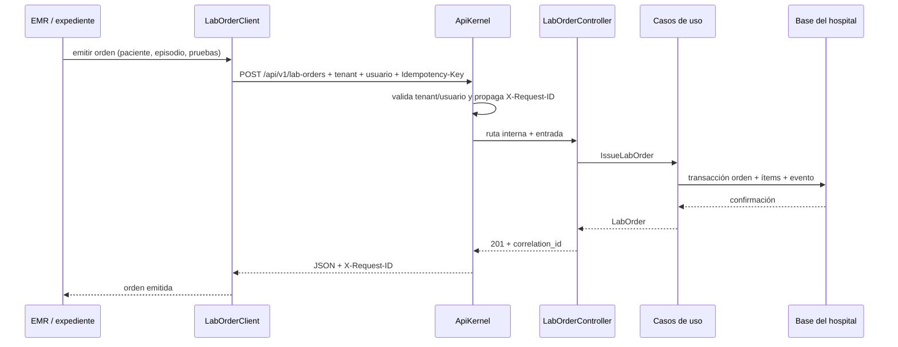

# Órdenes de laboratorio desde EMR — Semana 5: API y cliente

**Módulo:** Órdenes de laboratorio desde EMR (ASII-16) · **Entrega académica:** Fajardo López, Javier Alexander (`Javifa2324`, ASII-09)
**Código:** [`micro-his/ordenes-laboratorio`](../../../micro-his/ordenes-laboratorio/) · **Semanas previas:** [3](../semana-03/README.md) · [4](../semana-04/README.md)
**Contrato:** [`openapi.yaml`](./openapi.yaml)

## 1. Frontera del microservicio



El EMR **solo** usa el contrato HTTP. No lee tablas de órdenes ni comparte transacciones: recibe el
`lab_order_id` y consulta el estado por la API. El módulo de laboratorio (muestras/resultados) puede
consumir la misma API o reaccionar a los eventos del historial.

## 2. Endpoints

| Método | Ruta | Quién | Resultado |
|---|---|---|---|
| `GET` | `/health` | Infraestructura | `200 {"status":"ok"}` |
| `GET` | `/health/ready` | Infraestructura | `200 {"status":"ready"}` |
| `POST` | `/api/v1/lab-orders` | Médico | `201` orden nueva / `200` recuperada por idempotencia |
| `GET` | `/api/v1/lab-orders` | Médico / laboratorio | `200` página filtrable por paciente, episodio o estado |
| `GET` | `/api/v1/lab-orders/{id}` | Médico / laboratorio | `200` orden con ítems e historial |
| `PATCH` | `/api/v1/lab-orders/{id}/status` | Laboratorio | `200` estado avanzado |
| `POST` | `/api/v1/lab-orders/{id}/cancel` | Médico | `200` orden `CANCELLED` con motivo |

Cabeceras obligatorias: `X-Tenant-ID`, `X-User-Ref` y `X-Permissions` (permisos ya verificados por
el gateway); `Idempotency-Key` en la emisión; `X-Request-ID` es opcional y se devuelve siempre.

## 3. Errores y códigos

| HTTP | `code` | Cuándo |
|---|---|---|
| `400` | `TENANT_REQUIRED` / `INVALID_JSON` | Falta el tenant o el cuerpo no es JSON |
| `401` | `UNAUTHENTICATED` | Falta el usuario |
| `404` | `NOT_FOUND` / `ORDER_NOT_FOUND` | Ruta u orden inexistente en el tenant |
| `403` | `FORBIDDEN` | Falta el permiso `laboratorio.ordenes.*` de la operación |
| `409` | `INVALID_STATUS_TRANSITION` / `ORDER_ALREADY_VALIDATED` | Transición o cancelación no permitida |
| `422` | `IDEMPOTENCY_KEY_REQUIRED`, `FIELD_REQUIRED`, `LAB_TEST_NOT_ACTIVE`, `ORDER_ITEMS_INVALID`, … | Regla de negocio incumplida |
| `503` | `PERSISTENCE_FAILURE` | La base no respondió; reintentar con la misma clave |

Formato `application/problem+json` (RFC 9457) con `type`, `title`, `status`, `code`, `request_id` y
`field` cuando aplica.

## 4. Idempotencia y reintentos

- La emisión exige `Idempotency-Key` (cabecera o campo del cuerpo) y la base impone
  `UNIQUE (tenant_id, idempotency_key)`.
- Un reintento con la misma clave devuelve **la misma orden**, no una segunda.
- El cliente HTTP **solo reintenta lecturas (`GET`)**; las escrituras no se reintentan a ciegas porque
  el resultado podría ser ambiguo. El llamador decide reintentar con la misma clave.
- Timeout de conexión y lectura: 2 s por defecto; al agotarse lanza `LabOrdersUnavailable`.

## 5. Seguridad (estado actual y siguiente paso)

En esta entrega el kernel **confía** en `X-Tenant-ID`, `X-User-Ref` y `X-Permissions`, inyectados por
el gateway de desarrollo. En producción ese gateway debe validar OAuth2/OIDC, derivar tenant y
permisos del token y **sobrescribir** las tres cabeceras; además, la comunicación debe ir por
TLS/mTLS. El módulo aplica la regla `laboratorio.ordenes.*` de cada ruta y devuelve `403` si falta,
pero la autoridad final de los permisos es el gateway, no la cabecera enviada por el cliente.

## 6. Evidencia ejecutada (22-oct-2026)

Batería del kernel, sin red:

```text
$ php micro-his/ordenes-laboratorio/tests/api.php
PASS  /health sin credenciales → 200
PASS  sin X-Tenant-ID → 400
PASS  el error usa problem+json
PASS  el error incluye request_id generado
PASS  sin X-User-Ref → 401
PASS  emisión → 201 con X-Request-ID
PASS  sin permiso de creación → 403
PASS  misma Idempotency-Key recupera con 200
PASS  Idempotency-Key por cabecera es aceptada
PASS  GET orden → 200
PASS  otro tenant no ve la orden → 404
PASS  PATCH de estado → 200
PASS  transición inválida → 409
PASS  el 409 conserva el campo
PASS  cancelación → 200 CANCELLED
PASS  sin Idempotency-Key → 422
PASS  ruta desconocida → 404
PASS  método desconocido → 404
OK: verificaciones de API aprobadas
```

Cliente real contra un servidor PHP levantado en `127.0.0.1:8091`, con SQLite persistente:

```text
$ php -S 127.0.0.1:8091 -t public public/index.php
$ php micro-his/ordenes-laboratorio/tests/client.php
PASS  cliente crea la orden por HTTP → 201
PASS  cliente consulta la orden → 200
PASS  cliente avanza a COLLECTED → 200
PASS  cliente cancela con motivo → 200
PASS  cliente lista por estado → 200
PASS  servidor caído lanza LabOrdersUnavailable
OK: verificaciones del cliente aprobadas
```

Prueba manual del contrato con `curl`:

```text
GET  /health                                  → 200 application/json
POST /api/v1/lab-orders                       → 201 ISSUED, 1 ítem, 1 evento
PATCH /api/v1/lab-orders/{id}/status          → 200 COLLECTED
PATCH ... {"status":"VALIDATED"}              → 409 INVALID_STATUS_TRANSITION (problem+json)
POST /api/v1/lab-orders/{id}/cancel           → 200 CANCELLED
GET  /api/v1/lab-orders (sin X-Tenant-ID)     → 400 TENANT_REQUIRED (problem+json)
```

## 7. Declaración de IA

[`DECLARACION_IA.md`](./DECLARACION_IA.md), con validación humana pendiente.
