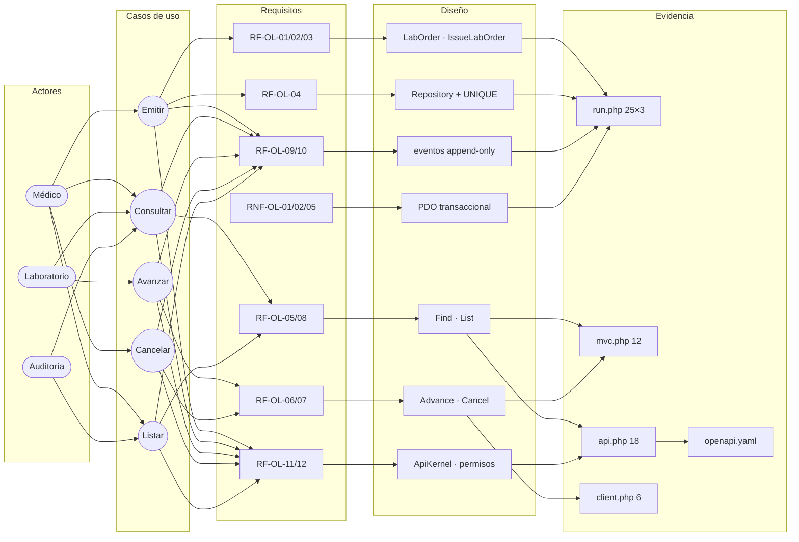

# Órdenes de laboratorio desde EMR — Semana 6: primera evaluación parcial

**Módulo:** Órdenes de laboratorio desde EMR (ASII-16) · **Entrega académica:** Fajardo López, Javier Alexander (`Javifa2324`, ASII-09)
**Defensa:** arquitectura de «emisión de orden desde el expediente y seguimiento de su estado»
**Presentación:** [`presentacion.md`](./presentacion.md) · **Diagrama:** [`fuentes/trazabilidad.mmd`](./fuentes/trazabilidad.mmd)

## 1. Tesis de la defensa

La orden de laboratorio no es un formulario: es un **documento clínico con estado, dueño y
historial**. Por eso el diseño separa cuatro decisiones que no deben mezclarse:

1. **Dominio**: qué es una orden válida y qué transiciones existen (`LabOrder`).
2. **Aplicación**: qué se valida contra el expediente y qué se guarda en una transacción
   (`IssueLabOrder`, `AdvanceLabOrder`, `CancelLabOrder`).
3. **Persistencia**: cómo se aísla por hospital y cómo se conserva el historial (`LabOrderRepository`,
   `PdoLabOrderRepository`, `lab_order_events` append-only).
4. **Entrada**: cómo se expone el caso de uso sin filtrar reglas ni SQL (`LabOrderController`,
   `ApiKernel`, `LabOrderPresenter`).

La tesis se sostiene en una frase verificable: **toda orden puede reconstruirse desde su historial y
ninguna transición puede saltarse una regla del dominio**.

## 2. Diagrama trazable

El SVG regenerado está en [`trazabilidad.svg`](./trazabilidad.svg); la fuente editable es el `.mmd`.

## 3. Matriz decisión → evidencia

| # | Decisión | Alternativa descartada | Evidencia | Estado |
|---|---|---|---|---|
| D1 | La orden nace `ISSUED` y solo avanza por transiciones explícitas | Estado libre por `UPDATE` | `tests/run.php`: transición inválida y cancelación | Verificado |
| D2 | Idempotencia con `UNIQUE (tenant_id, idempotency_key)` | Buscar antes de insertar sin restricción | `tests/api.php`: replay devuelve 200 y la misma orden | Verificado |
| D3 | Ítems con instantánea de código y nombre | Unir siempre contra `lab_tests` | `LabOrderItem` y `lab_order_items` | Verificado |
| D4 | Historial append-only con evento por transición | Campo `updated_by` en la cabecera | `lab_order_events` y prueba de secuencia | Verificado |
| D5 | Aislamiento por tenant en todas las consultas | Filtrar en PHP después de leer | `tests/run.php` y `tests/api.php`: 404 entre hospitales | Verificado |
| D6 | Errores estables `problem+json` sin filtrar SQL | Devolver el mensaje de PDO | `tests/api.php`: 400/401/403/409/422 | Verificado |
| D7 | Permisos `laboratorio.ordenes.*` verificados antes del caso de uso | Autorizar dentro del controlador con roles | `tests/api.php`: 403 sin `crear` | Verificado (cabecera confiada al gateway) |
| D8 | Repositorio con adaptadores PDO e InMemory | Acoplar los casos de uso a PDO | `tests/run.php` sobre InMemory, SQLite y PostgreSQL 16 | Verificado |
| D9 | Transacción orden + ítems + evento | Tres escrituras independientes | Prueba de fallo de persistencia sin orden parcial | Verificado |
| D10 | Cliente con timeout y reintento solo en lecturas | Reintentar todo | `tests/client.php` y servidor caído | Verificado |

## 4. Recorrido de la presentación

| Diapositiva | Contenido | Evidencia que se muestra |
|---|---|---|
| 1 | Problema: la orden nace en el expediente y debe seguirse | Narrativa semana 1 |
| 2 | Actores, casos de uso y alcance | Diagrama UML semana 1 |
| 3 | RF/RNF y criterios verificables | Tabla semana 2 |
| 4 | SOLID: una razón de cambio por clase | Antes/después semana 2 |
| 5 | Arquitectura por capas y C4 | Semana 3 + `lab_orders` |
| 6 | Repository y MVC | Semana 4 + 12 pruebas |
| 7 | Frontera de microservicio y contrato | Semana 5 + OpenAPI |
| 8 | Cambio práctico y cierre | Respuesta de la sección 5 |

## 5. Cambio práctico defendido

**Solicitud:** «El médico necesita agregar una prueba a una orden que ya fue emitida, sin perder el
historial ni duplicar la orden.»

**Respuesta:** se acepta con condiciones, como **enmienda controlada**, no como edición libre.

| Aspecto | Decisión |
|---|---|
| Estados permitidos | Solo `ISSUED` (aún sin toma). Desde `COLLECTED` se rechaza con `409` y se emite una orden nueva |
| Contrato | `POST /api/v1/lab-orders/{id}/items` con `lab_test_id`, `Idempotency-Key` y permiso `laboratorio.ordenes.actualizar` |
| Dominio | `LabOrder::addItem()` valida prueba activa, no duplicada y estado `ISSUED`; no cambia el estado de la orden |
| Persistencia | Transacción: `INSERT` del ítem + evento de auditoría `ITEM_ADDED` con actor, fecha, `correlation_id` y motivo |
| Esquema | Evolución de `lab_order_events` con `event_type` (`STATUS_CHANGED` / `ITEM_ADDED`) o tabla de enmiendas; se prefiere `event_type` para no duplicar historial |
| Trazabilidad | El evento conserva `from_status` y `to_status` iguales a `ISSUED`; la UI muestra «prueba agregada» sin inventar una transición |
| UX | Confirmación explícita, lista actualizada y aviso de que la toma debe coordinarse con laboratorio |
| Pruebas | Enmienda válida, duplicado, estado no permitido, tenant ajeno, replay de la enmienda y evento único |
| Fuera de alcance | Quitar pruebas, cambiar paciente/episodio o editar una orden ya tomada |

**Por qué no se implementa en esta entrega:** cambia el contrato, el esquema y la máquina de eventos;
requiere una migración coordinada con los dueños de muestras y resultados. Se documenta como cambio
solicitado con impacto y criterios, no como funcionalidad existente.

## 6. Riesgos y preguntas de defensa

- **R1:** el adaptador real del expediente no existe; se usa un doble en memoria. Se declara.
- **R2:** los permisos llegan en una cabecera confiada al gateway; en producción deben derivarse del
  token.
- **R3:** los estados compartidos con muestras y resultados siguen pendientes de acuerdo.
- **R4:** la enmienda de ítems requiere migración y no está implementada.

## 7. Declaración de IA

[`DECLARACION_IA.md`](./DECLARACION_IA.md), con validación humana pendiente.
