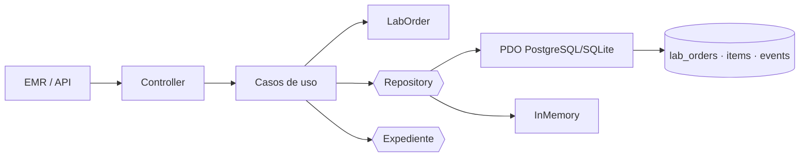

# Presentación — Primera evaluación parcial
## Órdenes de laboratorio desde EMR

**Javier Alexander Fajardo López** · ASII-09 · 22-oct-2026

---

## 1. El problema

- El médico decide un estudio dentro del expediente.
- La orden debe nacer ligada a paciente, episodio y nota.
- Laboratorio necesita saber qué hacer y en qué estado está.
- Auditoría necesita reconstruir quién cambió qué y cuándo.
- **No es un formulario: es un documento clínico con estado e historial.**

Nota: el flujo es «emisión de orden desde el expediente y seguimiento de su estado».

---

## 2. Actores y alcance

| Actor | Objetivo |
|---|---|
| Médico | Emitir, consultar y cancelar sus órdenes |
| Enfermería | Consultar estado |
| Laboratorio | Avanzar el estado |
| Auditoría | Leer el historial sin modificarlo |

Fuera de alcance: catálogo de pruebas, toma de muestras y resultados (otros dueños).

---

## 3. Requisitos que gobiernan el diseño

- **RF-OL-01/02/03:** orden con pruebas válidas y episodio abierto.
- **RF-OL-04:** idempotencia por `Idempotency-Key`.
- **RF-OL-06/07:** transiciones válidas y cancelación con motivo.
- **RF-OL-09/10:** aislamiento por tenant e historial completo.
- **RF-OL-11/12:** errores seguros y permisos por operación.
- **RNF-OL-01/02/05:** atomicidad, falla segura e historial append-only.

---

## 4. SOLID en una frase

- **SRP:** dominio decide; aplicación orquesta; persistencia guarda; presentación traduce.
- **DIP:** los casos de uso dependen de `LabOrderRepository` y `ExpedienteGateway`, no de PDO.
- **OCP:** agregar un adaptador no cambia las reglas.
- **LSP:** InMemory y PDO cumplen el mismo contrato y la misma batería.
- **ISP:** puertos pequeños y específicos.

---

## 5. Arquitectura y datos

Evidencia: 25 verificaciones por adaptador, incluida PostgreSQL 16 real.

---

## 6. Repository y MVC

- `LabOrderRepository`: `find`, `findByIdempotency`, `create`, `updateStatus`, `search`.
- `PdoLabOrderRepository`: transacción y sentencias preparadas.
- `InMemoryLabOrderRepository`: pruebas rápidas y contrato.
- `LabOrderController`: rutas y delegación, **sin SQL ni reglas**.
- `LabOrderView`: HTML escapado; `LabOrderPresenter`: JSON y errores.

Evidencia: 12 verificaciones MVC.

---

## 7. Frontera de microservicio

- API v1: emitir, consultar, listar, avanzar y cancelar.
- `X-Tenant-ID`, `X-User-Ref`, `X-Permissions`, `Idempotency-Key`, `X-Request-ID`.
- Errores `problem+json` (RFC 9457).
- Cliente con timeout y reintento **solo** en lecturas.
- Propiedad de datos: órdenes e historial son del módulo; catálogo, muestras y resultados son de sus dueños.

Evidencia: 18 verificaciones de kernel, 6 del cliente y OpenAPI 3.1.

---

## 8. Cambio práctico y cierre

**Solicitud:** agregar una prueba a una orden ya emitida.

**Respuesta:** enmienda controlada solo en `ISSUED`, con evento `ITEM_ADDED`, idempotencia y permiso
`laboratorio.ordenes.actualizar`. Desde `COLLECTED` se rechaza y se emite una orden nueva.

**Riesgos declarados:** adaptador real del expediente pendiente; permisos confiados al gateway;
estados compartidos sin acuerdo; enmienda requiere migración.

**Cierre:** el diseño es verificable, pero no se declara implementado lo que sigue pendiente.
