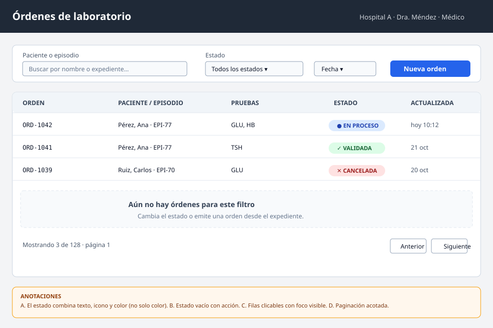
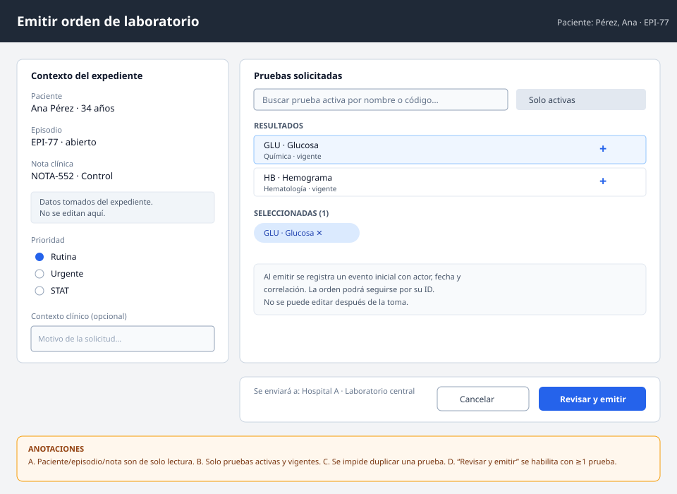
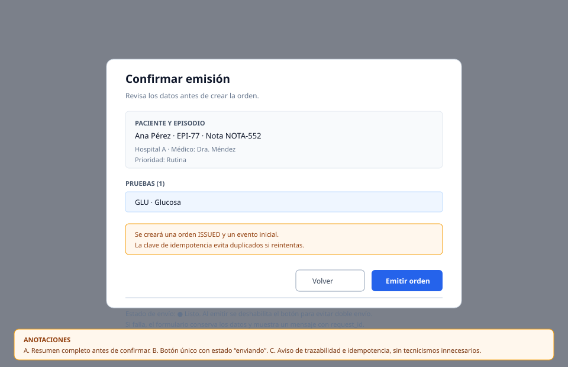
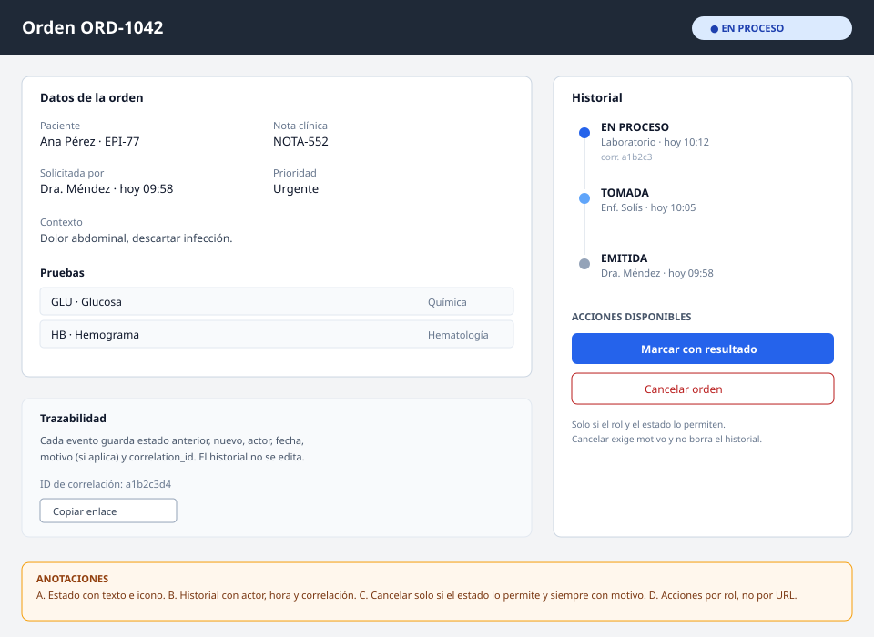
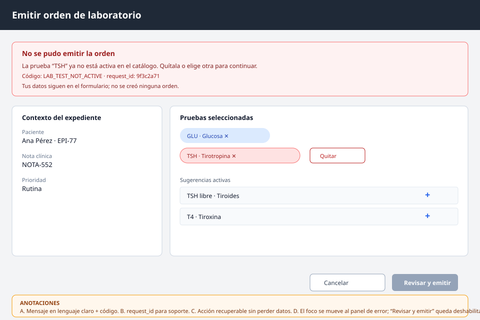

# Órdenes de laboratorio desde EMR — Semana 8: diseño de experiencia de usuario

**Módulo:** Órdenes de laboratorio desde EMR (ASII-16) · **Entrega académica:** Fajardo López, Javier Alexander (`Javifa2324`, ASII-09)
**Flujo:** «emisión de orden desde el expediente y seguimiento de su estado»
**Wireframes:** [`wireframes/`](./wireframes/) · **Prototipo navegable:** semana 11

## 1. User flow por rol

```mermaid
flowchart TD
  subgraph MED[Médico]
    M1[Expediente del paciente] --> M2[Elegir episodio y nota]
    M2 --> M3[Buscar y seleccionar pruebas]
    M3 --> M4{¿Datos completos?}
    M4 -- No --> M5[Corregir campos<br/>sin perder lo escrito]
    M5 --> M3
    M4 -- Sí --> M6[Revisar resumen]
    M6 --> M7[Emitir orden]
    M7 --> M8{¿Respuesta?}
    M8 -- 201/200 --> M9[Orden ISSUED + ID]
    M8 -- 422/409 --> M10[Error recuperable<br/>request_id]
    M10 --> M3
    M9 --> M11[Seguir estado]
    M11 --> M12{¿Cancelable?}
    M12 -- Sí --> M13[Cancelar con motivo]
    M12 -- No --> M14[Explicar por qué no]
  end

  subgraph LAB[Laboratorio]
    L1[Bandeja de órdenes] --> L2[Filtrar por estado]
    L2 --> L3[Abrir orden]
    L3 --> L4{¿Transición válida?}
    L4 -- Sí --> L5[Avanzar estado]
    L4 -- No --> L6[Mostrar transición permitida]
    L5 --> L7[Historial actualizado]
  end

  subgraph AUD[Auditoría]
    A1[Buscar por paciente/episodio] --> A2[Abrir orden]
    A2 --> A3[Leer historial y correlación]
    A3 --> A4[Exportar evidencia<br/>sin editar]
  end
```

## 2. Inventario de pantallas

| # | Pantalla | Rol | Objetivo | Estados cubiertos |
|---|---|---|---|---|
| 1 | Bandeja de órdenes | Médico / laboratorio | Encontrar y abrir órdenes | vacío, carga, paginado, error de red |
| 2 | Emisión desde el expediente | Médico | Crear una orden válida | vacío, validación, prueba inactiva |
| 3 | Confirmación | Médico | Revisar antes de emitir | listo, enviando, doble envío bloqueado |
| 4 | Detalle y historial | Todos | Seguir estados y auditar | carga, historial, acciones por rol |
| 5 | Error recuperable | Médico | Corregir sin perder datos | prueba inactiva, conflicto, red |

## 3. Wireframes anotados

### 3.1 Bandeja — [`01-bandeja.svg`](./wireframes/01-bandeja.svg)

| Anotación | Decisión | Regla de interacción |
|---|---|---|
| A | Estado con texto + icono + color | No depender solo del color; `aria-label` con el estado |
| B | Estado vacío con siguiente acción | «Nueva orden» lleva al expediente, no a un formulario suelto |
| C | Fila completa clicable | Foco visible y activación con Enter/Espacio |
| D | Paginación acotada | `per_page` 1–50; conservar filtros al paginar |

### 3.2 Emisión — [`02-emision.svg`](./wireframes/02-emision.svg)

| Anotación | Decisión | Regla de interacción |
|---|---|---|
| A | Paciente, episodio y nota son de solo lectura | Se toman del expediente; no se pueden teclear a mano |
| B | Solo pruebas activas y vigentes | La búsqueda excluye inactivas; si una deja de estarlo, se informa |
| C | No duplicar pruebas | Al agregar una repetida, se marca y no se añade |
| D | «Revisar y emitir» se habilita con ≥1 prueba | El botón permanece deshabilitado con explicación visible |

### 3.3 Confirmación — [`03-confirmacion.svg`](./wireframes/03-confirmacion.svg)

| Anotación | Decisión | Regla de interacción |
|---|---|---|
| A | Resumen de paciente, episodio, nota, prioridad y pruebas | El usuario confirma lo que realmente se enviará |
| B | Un solo botón, deshabilitado mientras envía | Evita doble emisión; la clave de idempotencia protege el reintento |
| C | Aviso de trazabilidad | Explica que se crea un historial y que no se puede editar tras la toma |

### 3.4 Detalle y seguimiento — [`04-detalle.svg`](./wireframes/04-detalle.svg)

| Anotación | Decisión | Regla de interacción |
|---|---|---|
| A | Estado con texto e icono | También en el título de la página para lectores de pantalla |
| B | Historial con actor, fecha, motivo y correlación | Orden cronológico; no se edita ni se borra |
| C | Cancelar solo si el estado lo permite | Siempre exige motivo; el historial conserva el evento |
| D | Acciones por rol | La UI oculta lo no permitido, pero la API vuelve a validar |

### 3.5 Error recuperable — [`05-error.svg`](./wireframes/05-error.svg)

| Anotación | Decisión | Regla de interacción |
|---|---|---|
| A | Mensaje claro + código estable | «La prueba TSH ya no está activa», no «Error 422» |
| B | `request_id` visible | Permite soporte sin exponer datos clínicos |
| C | Acción recuperable | Quitar la prueba o elegir otra; los datos se conservan |
| D | Foco al panel de error | `role="alert"`, foco programático y botón de envío deshabilitado |

## 4. Estados y mensajes

| Estado | Dónde | Mensaje | Acción |
|---|---|---|---|
| Vacío | Bandeja | «Aún no hay órdenes para este filtro» | Cambiar filtro o emitir |
| Carga | Bandeja / detalle | Esqueleto con `aria-busy="true"` | Esperar; no bloquear navegación |
| Éxito | Confirmación | «Orden ORD-1042 emitida» + enlace | Ver orden o volver al expediente |
| Error recuperable | Emisión | Código + texto + `request_id` | Corregir y reintentar |
| Error no recuperable | Detalle | «No tienes permiso para cancelar» | Volver; no mostrar botón inútil |
| Conflicto | Detalle | «La orden ya fue validada» | Refrescar estado |

## 5. Protección de datos

- Mostrar solo lo necesario: nombre del paciente en la pantalla, **nunca** en logs ni en el
  `request_id`.
- No incluir resultados clínicos en la bandeja; solo ID, pruebas y estado.
- Mensajes de error sin `SQLSTATE`, rutas internas ni datos de otro hospital.
- Copiar enlace comparte el ID de la orden, no un token de sesión.
- Cierre de sesión por inactividad y reautenticación para cancelar, definidos por el gateway.

## 6. Criterios de aceptación UX

1. Un médico puede emitir una orden con teclado, sin ratón, en ≤ 2 minutos.
2. Cada error muestra código, texto accionable y `request_id`.
3. El estado nunca se comunica solo por color.
4. Cancelar exige motivo y explica el efecto en el historial.
5. La pantalla de 320 px conserva todas las acciones (semana 10).

## 7. Declaración de IA

[`DECLARACION_IA.md`](./DECLARACION_IA.md), con validación humana pendiente.
