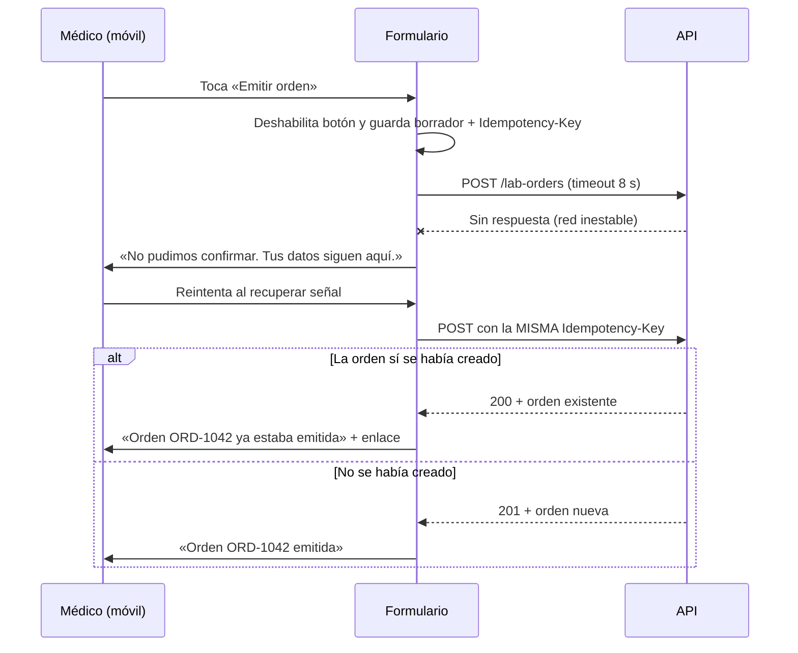

# Órdenes de laboratorio desde EMR — Semana 10: diseño para movilidad

**Módulo:** Órdenes de laboratorio desde EMR (ASII-16) · **Entrega académica:** Fajardo López, Javier Alexander (`Javifa2324`, ASII-09)
**Rango:** 320–430 px · **Pantallas:** [bandeja](./wireframes/01-bandeja-movil.svg) · [emisión](./wireframes/02-emision-movil.svg) · [detalle/error](./wireframes/03-detalle-movil.svg)
**Base:** hallazgos UX-01, UX-05, UX-06 y UX-10 de la [semana 9](../semana-09/README.md).

## 1. Reglas de breakpoint

| Rango | Layout | Navegación | Tablas |
|---|---|---|---|
| 320–430 px | Una columna, tarjetas, acciones fijas al pie | Barra inferior + botón flotante | Tarjetas con etiqueta por campo |
| 431–767 px | Una columna ancha, dos columnas solo en detalle | Barra superior | Tarjetas o tabla compacta |
| 768–1023 px | Dos columnas (contexto + contenido) | Barra superior | Tabla con scroll controlado |
| ≥1024 px | Layout de escritorio de la semana 8 | Barra superior | Tabla completa |

Objetivo: **cero scroll horizontal** en 320 px y objetivos táctiles de **≥44×44 px**.

## 2. Jerarquía de contenido

1. **Estado y siguiente acción** (lo primero que se lee).
2. **Paciente y episodio** (contexto seguro, no editable).
3. **Pruebas** (código y nombre; no resultados en la bandeja).
4. **Historial** (colapsado a los últimos 2 eventos, con «Ver todo»).
5. **Acciones secundarias** en menú `⋯`; cancelar nunca es la acción primaria.

## 3. Tablas y formularios

| Desktop | Móvil |
|---|---|
| Tabla de 6 columnas | Tarjeta por orden: ID, estado, paciente, pruebas y fecha; etiquetas visibles |
| Filtros en una barra | Chips horizontales desplazables; búsqueda arriba |
| Formulario de dos columnas | Una columna, contexto colapsable, selector de pruebas a pantalla completa |
| Botón en el pie del formulario | Barra fija con «Revisar y emitir» y resumen de 1 línea |

Reglas de formulario:

- Etiqueta persistente (no solo placeholder), `autocomplete` cuando aplique y teclado numérico para
  IDs.
- Validación al salir del campo y al enviar; nunca borrar lo escrito.
- El botón de envío se deshabilita mientras hay una petición en curso.
- Confirmación en hoja inferior con resumen y foco gestionado.

## 4. Escenario móvil 1 — se pierde la conexión al emitir

Decisiones:

- **No reintentar escrituras automáticamente**; el cliente solo reintenta lecturas.
- La clave se conserva en el borrador local; el reintento manual es seguro.
- Nunca mostrar «emitida» sin confirmación del servidor.
- El botón se reactiva al recuperar la conexión, no antes.

## 5. Escenario móvil 2 — conexión intermitente en seguimiento

| Momento | Comportamiento | Mensaje |
|---|---|---|
| Abrir bandeja sin red | Muestra última copia con hora | «Última actualización: 10:12. Sin conexión.» |
| Recuperar red | Reintenta `GET` una vez | «Actualizado» |
| Avanzar estado sin red | No cambia la UI de forma optimista | «No se pudo enviar. Verifica tu conexión.» |
| Conflicto 409 | Refresca la orden y explica | «Otro usuario ya la validó.» |
| Error 503 | Conserva estado y permite reintentar | «Servicio no disponible. Reintentar.» |

No se promete una cola offline de escrituras: el módulo no implementa sincronización en segundo
plano. La recuperación es **manual y explícita**, con idempotencia del lado servidor.

## 6. Accesibilidad móvil

- Orden de foco: encabezado → contexto → búsqueda → resultados → seleccionadas → prioridad → pie.
- Barra fija no debe tapar el último campo; `padding-bottom` equivalente a su altura.
- Estados con texto e icono; no solo color.
- `aria-live="polite"` para «borrador guardado», «sin conexión» y «orden emitida».
- Objetivos ≥44 px; separación mínima de 8 px.
- Soporte de texto al 200% sin pérdida de acciones (reflow).

## 7. Criterios de aceptación

1. A 320 px no hay scroll horizontal en bandeja, emisión ni detalle.
2. Emitir requiere ≤4 toques después de elegir al paciente.
3. Un timeout muestra el mensaje de recuperación y conserva el borrador.
4. Reintentar con la misma clave devuelve la misma orden (200), no un duplicado.
5. Cancelar en móvil exige motivo y confirmación, igual que en escritorio.

## 8. Declaración de IA

[`DECLARACION_IA.md`](./DECLARACION_IA.md), con validación humana pendiente.
