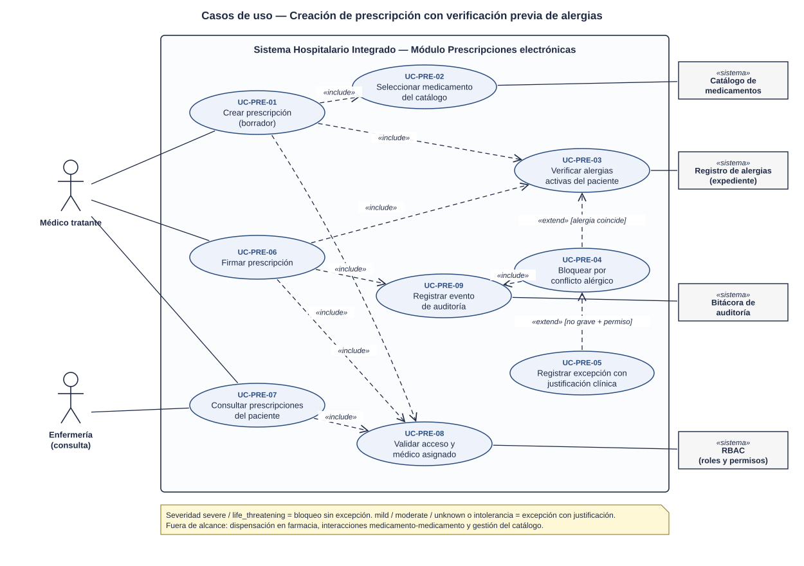
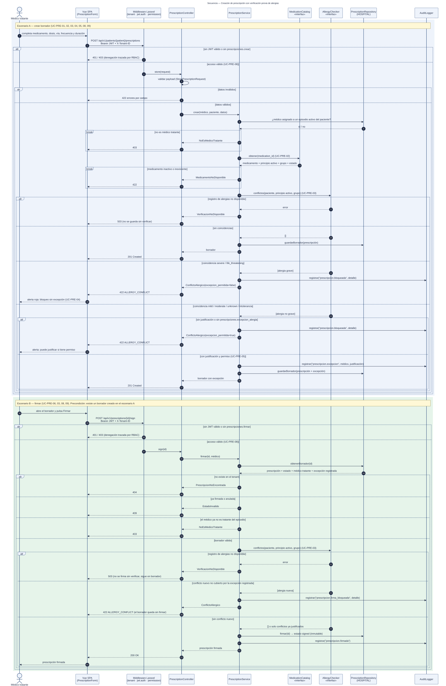

# Prescripciones electrónicas con validación de alergias — Semana 1

## Ficha de la asignación

- **Estudiante:** López Fajardo, María de los Ángeles (`Mar-03`)
- **Módulo:** Prescripciones electrónicas con validación de alergias
- **Semana:** Semana 1 — Conceptos generales, orientación a objetos y UML
- **Tarea individual:** Modele el proceso «creación de prescripción con verificación previa de alergias». Casos de uso: delimitar actores y objetivo; el de actividad debe incluir decisiones, excepciones y resultado; el de secuencia debe mostrar participantes, mensajes, validaciones y respuesta. Mantenga trazabilidad entre los tres diagramas.
- **Entregable / evidencia:** UML de casos de uso y narrativa de alcance.
- **Estructura:** Sistema Hospitalario Integrado 2026 | Semanas 1–15.

---

## Contexto arquitectónico

- **Backend:** Laravel 12 (PHP 8.2+), JWT y RBAC por permisos (`prescripciones.crear`, `prescripciones.firmar`, `prescripciones.ver`, `prescripciones.excepcion_alergia`).
- **Base de datos HOSPITAL (PostgreSQL):**
  - Ya existen `local_patients`, `care_episodes`, `care_assignments`, `doctor_profiles`, `medical_records` y `allergies`. Esta última tiene `allergen_code`, `allergy_type`, `severity`, `status` y `reaction`.
  - Las tablas `medication` y `prescription` están planificadas en la porción H5 del esquema, con firma e inmutabilidad.
- **Multitenancy:** el hospital activo llega en `X-Tenant-ID`; la prescripción vive en la base de ese hospital.
- **Frontend:** Vue 3, Pinia y Axios (formulario de prescripción con alerta de alergia).
- **Endpoints preliminares** (se formalizan en la Semana 5):
  - `POST /api/v1/patients/{patient}/prescriptions`
  - `GET /api/v1/patients/{patient}/prescriptions`
  - `POST /api/v1/prescriptions/{id}/sign`

---

## Componentes propuestos (todavía no implementados)

| Componente | Responsabilidad | Estado |
|---|---|---|
| `PrescriptionController` | Recibir las peticiones HTTP (`store`, `sign`, `index`) y traducirlas al servicio; sin SQL ni reglas de negocio. | Propuesto, no implementado |
| `StorePrescriptionRequest` | Validar el payload de creación (dosis, vía, frecuencia y duración). | Propuesto, no implementado |
| `PrescriptionService` | Orquestar las reglas de acceso, médico tratante, catálogo, alergias, firma e inmutabilidad. | Propuesto, no implementado |
| `MedicationCatalog` (interfaz) | Contrato para consultar medicamento, principio activo y grupo. | Propuesto, no implementado |
| `AllergyChecker` (interfaz) | Contrato para consultar conflictos de alergias activas. | Propuesto, no implementado |
| Implementaciones en memoria de `MedicationCatalog` y `AllergyChecker` | Adaptadores temporales hasta integrar los módulos *Catálogo de medicamentos* y *Alergias clínicas*. | Propuesto, no implementado |
| `PrescriptionRepository` | Persistencia del borrador y de la firma en la base HOSPITAL. | Propuesto, no implementado |

Dependencia externa: el registro de auditoría lo provee el módulo de auditoría (`AuditLogger`), que no forma parte de este módulo.

## 1. Diagrama de casos de uso

[Abrir el diagrama de casos de uso en SVG](./01-casos-de-uso.svg)

### Descripción

El objetivo es que **ninguna prescripción se guarde ni se firme sin verificar antes las alergias activas del paciente**.

- **Actores principales:**
  - *Médico tratante:* crea, firma y consulta prescripciones.
  - *Enfermería:* solo consulta.
- **Actores secundarios (sistemas):** *Catálogo de medicamentos*, *Registro de alergias* (expediente), *Bitácora de auditoría* y *RBAC*.
- **UC-PRE-01 (Crear prescripción):** incluye `<<include>>` la selección del medicamento (UC-PRE-02), la verificación de alergias (UC-PRE-03) y la validación de acceso y médico asignado (UC-PRE-08).
- **UC-PRE-06 (Firmar):** vuelve a incluir UC-PRE-03, porque las alergias pudieron cambiar desde el borrador, y registra la auditoría (UC-PRE-09).
- **UC-PRE-04 (Bloquear por conflicto)** extiende `<<extend>>` a UC-PRE-03 cuando una alergia coincide. **UC-PRE-05 (Registrar excepción con justificación)** extiende a UC-PRE-04 solo si la alergia no es grave y el médico tiene el permiso de excepción.

## 2. Diagrama de actividades

[Abrir el diagrama de actividades en SVG](./02-actividad.svg)

### Descripción

Recorre el proceso en dos particiones, con sus decisiones, excepciones y resultados.

**A · Crear borrador**

- **Validaciones:** acceso (401/403), datos de la indicación (422), médico asignado a un episodio activo (403) y medicamento existente y activo (422).
- **Falla segura:** si el registro de alergias no responde, se responde **503** y no se guarda nada.
- **Severidad:** una coincidencia `severe` o `life_threatening` **bloquea sin excepción** (`422 ALLERGY_CONFLICT`). En `mild`, `moderate`, `unknown` o intolerancia se permite una excepción con justificación y permiso.
- **Resultado:** borrador en estado `draft` (201).

**B · Firmar un borrador existente** (precondición: borrador en `draft`)

- **Validaciones:** permiso `prescripciones.firmar` (401/403), borrador existente (404), en estado `draft` (409) y médico todavía tratante (403).
- **Re-verificación de alergias:** si el registro no responde, no se firma (503). Si aparece una alergia nueva no cubierta por la excepción registrada, no se firma (422). En ambos casos el borrador **sigue en `draft`**; la firma nunca vuelve a crear ni guardar otro borrador.
- **Resultado:** prescripción `signed`, **inmutable** (200).

**Política de severidad (SD-PRE-01):** la regla de bloqueo/excepción no está confirmada aún en el repositorio; se documenta como supuesto de diseño **SD-PRE-01 — pendiente de validación**. El esquema HOSPITAL solo confirma los valores de `severity` y `allergy_type` (`database/migrations/hospital/2026_08_11_000401_create_allergy_and_vital_sign_tables.php`, constraints `allergies_severity_check` y `allergies_type_check`), no la política de bloqueo.

## 3. Diagrama de secuencia

[Abrir el diagrama de secuencia en SVG](./03-secuencia.svg)

### Descripción

- **Participantes (componentes propuestos, todavía no implementados):** Vue (`PrescriptionForm`), middlewares, `PrescriptionController`, `PrescriptionService`, `MedicationCatalog` «interfaz», `AllergyChecker` «interfaz», `PrescriptionRepository` (HOSPITAL) y `AuditLogger` (externo).
- **Dependencias como interfaces:** `MedicationCatalog` y `AllergyChecker` se modelan como interfaces. El servicio propuesto no dependerá del código de otros módulos sino de un contrato, y esa decisión se desarrolla en la Semana 2 con el principio DIP.
- **Escenario A (crear borrador):** `alt` para 401/403 y para datos inválidos (422). Bloques `break` para médico no tratante (403) y medicamento inexistente o inactivo (422), de modo que esos caminos terminan ahí y no continúan hacia la verificación de alergias. `alt` para 503, "sin coincidencias" (201), "coincidencia grave" (422 sin excepción) y "coincidencia no grave" (422 o 201 con excepción).
- **Escenario B (firmar):** precondición de borrador existente en `draft`. Valida el permiso de firma, recupera el borrador (`obtenerBorrador`) y usa `alt` para 404, 409 y 403, que terminan sin firmar. Re-verifica alergias con `alt` para 503 (no se firma), conflicto nuevo (422, sigue en `draft`) y firma exitosa (200).

## 4. Narrativa de alcance y trazabilidad

La narrativa completa y la tabla de trazabilidad están en [narrativa-alcance-trazabilidad.md](./narrativa-alcance-trazabilidad.md).

## Fuentes editables

- Casos de uso: el SVG es editable en draw.io o Inkscape.
- Actividad y secuencia: [`fuentes/02-actividad.mmd`](./fuentes/02-actividad.mmd) y [`fuentes/03-secuencia.mmd`](./fuentes/03-secuencia.mmd) (Mermaid).

## Declaración de uso de IA

Se usó Claude (Anthropic) para proponer la estructura de los diagramas, generar los SVG y redactar el primer borrador de este documento a partir del repositorio del proyecto y del enunciado de la tarea. La estudiante revisó los actores, las reglas clínicas (bloqueo por severidad, excepción justificada, falla segura) y la trazabilidad, y es responsable del contenido final.
