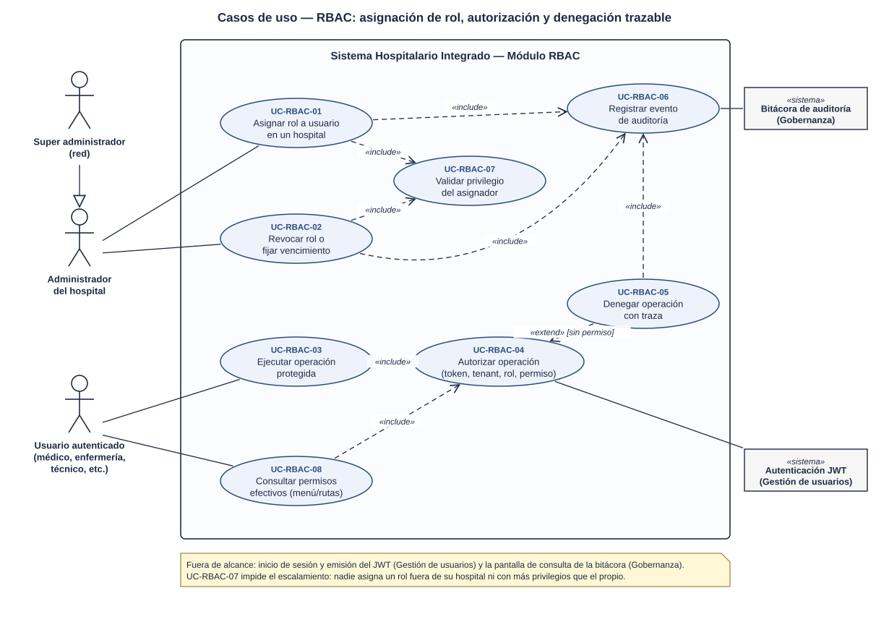
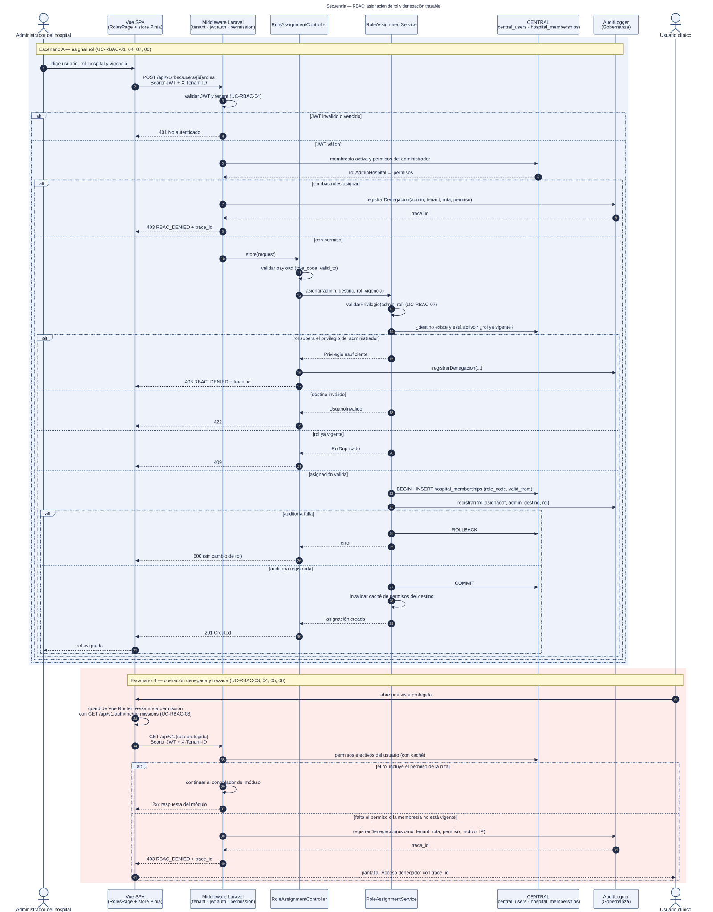

# RBAC: roles, permisos y protección de rutas — Semana 1

## Ficha de la asignación

- **Estudiante:** López Fajardo, María de los Ángeles (`Mar-03`)
- **Módulo:** RBAC: roles, permisos y protección de rutas
- **Semana:** Semana 1 — Conceptos generales, orientación a objetos y UML
- **Tarea individual:** Modele el proceso «asignación de rol, autorización de una operación y denegación trazable». Casos de uso: delimitar actores y objetivo; el de actividad debe incluir decisiones, excepciones y resultado; el de secuencia debe mostrar participantes, mensajes, validaciones y respuesta. Mantenga trazabilidad entre los tres diagramas.
- **Entregable / evidencia:** UML de casos de uso y narrativa de alcance.
- **Estructura:** Sistema Hospitalario Integrado 2026 | Semanas 1–15.

---

## Contexto arquitectónico

- **Backend:** Laravel 12 (PHP 8.2+), JWT (`tymon/jwt-auth`) y Spatie Laravel Permission.
- **Base de datos:** PostgreSQL federado. La base **CENTRAL** guarda las identidades (`central_users`) y las membresías por hospital con su rol (`hospital_memberships.role_code`, con `status` y vigencia `valid_from` / `valid_to`). La base **HOSPITAL** replica la referencia local del usuario (`local_user_refs.role_code`).
- **Multitenancy:** el hospital activo llega en el header `X-Tenant-ID` (middleware `tenant`); `jwt.auth` valida el token.
- **Frontend:** Vue 3, Vue Router, Pinia y Axios. Hoy `authGuard` solo revisa que exista token; este módulo agrega la revisión de permisos por ruta.
- **Endpoints preliminares** (se formalizan en la Semana 5):
  - `POST /api/v1/rbac/users/{id}/roles` y `DELETE /api/v1/rbac/users/{id}/roles/{role}`
  - `GET /api/v1/auth/me/permissions`
  - Toda ruta protegida declara su permiso con el middleware `permission:modulo.accion`.

---

## 1. Diagrama de casos de uso

[Abrir el diagrama de casos de uso en SVG](./01-casos-de-uso.svg)

### Descripción

Delimita qué hace el módulo y quién lo usa. Hay dos objetivos de negocio: que los administradores **asignen o revoquen roles** de forma controlada y que cada **operación del sistema se autorice o se deniegue dejando traza**.

- **Actores principales:**
  - *Administrador del hospital:* asigna y revoca roles dentro de su hospital.
  - *Super administrador:* especializa al anterior con alcance de toda la red (generalización).
  - *Usuario autenticado:* cualquier rol clínico u operativo que ejecuta operaciones protegidas.
- **Actores secundarios (sistemas):** *Autenticación JWT* (módulo Gestión de usuarios) y *Bitácora de auditoría* (módulo Gobernanza).
- **UC-RBAC-01 / 02 (Asignar / Revocar rol):** incluyen `<<include>>` la validación del privilegio del asignador (UC-RBAC-07) y el registro de auditoría (UC-RBAC-06).
- **UC-RBAC-03 (Ejecutar operación protegida)** y **UC-RBAC-08 (Consultar permisos efectivos)** incluyen la autorización (UC-RBAC-04).
- **UC-RBAC-05 (Denegar con traza)** extiende `<<extend>>` a UC-RBAC-04 cuando falta el permiso, e incluye el registro en la bitácora (UC-RBAC-06).

## 2. Diagrama de actividades

[Abrir el diagrama de actividades en SVG](./02-actividad.svg)

### Descripción

Muestra el flujo paso a paso en dos particiones, con decisiones, excepciones y resultado final:

- **A · Asignar o revocar rol:** JWT (401), tenant y permiso del asignador (403 con traza), usuario destino válido (422), rol ya vigente (409). Si la auditoría no se puede escribir, la transacción se revierte (500): **no existe cambio de rol sin traza**.
- **B · Autorizar una operación:** JWT (401), membresía activa y vigente en el tenant y permiso de la ruta. Si falta algo se registra la denegación y se responde **403 `RBAC_DENIED` + `trace_id`**. Si la bitácora falla, se escribe en el log de la aplicación y la operación **sigue denegada** (falla segura).

## 3. Diagrama de secuencia

[Abrir el diagrama de secuencia en SVG](./03-secuencia.svg)

### Descripción

Asigna cada paso a un objeto concreto:

- **Participantes:** Vue (página de roles, store de permisos y guard), middlewares `tenant`, `jwt.auth` y `permission`, `RoleAssignmentController`, `RoleAssignmentService`, CENTRAL y `AuditLogger`.
- **Escenario A (asignación):** bloques `alt` para 401, 403, 422, 409, la reversión por fallo de auditoría y el 201 de éxito.
- **Escenario B (denegación trazable):** el guard de Vue consulta los permisos efectivos (UC-RBAC-08); el middleware compara el permiso de la ruta y, si falta, registra la denegación y devuelve el `trace_id`.

## 4. Narrativa de alcance y trazabilidad

La narrativa completa, con la tabla de trazabilidad UC ↔ actividad ↔ secuencia, está en [narrativa-alcance-trazabilidad.md](./narrativa-alcance-trazabilidad.md).

## Fuentes editables

- Casos de uso: el SVG es editable en draw.io o Inkscape.
- Actividad y secuencia: [`fuentes/02-actividad.mmd`](./fuentes/02-actividad.mmd) y [`fuentes/03-secuencia.mmd`](./fuentes/03-secuencia.mmd) (Mermaid; GitHub los renderiza y se pueden editar en mermaid.live).

## Declaración de uso de IA

Se usó Claude (Anthropic) para proponer la estructura de los diagramas, generar los SVG y redactar el primer borrador de este documento a partir del repositorio del proyecto y del enunciado de la tarea. La estudiante revisó los actores, las reglas de negocio y la trazabilidad, y es responsable del contenido final.
