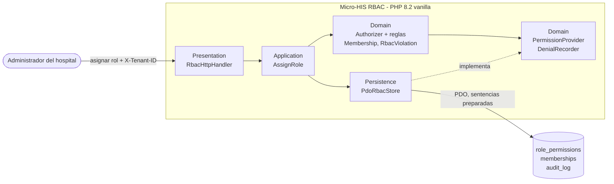

# RBAC: roles, permisos y protección de rutas — Semana 3

## Ficha de la asignación

- **Estudiante:** López Fajardo, María de los Ángeles (`Mar-03`) · mlopezf16@miumg.edu.gt
- **Módulo:** ASII-02 — RBAC: roles, permisos y protección de rutas (issue #4)
- **Semana:** Semana 3 — Diseño arquitectónico, vistas y patrones
- **Tarea individual:** Inicie «Micro-HIS RBAC: roles, permisos y protección de rutas» en PHP 8.2+ vanilla para ejecutar «asignación de rol, autorización de una operación y denegación trazable». Separe Presentation, Application, Domain y Persistence; use PDO con sentencias preparadas, sin framework, y pruebe al menos camino feliz, regla de dominio y error de persistencia mediante dobles o una base de prueba.
- **Entregable / evidencia:** Vista arquitectónica C4/UML del módulo y dependencias. Código en [`micro-his/rbac/`](../../../micro-his/rbac/).

## Vista de componentes (C4, nivel 3)



| Capa | Clase | Responsabilidad | Depende de |
|---|---|---|---|
| Presentation | `RbacHttpHandler` | Valida que encabezados y campos sean cadenas no vacías (rechaza array, objeto o espacios con `422`), llama al caso de uso y traduce el resultado a `201`, `403`, `409`, `422` o `500`. Sin SQL ni reglas. | `AssignRole` |
| Application | `AssignRole` | Valida el payload, autoriza `rbac.asignar`, rechaza el rol repetido y pide guardar la membresía. | `Authorizer`, `PdoRbacStore` |
| Domain | `Authorizer`, `RoleGrantsPermission`, `AssignerPrivilegeRule`, `Membership`, `RbacViolation` | Decide con reglas combinadas en AND; al denegar genera el `trace_id` y lo registra; si la bitácora falla, sigue denegando. | `PermissionProvider`, `DenialRecorder` (interfaces) |
| Persistence | `PdoRbacStore` | Lee permisos y roles; guarda membresía y auditoría en una sola transacción. | `PDO` |

Regla de dependencia: cada capa solo llama a la de abajo; Domain no conoce PDO. `AssignerPrivilegeRule` es una regla nueva agregada con `addRule()` sin modificar `Authorizer` (OCP de la Semana 2).

## Cómo verificar

```bash
php micro-his/rbac/tests/run.php
```

Base de prueba: SQLite en memoria (`pdo_sqlite`). Salida esperada: 9 líneas `OK:` (camino feliz; tres reglas de dominio; validación de rol inexistente `422`; validación de entradas inválidas por tipo o espacios con `422` sin escribir auditoría; error de persistencia con rollback; falla segura) y `Todas las pruebas pasaron.`

## Supuestos y dependencias externas

- **SD-RBAC-09:** niveles de privilegio de `AssignerPrivilegeRule::LEVELS`, pendientes de validación con Gestión de usuarios y tenants.
- **Cambio respecto a la Semana 2:** `authorize()` devuelve `null` (permitido) o el `trace_id` de la denegación para responder `403`; `DenialRecorder` se inyecta por constructor.
- **Alcance por hospital:** `PdoRbacStore::rolesIn()` solo lee los roles del hospital de `X-Tenant-ID`; sin roles allí, `RoleGrantsPermission` niega. Por eso `HospitalScopeRule` de la Semana 2 no se usa en este prototipo.
- **Propuesto, no implementado:** entrada MVC e interfaz Repository con adaptadores PDO e InMemory (Semana 4); contrato API (Semana 5).
- Usuarios y tenants reales (Gestión de usuarios) y bitácora central (Gobernanza) quedan fuera; aquí `audit_log` representa la bitácora.
