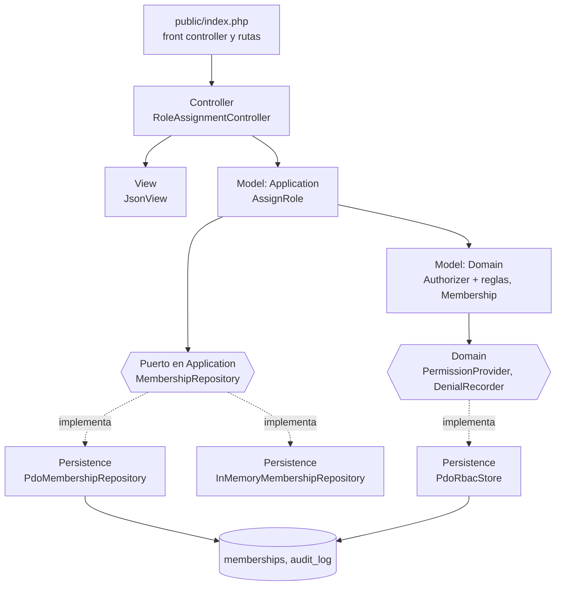

# RBAC: roles, permisos y protección de rutas — Semana 4

## Ficha de la asignación

- **Estudiante:** López Fajardo, María de los Ángeles (`Mar-03`) · mlopezf16@miumg.edu.gt
- **Módulo:** ASII-02 — RBAC: roles, permisos y protección de rutas (issue #4)
- **Semana:** Semana 4 — Arquitectura en capas y patrón repositorio
- **Tarea individual:** Continúe el MISMO «Micro-HIS RBAC: roles, permisos y protección de rutas» y el flujo «asignación de rol, autorización de una operación y denegación trazable». Organice la entrada con MVC; defina una interfaz Repository en el límite apropiado y adaptadores PDO e InMemory. El controlador no tendrá SQL ni reglas de negocio. Además, analice y diagrame cómo un repositorio de datos compartido integraría este módulo.
- **Entregable / evidencia:** Capas, responsabilidades y objetos reutilizables.

## Punto de partida (Semana 3, implementado)

El micro-HIS de la Semana 3 (`micro-his/rbac/`) ya separa las cuatro capas, pero `AssignRole` (Application) depende de la clase concreta `PdoRbacStore` (Persistence) y la entrada es `RbacHttpHandler`, que no separa controlador y vista. Esta semana corrige esas dos dependencias con MVC y Repository.

## Diseño propuesto (no implementado todavía)



- **Model:** Domain (`Authorizer`, reglas, `Membership`, `RbacViolation`) y Application (`AssignRole`).
- **View:** `JsonView` solo escribe el estado HTTP y el JSON.
- **Controller:** `RoleAssignmentController` lee la ruta y el cuerpo, llama a `AssignRole` y traduce el resultado. Sin SQL ni reglas de negocio.
- **Repository:** `MembershipRepository` vive en Application, que es quien lo necesita; los adaptadores viven en Persistence. Así Application deja de conocer PDO.

## Archivos de esta entrega

- [Responsabilidades por capa y objetos reutilizables](./responsabilidades.md)
- [Contrato del Repository y traducción a HTTP](./contrato-repository.md)
- [Repositorio de datos compartido](./repositorio-compartido.md)

## Cómo verificar

Esta entrega es de diseño: no modifica `micro-his/rbac/`, para no chocar con el PR de la Semana 3. Las clases citadas como existentes se comprueban en la rama de la Semana 3:

```bash
git grep -n -E "final class (AssignRole|PdoRbacStore|RbacHttpHandler|Authorizer)" origin/feature/asii-02-semana-03-rbac-mar-03 -- micro-his/rbac
```

Resultado esperado: 4 coincidencias, una por clase. Los componentes de la sección "Diseño propuesto" que no aparecen en ese resultado son propuestos.

## Supuestos

- **SD-RBAC-10:** el diseño se implementará en el micro-HIS cuando la Semana 3 esté integrada en `develop`; hasta entonces es propuesto.
- **SD-RBAC-11** y **SD-RBAC-12:** ver [repositorio compartido](./repositorio-compartido.md).
