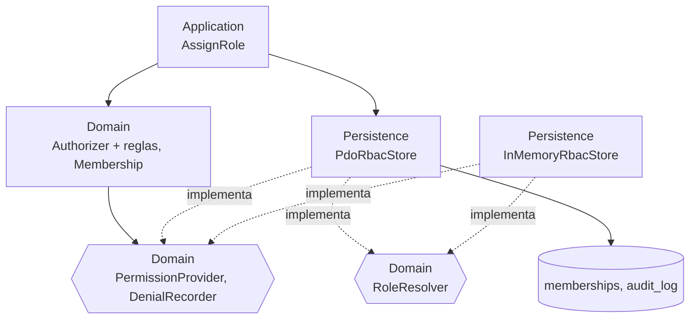
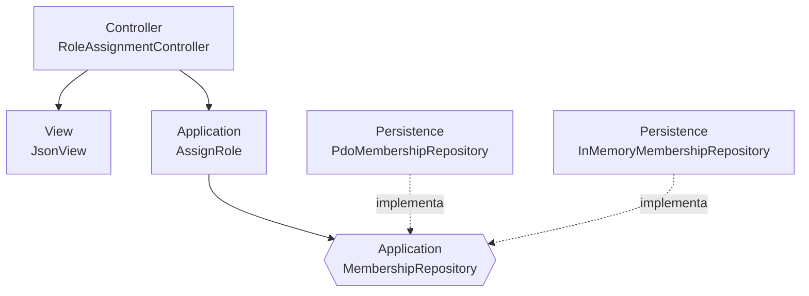

# RBAC: roles, permisos y protección de rutas — Semana 4

## Ficha de la asignación

- **Estudiante:** López Fajardo, María de los Ángeles (`Mar-03`) · mlopezf16@miumg.edu.gt
- **Módulo:** ASII-02 — RBAC: roles, permisos y protección de rutas (issue #4)
- **Semana:** Semana 4 — Arquitectura en capas y patrón repositorio
- **Tarea individual:** Continúe el MISMO «Micro-HIS RBAC: roles, permisos y protección de rutas» y el flujo «asignación de rol, autorización de una operación y denegación trazable». Organice la entrada con MVC; defina una interfaz Repository en el límite apropiado y adaptadores PDO e InMemory. El controlador no tendrá SQL ni reglas de negocio. Además, analice y diagrame cómo un repositorio de datos compartido integraría este módulo.
- **Entregable / evidencia:** Capas, responsabilidades y objetos reutilizables.

## Punto de partida (Semana 3, integrada en `develop`)

El micro-HIS de la Semana 3 (`micro-his/rbac/`) ya está integrado en `develop` y separa las cuatro capas. `AssignRole` (Application) todavía depende de la clase concreta `PdoRbacStore` (Persistence) y la entrada es `RbacHttpHandler`, que no separa controlador y vista. Esta semana define las interfaces en el límite del repositorio con adaptadores PDO e InMemory.

## Estado de implementación

**Implementado en esta entrega** (sí modifica `micro-his/rbac/`):



- `RoleResolver` (Domain): puerto de lectura de los roles de un usuario en un hospital.
- `PdoRbacStore` e `InMemoryRbacStore` (Persistence): adaptadores intercambiables que implementan `RoleResolver`; `PdoRbacStore` conserva `PermissionProvider` y `DenialRecorder`.

**Propuesto (no implementado todavía):**



- **MVC:** `RoleAssignmentController` + `JsonView` (no implementados).
- **Repository del agregado:** `MembershipRepository` (lectura y escritura con auditoría atómica); propuesto. Ver [contrato](./contrato-repository.md).
- **Capas:** detalle en [responsabilidades](./responsabilidades.md).

## Archivos de esta entrega

- [Responsabilidades por capa y objetos reutilizables](./responsabilidades.md)
- [Contrato del Repository y traducción a HTTP](./contrato-repository.md)
- [Repositorio de datos compartido](./repositorio-compartido.md)
- Código implementado: `micro-his/rbac/src/Domain/RoleResolver.php`, `micro-his/rbac/src/Persistence/InMemoryRbacStore.php`, `micro-his/rbac/src/Persistence/PdoRbacStore.php` y `micro-his/rbac/tests/inmemory.php`.

## Cómo verificar

La Semana 3 ya está integrada en `develop`, así que el motor se comprueba en esta misma rama:

```bash
php micro-his/rbac/tests/run.php
php micro-his/rbac/tests/inmemory.php
```

- `run.php`: flujo de asignación, reglas de dominio y error de persistencia.
- `inmemory.php`: contrato del adaptador en memoria, paridad con `PdoRbacStore` y no colisión de claves usuario/hospital.

## Supuestos

- **SD-RBAC-10:** la Semana 3 ya está integrada en `develop`; `RoleResolver` y sus adaptadores están implementados. MVC y `MembershipRepository` siguen propuestos.
- **SD-RBAC-11** y **SD-RBAC-12:** ver [repositorio compartido](./repositorio-compartido.md).
