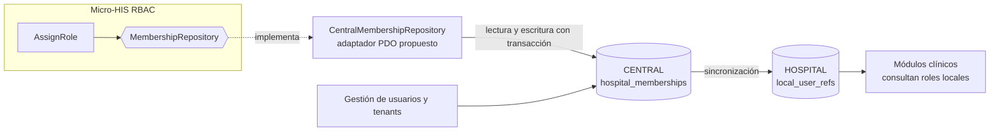

# Repositorio de datos compartido

## Situación actual

En el HIS, las membresías ya viven en una base compartida: la base **CENTRAL** guarda `hospital_memberships` con `role_code`, `status` y vigencia (`valid_from` / `valid_to`), y solo admite una membresía activa sin vencimiento por usuario, hospital y rol (`database/migrations/central/2026_08_11_000100_create_identity_and_memberships.php:26-41`). Cada base **HOSPITAL** guarda una copia local en `local_user_refs` (`database/migrations/hospital/2026_08_11_000100_create_local_identity_and_professional_tables.php:13-28`).

## Integración propuesta

- RBAC no lee las tablas de otros módulos directamente: usa un adaptador nuevo del mismo puerto `MembershipRepository`. `AssignRole`, el controlador y el dominio no cambian.
- **Lectura:** solo las membresías con `status = 'active'`, `valid_from <= ahora` y (`valid_to` nulo o mayor que ahora) en el hospital de `X-Tenant-ID`.
- **Escritura:** inserta en `hospital_memberships` con `status = 'active'` y `valid_from = ahora`. Si el índice único rechaza el registro, el adaptador lo informa como rol ya asignado (`409`).

## Correspondencia de datos

| Micro-HIS (`memberships`) | CENTRAL (`hospital_memberships`) |
|---|---|
| `user_id` | `user_id` (uuid, referencia a `central_users`) |
| `hospital_id` | `hospital_id` (uuid, referencia a `hospitals`) |
| `role_code` | `role_code` |
| — (siempre activa en el prototipo) | `status`, `valid_from`, `valid_to` |

## Propiedad, consistencia y riesgos

| Tema | Decisión |
|---|---|
| Propiedad | `hospital_memberships` pertenece a Gestión de usuarios y tenants; RBAC define el significado de `role_code` y sus permisos. Los cambios de esquema se coordinan entre los dos. |
| Consistencia | CENTRAL es la fuente de verdad para autorizar. La copia de HOSPITAL es eventual: un rol revocado puede seguir en la copia local hasta la siguiente sincronización. |
| Auditoría | CENTRAL no tiene una tabla para auditar asignaciones de rol (solo `cross_hospital_access_audits`, de acceso entre hospitales). |
| Catálogo de permisos | No existe una tabla de permisos por rol en las migraciones; el micro-HIS usa `role_permissions`. |

- **SD-RBAC-11:** la auditoría de asignaciones se guardará en CENTRAL, en la misma transacción que la membresía; pendiente de validar con Gobernanza y auditoría.
- **SD-RBAC-12:** el catálogo rol → permisos se agregará en CENTRAL; pendiente de validar con Gestión de usuarios y tenants.
