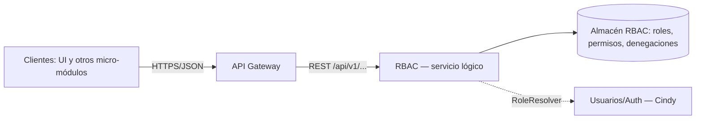

# RBAC — Semana 5: Cliente-servidor, API REST y frontera de microservicio

## Ficha de la asignación

| Campo | Valor |
|---|---|
| Módulo | ASII-02 — Roles, permisos y protección de rutas (RBAC, issue #4) |
| Estudiante | López Fajardo, María de los Ángeles · GitHub @Mar-03 |
| Semana | 5 — Cliente-servidor, API REST, microservicios e integración |
| Rama | `feature/asii-02-semana-05-rbac-mar-03` (creada desde `origin/develop`) |
| Destino del PR | `develop` |
| Revisor | Yamilet1235 |
| Entrega | Documentación **y** código (`Authorize`, `RbacHttpHandler`, pruebas) |
| Dependencia | PR #70 (Semana 4): aporta `RoleResolver`/`InMemoryRbacStore` que este PR consume |
| Límite | ≤ 400 líneas por PR: PR #70 → PR de código de la Semana 5 → PR de documentación de la Semana 5 |

## Punto de partida (Semana 4)

El Micro-HIS RBAC ya está diseñado en capas —Presentación, Aplicación, Dominio y Persistencia— con el puerto `RoleResolver` y adaptadores PDO e InMemory (PR #70); `MembershipRepository` es el repositorio **propuesto** del agregado (Semana 4). Esta semana se evoluciona hacia un diseño **cliente-servidor**: se expone un **contrato API REST estable** (`/api/v1`) y se evalúa si RBAC debe separarse como microservicio.

## Vista cliente-servidor



Los clientes (UI y otros módulos) no conocen la base: llaman por HTTPS/JSON al API Gateway, que enruta al servicio RBAC. RBAC resuelve la identidad del usuario con `RoleResolver` (Usuarios/Auth) y decide con su almacén propio; nunca lee tablas de otros módulos.

## Archivos de la semana

- [`contrato-api.md`](./contrato-api.md): contrato REST `/api/v1` con endpoints, códigos y ejemplos.
- [`permisos.md`](./permisos.md): catálogo de 12 permisos y matriz de 5 roles.
- [`frontera-microservicio.md`](./frontera-microservicio.md): evaluación y decisión de frontera.
- [`DECLARACION_IA.md`](./DECLARACION_IA.md): declaración de uso de IA y validación humana.

## Cómo verificar

Con las dependencias de PR #70 presentes (`RoleResolver`, `InMemoryRbacStore`):

```bash
php micro-his/rbac/tests/run.php                   # motor (Semanas 2/3)
php micro-his/rbac/tests/authorization.php         # caso de uso + handler (Semana 5)
php micro-his/rbac/tests/authorization_errors.php  # fallos y códigos HTTP (corrección)
```

Debe imprimir `OK` en cada caso y cerrar con `Todas las pruebas ... pasaron.`.

## Autenticación del endpoint vs. autorización evaluada

- **Autenticación del endpoint (¿quién llama?):** identidad del solicitante y su hospital. Sin identidad → `401`; sin permiso para invocar el endpoint (`rbac.autorizar`) → `403`. El permiso de endpoint es **obligatorio**: si el handler no se configura con él, falla cerrado con `503 endpoint_no_configurado` en vez de autorizar sin guardia.
- **Autorización evaluada (¿puede el `user_id` del cuerpo?):** se evalúa la acción sobre el **usuario del cuerpo** dentro del hospital del solicitante → `200` con `allowed:true/false`.
- **Falla de dependencia:** si falla la resolución de roles/permisos (`resolucion_no_disponible`), el registro de denegaciones (`registro_no_disponible`) o el endpoint no tiene permiso configurado (`endpoint_no_configurado`) → `503` con cuerpo uniforme `allowed:false`, `code`, `reason` y `trace_id`; nunca `allowed:true` ni auditoría fingida.
- En Laravel, la identidad del solicitante proviene de la sesión autenticada y el hospital del middleware de tenancy; **no** de cabeceras del cliente. El handler PHP vanilla las simula (`X-User-ID`/`X-Tenant-ID`) solo para demostración y pruebas.

## Propiedad de datos

RBAC es dueño de roles, permisos y denegaciones; **no** es dueño de usuarios, que resuelve `RoleResolver` (Usuarios/Auth). El contrato `v1` es estable, de modo que extraer RBAC más adelante no obliga a cambiar a los clientes.

## Falla segura

Si `DenialRecorder` no responde, `authorize` igual devuelve `allowed: false`; el `503` solo informa que no se pudo registrar la denegación. Todo `503` (`registro_no_disponible`, `resolucion_no_disponible` o `endpoint_no_configurado`) usa el mismo cuerpo: `allowed:false`, `code`, `reason` y `trace_id` (ver `contrato-api.md`).

## Supuestos

- **SD-RBAC-13:** la versión del contrato es `v1` y todas las rutas usan el prefijo `/api/v1`.
- **SD-RBAC-14:** la autenticación se delega a Usuarios/Auth; RBAC solo autoriza, no emite ni valida credenciales.
- **SD-RBAC-15:** la identidad del usuario llega como un claim ya validado (vía `RoleResolver`; la conexión real se resuelve en S16).
- **SD-RBAC-16:** todas las respuestas incluyen `trace_id` para observabilidad y correlación con la auditoría.
