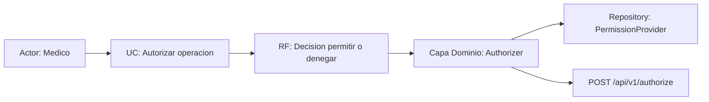

# Semana 6 — Primera evaluación parcial

**Módulo:** ASII-02 — RBAC: roles, permisos y protección de rutas  
**Estudiante:** LÓPEZ FAJARDO, MARÍA DE LOS ÁNGELES

## Tesis arquitectónica

El flujo «asignación de rol, autorización de una operación y denegación trazable» conserva la trazabilidad desde los actores y el UML hasta el dominio, las capas, el patrón Repository y el contrato HTTP `/api/v1`. Ninguna operación se autoriza sin verificar rol, permiso y tenant, y toda denegación queda registrada con `trace_id`.

## Diagrama trazable

## Integración de evidencias

| Decisión defendida | Evidencia | Criterio verificable |
|---|---|---|
| Separar reglas del transporte | Domain/Authorizer.php y la capa Application | El controlador no decide permisos |
| Aislar el almacenamiento | PermissionProvider con adaptadores InMemory/PDO | El caso de uso no contiene SQL |
| Falla segura | DenialRecorder con try/catch en Authorizer | Si falla la bitácora, la decisión sigue siendo denegar |
| Denegación trazable | trace_id generado en Authorizer | Cada denegación se correlaciona en la auditoría |
| Contrato HTTP estable | contrato-api.md con `/api/v1` | El cuerpo y el código HTTP coinciden |

## Cambio práctico defendido

Si se pide agregar el permiso `prescripciones.anular` al rol médico, solo cambian el catálogo de permisos y la matriz rol × permiso; `Authorizer` no se modifica (OCP/DIP) y el contrato `POST /api/v1/authorize` no cambia, por lo que ningún cliente se rompe.

## Validación

    php (Join-Path $env:TEMP "check-rbac-s6.php")
    OK: 2 archivos, Lineas totales: 79.

Las pruebas de dominio del RBAC (camino feliz, regla de dominio y error de persistencia) viven en `micro-his/rbac/tests` y se ejecutan al integrar las semanas de código.

## Decisiones pendientes

La asignación real de roles a usuarios depende de Usuarios/Auth (login actual en HTTP 500); las pruebas usan un usuario simulado vía `RoleResolver` y la conexión real se resuelve en la Semana 16.
