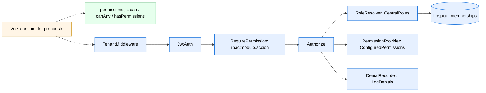

# Semana 7 — Componentes backend/frontend y diseño DIP

**Módulo:** ASII-02 — RBAC. **Estudiante:** LÓPEZ FAJARDO, MARÍA DE LOS ÁNGELES.

## Alcance de esta entrega

Rama reconstruida sobre develop actual después de la integración de #495. Este PR aporta únicamente el helper frontend `permissions.js`, su prueba y esta documentación. La autorización backend ya está integrada; no se registra otro motor ni se cambia el orden de providers.

Se retiran `EnsurePermission`, su alias `permission` y `tenant_binding.php`: su función corresponde al middleware vigente `App\Rbac\RequirePermission` y a las pruebas existentes de RBAC. Conservar el middleware anterior exigiría un enlace de `Authorizer` adicional y comprobaría `user.tenant_id` en lugar de utilizar las membresías centrales vigentes.

`RbacServiceProvider.php`, `bootstrap/providers.php`, `bootstrap/app.php` y `resources/js/router/guards.js` permanecen idénticos a develop. #510 (Tenants) sigue abierto y modifica el guard; esta entrega no modifica ese archivo ni conecta todavía el helper a la navegación.

## Componentes backend existentes en develop

Orden de ruta: `tenant → jwt.auth → rbac:modulo.accion → controlador`.

- `TenantMiddleware` resuelve el contexto de hospital y `JwtAuth` autentica al usuario.
- `RequirePermission` utiliza los identificadores del servidor, comprueba el contexto y delega en `Authorize`.
- `RbacServiceProvider` enlaza `RoleResolver` con `CentralRoles`, `PermissionProvider` con `ConfiguredPermissions` y `DenialRecorder` con `LogDenials`.
- `CentralRoles` consulta membresías activas y vigentes en `hospital_memberships`, junto con usuarios y hospitales activos. `ConfiguredPermissions` consulta `config/rbac.php`.
- `LogDenials` registra las denegaciones; la respuesta de error incluye `trace_id`. Estos componentes provienen de #495 y no son aportes nuevos de semana 7.

## Frontend implementado aquí

`hasPermissions(user)` detecta si `user.permissions` es un array. `can` comprueba un permiso exacto y `canAny` comprueba si coincide alguno. Sin array de permisos, ambos deniegan. La presencia de un array no acredita su autenticidad: el consumidor debe obtenerlo de la API y el backend siempre debe autorizar cada operación.

El payload actual de `login`/`me` contiene roles y tenant, sin `permissions`. El helper no infiere permisos a partir de roles. Su conexión a pantallas o guards queda propuesta hasta disponer de permisos efectivos del usuario y hospital activos; un catálogo general de permisos no equivale a permisos concedidos. Este PR no añade redirecciones.

## Diagrama de componentes

Verde: aporte de esta entrega. Azul: backend existente de develop. Amarillo y enlaces discontinuos: consumidor propuesto.

Fuente idéntica: `fuentes/01-componentes.mmd`.

## Diseño DIP y trabajo propuesto

La autorización existente depende de los puertos `RoleResolver`, `PermissionProvider` y `DenialRecorder`; el provider conecta sus adaptadores. Se conserva esa inversión de dependencias.

El refactor de `AssignRole(PdoRbacStore)` hacia `AssignRole(MembershipRepository)` es una propuesta de diseño, no una implementación de esta entrega. También quedan propuestos los controladores/FormRequest y las pantallas de asignación de roles. No se agregan modelos, migraciones ni tablas de auditoría.

## Validación

- `node resources/js/router/permissions.test.mjs`: permisos concedidos/ausentes, usuario nulo, formato inválido y payload real sin permisos.
- `php micro-his/rbac/tests/run.php` y `php micro-his/rbac/tests/authorization.php`: regresión del motor existente.
- `git diff --check` y comparación directa con develop de providers, bootstrap y guard.

Sin `vendor/` en este checkout, no se afirma una validación Laravel E2E. Las pruebas Feature de #495 permanecen en `tests/Feature/Rbac`.

Refs #4. Dependencia integrada: #495. Coordinación frontend: #510.
