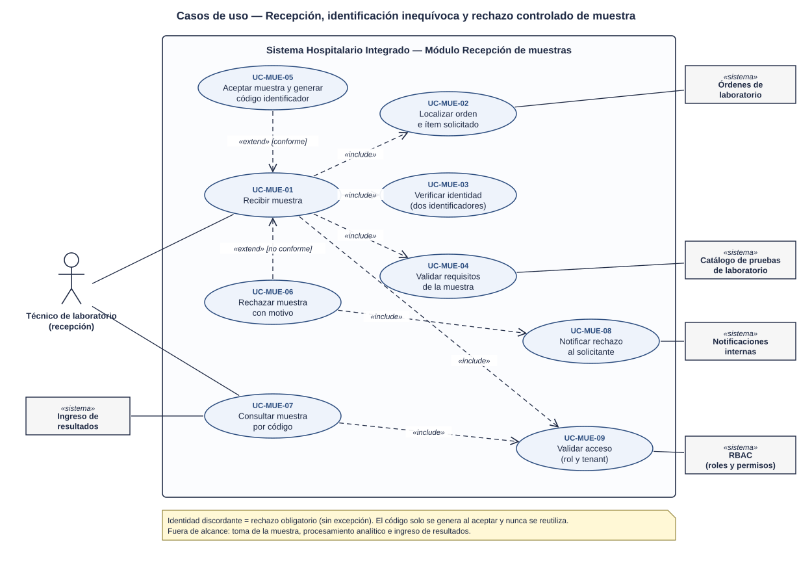
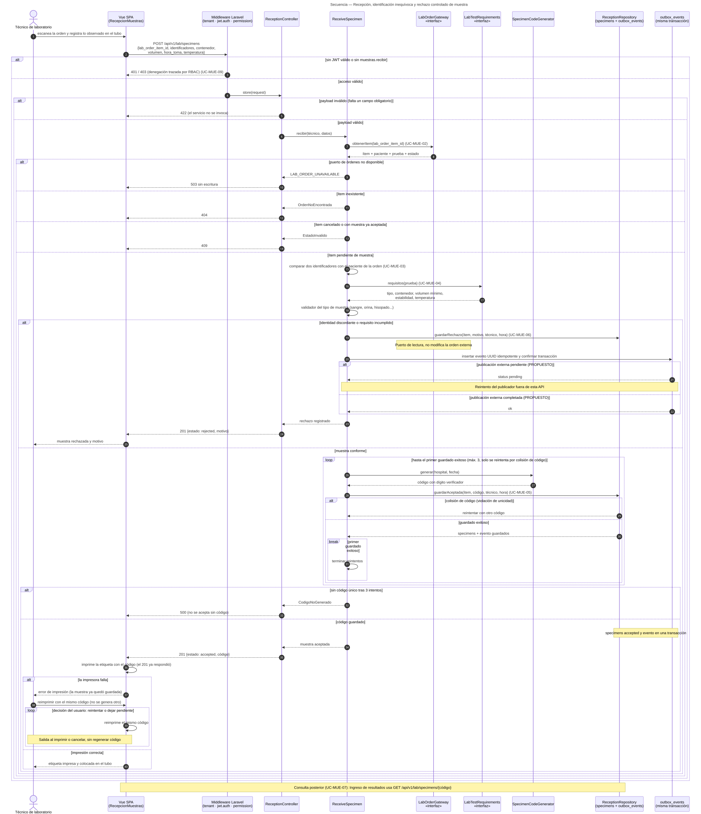

# Recepción de muestras y códigos identificadores — Semana 1

> Entrega corregida: el diseño UML expresa el flujo objetivo. La implementación acumulada hasta
> semana 15 y las decisiones de integración se consultan en el [índice](../README.md).
> ASII-18 conserva la asignación oficial del README; Mar-03 identifica la autoría de esta entrega.
> La impresión ocurre en el navegador después de persistir; la entrega del aviso externo no se
> declara confirmada hasta recibir acuse del consumidor. Los casos de uso y excepciones se mantienen.

## Índice de la entrega

1. Ficha y contexto del módulo.
2. Casos de uso, actividad y secuencia.
3. Narrativa de alcance y trazabilidad.
4. Decisiones del diseño implementado y conclusión.

## Ficha de la asignación

- **Estudiante:** López Fajardo, María de los Ángeles (`Mar-03`)
- **Módulo:** Recepción de muestras y códigos identificadores
- **Semana:** Semana 1 — Conceptos generales, orientación a objetos y UML
- **Tarea individual:** Modele el proceso «recepción, identificación inequívoca y rechazo controlado de muestra». Casos de uso: delimitar actores y objetivo; el de actividad debe incluir decisiones, excepciones y resultado; el de secuencia debe mostrar participantes, mensajes, validaciones y respuesta. Mantenga trazabilidad entre los tres diagramas.
- **Entregable / evidencia:** UML de casos de uso y narrativa de alcance.
- **Estructura:** Sistema Hospitalario Integrado 2026 | Semanas 1–15.

## Introducción

La recepción verifica que una muestra corresponda a una orden y a un paciente antes de habilitar resultados.
El problema incluye errores de identidad, conservación, disponibilidad y confirmación de persistencia.
Los diagramas muestran decisiones y excepciones; la narrativa enlaza cada UC con esos pasos.

---

## Contexto arquitectónico

- **Backend:** Laravel 12 (PHP 8.2+), JWT y RBAC por permisos (`muestras.recibir`, `muestras.rechazar`, `muestras.ver`).
- **Base de datos HOSPITAL (PostgreSQL):** `specimens` pertenece a ASII-18; `lab_orders`, `lab_order_items` y `lab_tests` pertenecen a ASII-16/17. El único evento durable vive en `outbox_events`.
- **Multitenancy:** el código identificador es único por hospital (tenant `X-Tenant-ID`).
- **Frontend:** Vue 3, Pinia y Axios (pantalla de recepción con lector de código e impresión de etiqueta).
- **Endpoints preliminares** (se formalizan en la Semana 5):
  - `POST /api/v1/lab/specimens` (recibir: acepta o rechaza)
  - `GET /api/v1/lab/specimens/{código}`

---

## 1. Diagrama de casos de uso

[Abrir el diagrama de casos de uso en SVG](./01-casos-de-uso.svg)

### Descripción

El objetivo es que **cada muestra que entra al laboratorio quede identificada sin ambigüedad o rechazada con un motivo registrado**.

- **Actor principal:** *Técnico de laboratorio (recepción)*.
- **Actores secundarios (sistemas):**
  - *Órdenes de laboratorio:* dice qué se pidió y para quién.
  - *Catálogo de pruebas:* define los requisitos de la muestra.
  - *Notificaciones internas (PROPUESTO):* consume el evento de rechazo.
  - *RBAC:* controla el acceso.
  - *Ingreso de resultados:* consulta la muestra por código.
- **UC-MUE-01 (Recibir muestra):** incluye `<<include>>` localizar la orden (UC-MUE-02), verificar la identidad con dos identificadores (UC-MUE-03), validar los requisitos (UC-MUE-04) y validar el acceso (UC-MUE-09).
- **UC-MUE-05 (Aceptar y generar código)** y **UC-MUE-06 (Rechazar con motivo)** extienden `<<extend>>` a UC-MUE-01 según la muestra sea conforme o no. El rechazo incluye registrar el evento para la notificación externa PROPUESTA (UC-MUE-08).

## 2. Diagrama de actividades

[Abrir el diagrama de actividades en SVG](./02-actividad.svg)

### Descripción

- **Validaciones previas:** acceso (401/403), payload (422) y orden válida (404/409).
- **Identidad:** si la etiqueta no coincide con la orden, el rechazo es **obligatorio** (no admite excepción).
- **Requisitos:** se revisan tipo, contenedor, volumen, tiempo desde la toma y temperatura. Si alguno falla, se rechaza con un motivo del catálogo.
- **Aceptación:** se genera un código y se reintenta hasta 3 veces si choca con uno existente (solo se reintenta por colisión). Nunca se acepta una muestra sin código (500). La etiqueta se imprime **después de responder el 201**; si la impresora falla, la muestra ya quedó guardada (sin rollback) y se reimprime **el mismo** código.
- **Rechazo:** se publica un evento en outbox_events; la actualización externa de la orden y la notificación son PROPUESTAS. Si el publicador externo falla, el evento sigue pendiente y el rechazo ya está registrado.

## 3. Diagrama de secuencia

[Abrir el diagrama de secuencia en SVG](./03-secuencia.svg)

### Descripción

- **Participantes:** Vue, middlewares, `ReceptionController`, `ReceiveSpecimen`, puerto `LabOrderGateway`, requisitos, generador, `ReceptionRepository` y `outbox_events` en la misma transacción.
- **Validadores por tipo de muestra:** sangre, orina, hisopado, etc. Se modelan como validadores intercambiables, base del principio LSP que se trabaja en la Semana 2.
- **Bloques:** `alt` para 401/403, 422 (payload inválido), 404, 409, 503 del puerto ausente, rechazo (publicación externa PROPUESTA) y aceptación; `loop` de reintento por colisión de código (hasta el primer guardado exitoso, máx. 3); impresión y reimpresión de la etiqueta **después del 201**, con `alt` por falla de impresora.

## 4. Narrativa de alcance y trazabilidad

La narrativa completa y la tabla de trazabilidad están en [narrativa-alcance-trazabilidad.md](./narrativa-alcance-trazabilidad.md).

## Fuentes editables

- Casos de uso: el SVG es editable en draw.io o Inkscape.
- Actividad y secuencia: [`fuentes/02-actividad.mmd`](./fuentes/02-actividad.mmd) y [`fuentes/03-secuencia.mmd`](./fuentes/03-secuencia.mmd) (Mermaid).

## Declaración de uso de IA

El documento original declaró Claude (Anthropic) para el borrador UML/SVG. Esta revisión con Codex
se documenta en [DECLARACION_IA.md](./DECLARACION_IA.md); no certifica revisión humana no registrada.

## Decisiones vigentes y correspondencia con el código

| Abstracción de los diagramas iniciales | Implementación Laravel 12 |
|---|---|
| SpecimenController / ReceiveSpecimenService | ReceptionController / ReceiveSpecimen. |
| Gateway de orden y requisitos | OrdersGateway y adaptador de solo lectura; 503 si ASII-16 no está disponible. |
| SpecimenRepository y generador | ReceptionRepository/PDO y SpecimenCode. |
| Notifier | outbox_events en la misma transacción; publicación externa PROPUESTA. |
| Código hospital-fecha-secuencia propuesto | 96 bits hexadecimales y dígito, con índice UNIQUE. |
| Rechazo sin etiqueta | sin_etiqueta registra rechazo sin inventar código/nombre de paciente. |

Los nombres UML expresan responsabilidades; la tabla evita presentarlos como clases inexistentes.
La selección de orden no copia la identidad observada; el técnico debe comprobarla contra la etiqueta.

## Conclusión y fuentes

El alcance identifica actores, decisiones, excepciones y resultados enlazados entre los tres diagramas.
El diseño se contrasta con fuentes reales y pruebas, y conserva los límites con órdenes, catálogo y resultados.
Fuente: [README original y matriz ASII-18](../../../../README.md); [validaciones de esta semana](./EVIDENCIA.md).

## Corrección de integración — 21 de octubre de 2026

La tabla propia del HIS es specimens (migración 000601, propuesta de Javier); lab_order_item_id es UUID lógico sin FK a Órdenes. Las FK locales son indexadas y RESTRICT. Se reutiliza outbox_events.
El módulo finalizado de Gerson se conserva; esta entrega no cambia Resultados/Validación. El contrato de lectura con ASII-16 debe verificarse con su proveedor; si no está disponible se responde 503 sin guardar muestras.
La evidencia y los límites de esta entrega están en [EVIDENCIA.md](./EVIDENCIA.md). Solo Yamilet puede mergear los PR.

## Supuestos de análisis

SD-REC-01: la verificación con dos identificadores, umbrales por prueba, catálogo de rechazo y formato del código requieren validación clínica. Se usan fixtures ficticios; no se presenta una política clínica aprobada. El acceso y la persistencia se formalizan en S05; esta semana entrega análisis UML.
