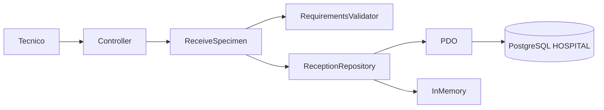

# Semana 3 — Micro PHP 8.2 y vista arquitectónica

Código real: `micro-his/recepcion-muestras/`, sin framework ni dependencias externas.
Ejecutar `php micro-his/recepcion-muestras/demo.php` y `php micro-his/recepcion-muestras/tests/run.php`.
Presentation: ReceptionController; Application: ReceiveSpecimen; Domain: SampleValidator y SpecimenCode;
Persistence: PdoReceptionRepository e InMemoryReceptionRepository. SQL PostgreSQL preparado.

Pruebas ejecutadas: éxito, rechazo por dominio y error de persistencia con rollback mediante doble.
La persistencia PostgreSQL y la concurrencia real necesitan ejecución adicional; no se sustituyen por SQLite.
