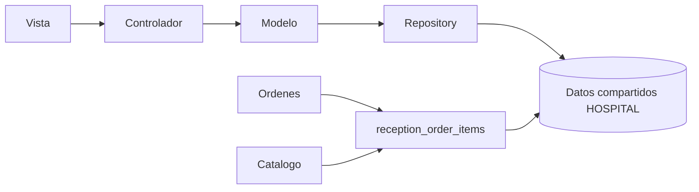

# Semana 4 — MVC y Repository

Se continúa el mismo micro de semana 3. `demo.php` compone el controlador y el repositorio.
Modelo: servicio y dominio; vista CLI: serialización JSON; controlador: valida entrada y traduce errores.
ReceptionRepository define transaction/order/save/find; PDO e InMemory implementan ese contrato.
Ni el controlador PHP ni el Laravel contienen SQL o reglas clínicas.

Compartir PostgreSQL permite transacciones locales; escribir tablas ajenas acopla módulos.
Por eso recepción solo escribe sus tablas y consume una proyección confiable con tenant compuesto.
El adaptador que alimenta esa proyección aún falta; no aceptar requisitos enviados desde la UI.
