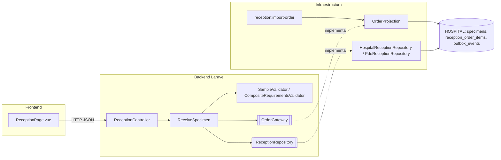

# Semana 7 — Componentes ejecutables

OrderProjection implementa OrderGateway usando la base hospitalaria local. reception:import-order recibe JSON confiable con tenant_id, item_id UUID, local_patient_id, care_episode_id, identificación y requisitos clínicos. Valida hospital y episodio/paciente. Serializa la recepción con FOR UPDATE; una orden aceptada no se reabre. Los eventos de aceptación y rechazo se escriben atómicamente en outbox_events para el publicador institucional.

## Diagrama de componentes y propuesta de refactorización (semana 7)

| Componente | Responsabilidad |
|---|---|
| `ReceptionController` | HTTP, validación de formato, actor y hospital |
| `ReceiveSpecimen` | Idempotencia, identificación, reglas y reintento ante colisión de código |
| `SampleValidator` | Motivo de rechazo: tipo, contenedor, volumen, estabilidad, temperatura, hemólisis, coagulación, derrame |
| `OrderGateway` / `OrderProjection` | Lectura de requisitos del ítem; proyección local sin alta pública |
| `ReceptionRepository` / `HospitalReceptionRepository` | Transacción, persistencia y consulta por solicitud o código |
| `reception:import-order` | Entrada confiable de órdenes mientras ASII-16 no publica contrato |

**Propuesta de refactorización (antes → después)**
- Antes: el micro académico y Laravel compartían dominio con `require_once`. Después: el dominio vive en `app/Modules/Reception` con autoload PSR-4 y el runtime no carga `micro-his`.
- Antes: un adaptador de órdenes que siempre respondía 503. Después: `OrderProjection` detrás del mismo puerto; el controlador no cambia (OCP).
- Pendiente propuesto: extraer la validación de entrada del controlador a un FormRequest y mover la creación del caso de uso al contenedor de servicios.
