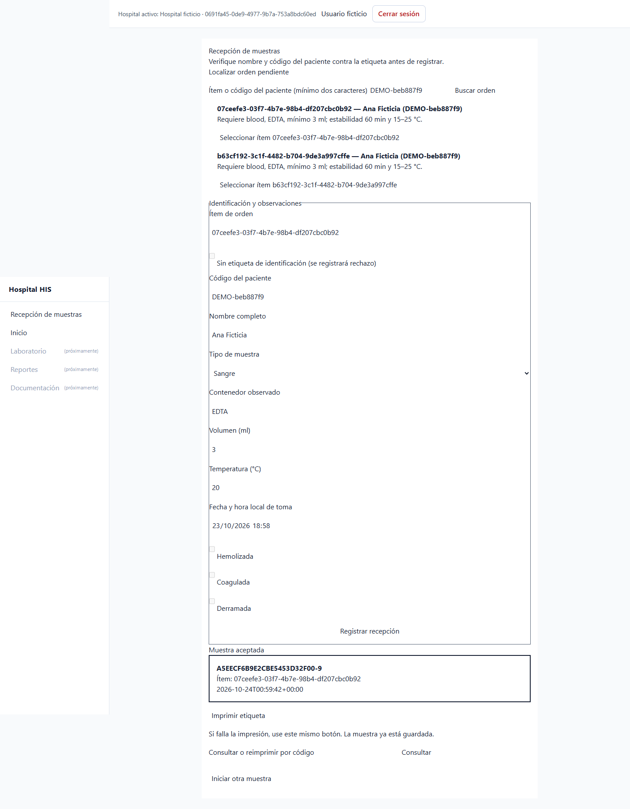
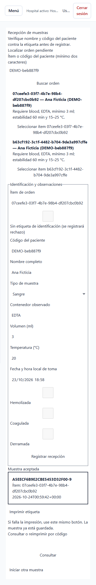

# Semana 16 — Integración, validación y primera entrega funcional

Issue #6. Rama feature/asii-18-semana-16-recepcion-muestras-mar-03, creada desde origin/develop; PR dirigido a develop. Requiere el código de semanas 5–15 pendiente de integración. No lo vuelve a copiar ni lo mergea.

## Trazabilidad con la matriz del README

| Requisito | Implementación y evidencia |
|---|---|
| Integración con HIS | Login JWT y permisos CENTRAL PostgreSQL; pacientes/episodios, recepción y outbox HOSPITAL PostgreSQL |
| Primera entrega funcional | Vue compilado servido en instalación staging on-premise de loopback |
| Validación reproducible | reception:readiness, reception:verify-deployment y pruebas ReceptionPostgresTestCase |
| Evidencia UI | Capturas desktop/móvil de la app real; tests/Browser/Reception/deployment.cjs, sin interceptar HTTP |

## Reproducción en una instalación dedicada

1. Preparar dependencias Laravel/Vue y el código pendiente de semanas 5–15 en una copia de validación; no mergear PR para ejecutar la demo.
2. Crear dos bases PostgreSQL dedicadas terminadas en _staging, una CENTRAL y otra HOSPITAL. Configurar .env siguiendo deploy/recepcion-muestras/staging.env.example. Generar APP_KEY/JWT_SECRET; fijar el mismo UUID para RECEPTION_HOSPITAL_ID y HOSPITAL_DB_TENANT_ID; contraseña ficticia de al menos 16 caracteres.
3. Ejecutar php artisan migrate --database=central --path=database/migrations/central --force y su equivalente --database=hospital --path=database/migrations/hospital. No usar migrate:fresh sobre una instalación compartida.
4. Ejecutar php artisan db:seed --class=ReceptionStagingSeeder --force. El fixture queda en storage/app/private/reception-stage-fixture.json y contiene credenciales ficticias: no publicarlo.
5. Compilar con VITE_API_URL=/api/v1 usando npm run build; servir public/ solo en 127.0.0.1:8096 para la demo. En un servidor compartido usar HTTPS.
6. Ejecutar php artisan reception:readiness --json y php artisan reception:verify-deployment storage/app/private/reception-stage-fixture.json. Para repetir el escenario de escritura, generar un fixture nuevo.
7. Regenerar fixture y ejecutar node tests/Browser/Reception/deployment.cjs con Playwright instalado. RECEPTION_BROWSER_CHANNEL=msedge en Windows; Chromium instalado en Linux.

## Bitácora de validación — 23/10/2026, America/Guatemala

Instalación en esta computadora; dos contenedores PostgreSQL, bases his_reception_s1617_staging separadas por servidor; APP_ENV=staging y APP_DEBUG=false. No se usó SQLite ni Http::fake para esta entrega.

- Migraciones CENTRAL/HOSPITAL y fixture ficticio: ejecutados correctamente.
- Diagnóstico: ready=true, todas las comprobaciones aprobadas.
- Caja negra HTTP: 8 comprobaciones aprobadas (login, aceptación, replay, consulta, etiqueta, rechazo, JWT obligatorio y lector sin escritura).
- Navegador: login real → navegación Vue → búsqueda de orden → recepción persistida; capturas 1440px y 390px, sin desbordamiento horizontal.
- Error de integración corregido: el bundle inicial apuntaba a localhost:8000; se recompiló con API relativa /api/v1 y se repitió el flujo real.
- Error del arnés corregido: las migraciones CENTRAL que bloquean auditoría deben ejecutarse dentro de transacciones, igual que el migrador Laravel.

Límite explícito: integra la proyección local confiable de órdenes ya implementada; no afirma conexión con un servicio externo ASII-16 todavía no publicado. La demo es on-premise de loopback, no un despliegue público de producción.
